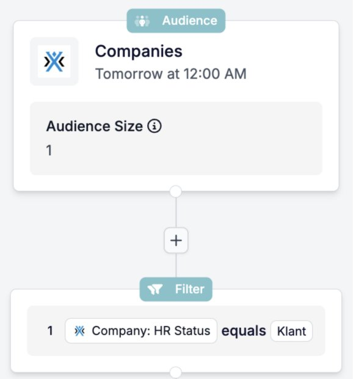
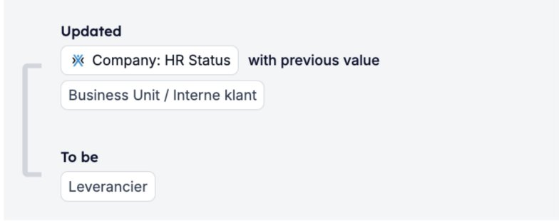

In Carerix, a company can have a status per business line, such as one for HR and one for Finance. HireData lists each of these statuses as its own field, named after the business line, for example **Company: HR Status**. An automation can now check or change the status of exactly one business line.

Before, every business line status arrived as one field, **Company: Status**, so an automation couldn't tell which business line it was looking at or updating.

## Filter on one business line

Use the business line field anywhere you filter companies:

- the start filter of an automation
- a **Filter** step
- the audience of a scheduled automation that runs over companies

For example, **Company: HR Status** equals the status you want to target. Companies with that status in another business line don't pass.

## Update one business line

In an [**Update Field(s)** task in Carerix](/apps/carerix/update-fields-in-carerix-with-hiredata), pick the status field of the business line you want to change, such as **Company: HR Status**, and choose the new value. Only that business line's status changes. The other business lines keep theirs.

For example: when a placement is created, set the client's status for that business line to the value your team uses for active clients.

## Check what changed

Open a run and click the update step. It shows the field with its previous value, and the new value under **To be**.

## Related

- [Update fields in Carerix](/apps/carerix/update-fields-in-carerix-with-hiredata)
- [Filter](/reference/automations/steps/filter)
- [Enable Carerix fields and relationships](/apps/carerix/how-to-enable-carerix-fields-and-relationships-in-your-automations)
