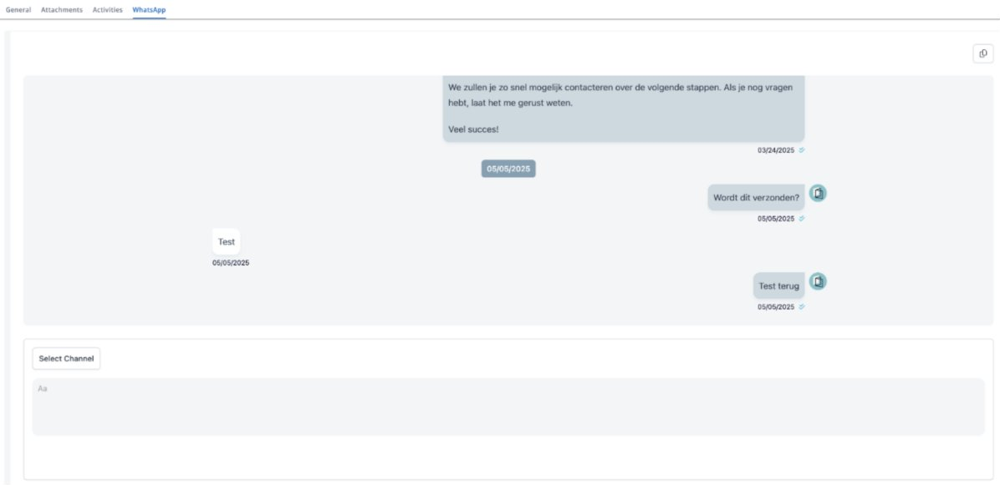

When you open a candidate or a match in Carerix, the **WhatsApp** tab shows the WhatsApp conversation with that candidate. You see the chat where you're already working, for example while you prepare a call, instead of searching for it in the inbox.

## Where to find it

- **Candidate:** open the candidate and click the **WhatsApp** tab, at the end of the row of tabs.
- **Match:** open the match and click the **WhatsApp** tab, next to **General**, **Attachments** and **Activities**. It shows the chat with the candidate of that match.

The tab is part of the HireData app in Carerix (Carerix RMA). If you don't see it, check that the app is [connected](/apps/carerix/connect-with-carerix).

## What the tab shows

- Every message in the conversation, sent and received, each with its date.
- Files the candidate sent you, such as a CV.
- A message box at the bottom. Pick a channel under **Select Channel**, type your message and send it.

WhatsApp only lets you send a free message within 24 hours of the candidate's last reply. After that, start with an approved template. See [WhatsApp inbox basics](/apps/messaging/whatsapp/whatsapp-inbox-basics).

## Related

- [WhatsApp active chats counter in Carerix RMA](/apps/carerix/whatsapp-active-chats-counter-in-carerix-rma)
- [Logging WhatsApp conversations in Carerix](/apps/carerix/logging-whatsapp-conversations-in-carerix-with-hiredata)
