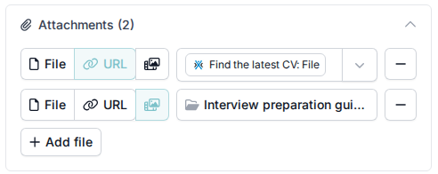
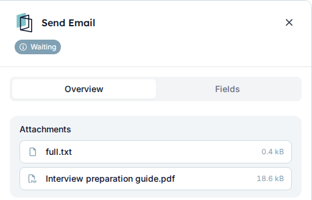

{/* DRAFT FOR REVIEW (EN only). Screenshots cropped from Ian's HD-1335 update in Linear; names, phone numbers and email addresses left out. */}

The **Send Email** task can now attach files. Send a candidate's latest CV to the recruiter or a client, or add the same PDF, such as an interview preparation guide, to every email an automation sends.

## Where to add attachments

Open the **Send Email** task in your automation. Under **Settings** you'll find the **Attachments** section, next to **Recipient**, **CC and BCC** and **Sender**.

Click **Add file** to add a row. Each row has three sources to choose from:

- **File** attaches a file from an earlier step in the automation, such as a candidate's CV. Pick it from **Choose an uploaded file**.
- **URL** attaches the file at a web address.
- **Media library** (the image icon) attaches a file you uploaded to HireData, such as a standard PDF.

Add as many rows as you need. The **−** button removes a row.

## Attach a candidate's latest CV

To attach a file stored on a Carerix or Spott record, find it first with a **Find** step, then attach it.

1. Before the **Send Email** task, add a **Find** step that looks up the candidate's files. When there are several, the newest file comes first, so you get the latest CV. See [Look up records](/automations/look-up-records).
2. In the **Send Email** task, open **Attachments** and click **Add file**.
3. Keep **File** selected and pick the file from your **Find** step, for example **Find the latest CV: File**.
4. Save the task.

## Check what was sent

Open a run of the automation. The **Send Email** step lists the files that were attached to the email.

<Tip>
  Test with a test candidate and your own address first, and check the delivered email before you switch the automation on for real candidates.
</Tip>

Attachments work in every automation, including automations built before the new automation builder.

## Related

- [Send Email task](/reference/automations/tasks/send-email) explains every setting of the task.
- [Look up records](/automations/look-up-records) explains the Find step.
