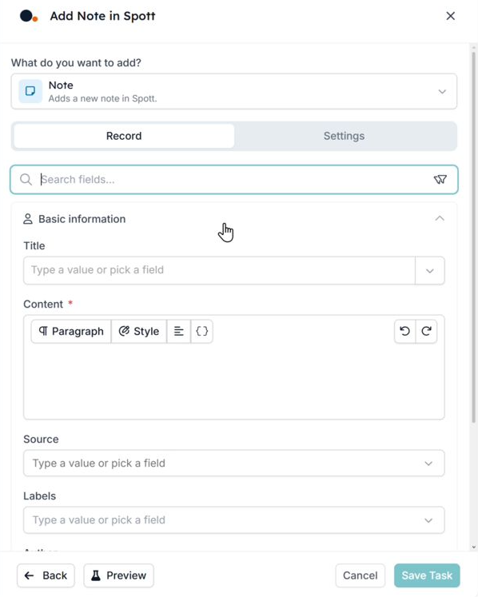
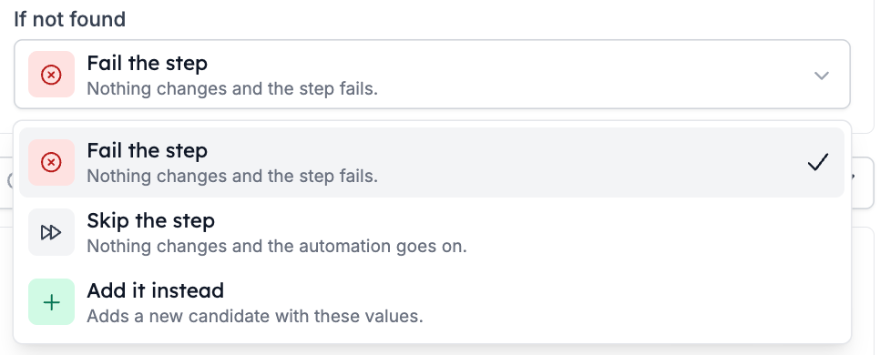
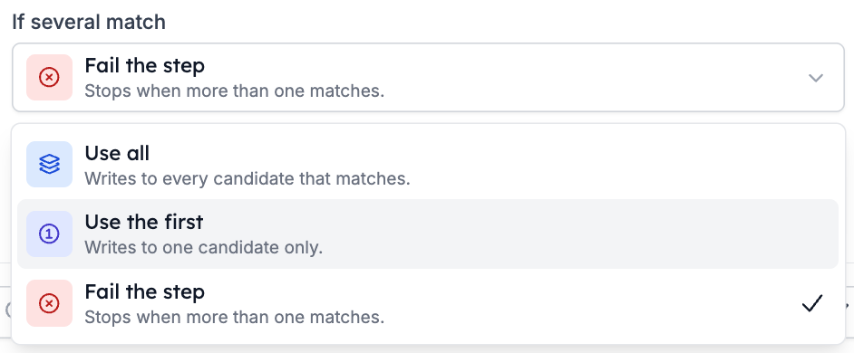
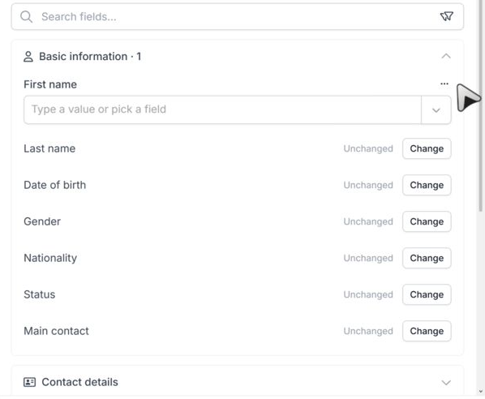
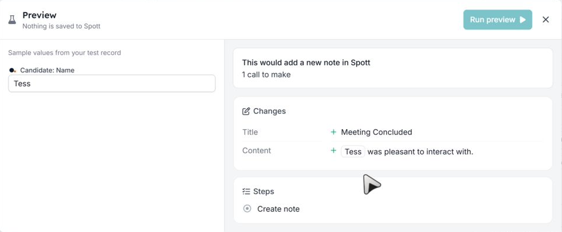
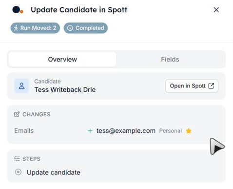

Your automations can now write back to Spott. Log a note after a WhatsApp conversation, move an application to the next stage when a candidate answers a form, or keep a candidate's contact details up to date, without anyone retyping it in Spott.

## Step 1: Add a Spott step

In your automation, click **+** and pick the Spott step you need. There's one step per action and Spott object, such as **Add Note in Spott**, **Update Candidate in Spott** or **Delete Note in Spott**.

Under **What do you want to add?** you can switch to another Spott object at any time.

## Step 2: Pick the record to change

For an update or a delete, tell HireData which Spott record to change:

- **By ID**, for example the candidate who started the automation.
- **With conditions** that find the record, for example the candidate with a given email address.

Then choose what happens when the record can't be found:

- **Fail the step:** nothing changes and the step fails. This is the default.
- **Skip the step:** nothing changes and the automation goes on.
- **Add it instead:** adds a new record with these values.

When your conditions find more than one record, choose **Use all**, **Use the first** or **Fail the step**.

## Step 3: Fill in the fields

Type a value or pick a field from earlier in the automation, such as a form answer. Fields you don't touch show **Unchanged** and stay as they are in Spott. Click **Change** to set a new value, or clear the field.

For lists, such as a candidate's email addresses, you can add an item, replace the whole list or remove matching items.

A few things HireData handles for you:

- **Answers are matched to Spott's choices** by name or value, so a form answer such as "yes" or a stage name lands on the right option.
- **Numbers and dates** are read the way your workspace writes them.
- **New applications and jobs** can be placed on a specific pipeline track, and an application on a sub-stage.
- **A value that can't be read** stops the step and shows which value it was, instead of emptying the field in Spott.

<Tip>
  An update only changes the fields you set. If nothing would change, the step is skipped instead of saving the same values again, and the run says why.
</Tip>

## Step 4: Preview before you save

Click **Preview**, search for a sample record by name and click **Run preview**. You see exactly what would be added or changed. Nothing is saved to Spott.

## Step 5: Check what was saved

Open a run and click the Spott step. You see which record was changed, each changed field with its old and new value, and **Open in Spott** to go straight to the record.

When something goes wrong, the run explains it in plain words, such as **Record not found**.

## What you can't do yet

- **Jobs** can't be deleted, because Spott doesn't allow it.
- **Placements** can be updated, but not added or deleted.

## Related

- [Create a Spott automation](/apps/spott/create-a-spott-automation-in-hiredata)
- [Test an automation](/automations/how-to-test-an-automation)
