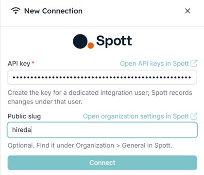
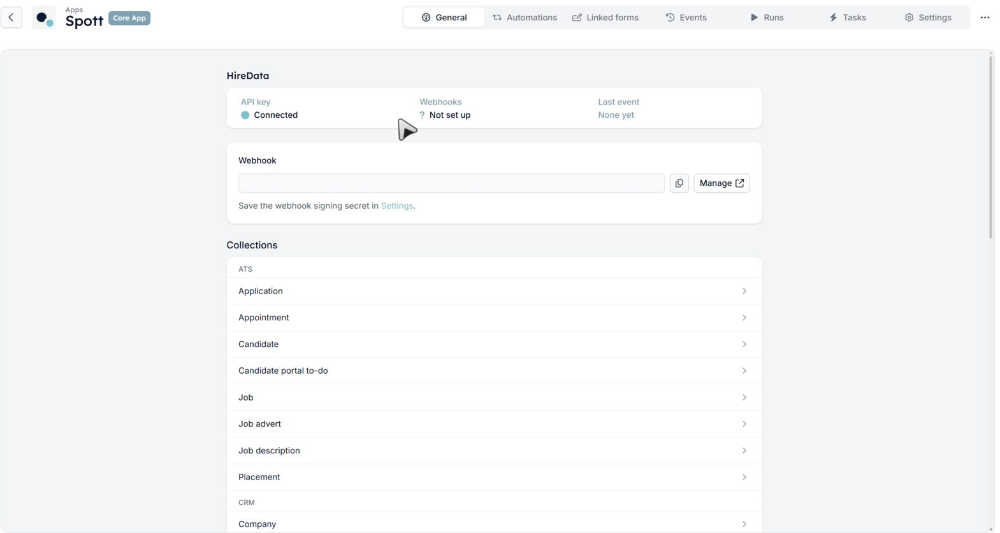

{/* DRAFT FOR REVIEW (EN only). Screenshots from Ian's Spott walkthrough in Supercut; webhook address masked. */}

Connect Spott once, and changes in Spott start your HireData automations.

## Before you start

- You need a Spott user who can create API keys and webhook endpoints in Spott.
- You need a HireData admin to add the app.

## Step 1: Add your API key

1. Go to **Settings** > [**Apps**](https://app.hiredata.com/settings/apps). Spott is listed at the top.
2. Open **Spott** and click **Connect to Spott**.
3. Click **Open API keys in Spott**, create a new key and copy it. Use a dedicated integration user: Spott records changes under that user.
4. Paste the key under **API key**. The **Public slug** is optional; you find it under Organization > General in Spott.
5. Click **Connect**. HireData checks the key with Spott before it saves the connection.

HireData then syncs your Spott field definitions and users. The **Data sync** timeline on the **General** tab shows each step.

## Step 2: Add the webhook in Spott

Spott tells HireData about changes through a webhook. You set it up once, in Spott.

1. On the **General** tab of the Spott connection, copy the address under **Webhook**. **Manage** opens the webhook settings in Spott.
2. In Spott, add a new endpoint, paste the address and select all events.
3. Copy the signing secret Spott shows you.
4. In HireData, open the **Settings** tab of the Spott connection and paste it as the webhook signing secret. Save.

HireData only accepts events signed with this secret, so the webhook doesn't work without it.

## Step 3: Check that events arrive

Change a test candidate in Spott. The **General** tab then shows when the last event arrived, and the event is listed on the **Events** tab.

You're ready to [create your first Spott automation](/apps/spott/create-a-spott-automation-in-hiredata).

<Note>
  The first sync doesn't import all your Spott records. Records come in when they change in Spott, when an automation looks them up, or when a scheduled automation runs.
</Note>
