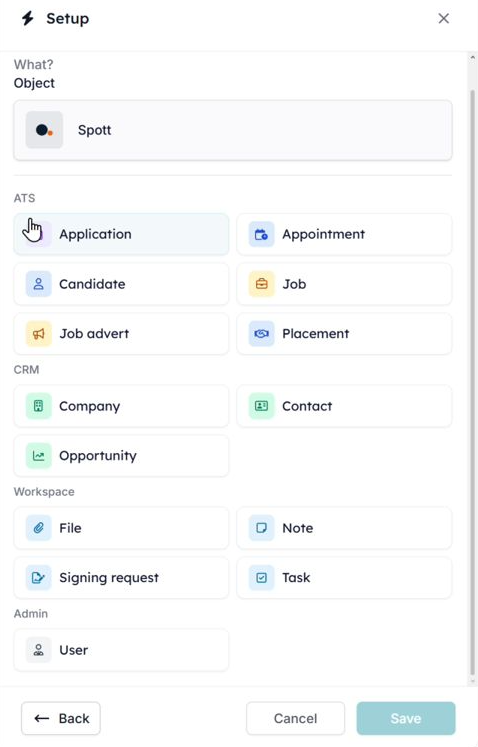
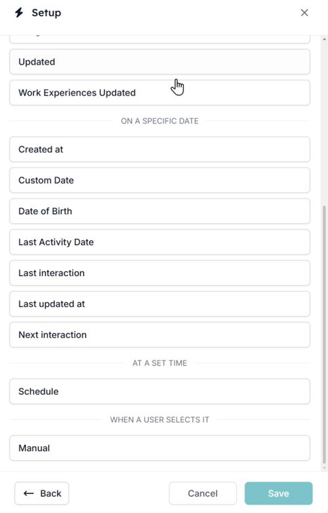

{/* DRAFT FOR REVIEW (EN only). Screenshots from Ian's Spott walkthrough in Supercut. */}

Once [Spott is connected](/apps/spott/connect-with-spott), any change in Spott can start an automation.

## Step 1: Pick a Spott object

Go to [**Automations**](https://app.hiredata.com/automations) and create a new automation. In **Setup**, choose **Spott**, then the object the automation is about.

Objects are grouped the way Spott groups them: ATS, CRM, Workspace and Admin. Names follow Spott, such as **Job** and **Job advert**.

## Step 2: Choose how it starts

- **An event**, such as an application being created, updated or moved to another stage, or an opportunity being created, updated, deleted or moved to another stage.
- **On a specific date**, such as one week after a placement's start date. Pick one of the object's date fields, or **Custom Date**.
- **At a set time**: **Schedule** runs the automation over a set of records, for example every Monday.
- **When a user selects it**: **Manual** runs it by hand for one record.

## Step 3: Only start for one track or stage

If you use several pipeline tracks in Spott, you can limit an application automation to one track, and to a stage within that track.

- Add a start filter on **Stage track IDs** to pick the track.
- Add a start filter on **Stage ID** to pick the stage. Stages with the same name show their track next to them, so you can tell them apart.

An application in another track won't start the automation, even when its stage has the same name.

<Tip>
  **Track ID** is marked **(legacy)** because Spott plans to remove it. Use **Stage track IDs** instead; it works the same way in filters.
</Tip>

### Scheduled automations

A scheduled automation only offers the filters Spott itself can search on. To narrow the audience further, add a **Filter** step after the start.

Spott doesn't report how many records match, so the builder can't show the audience size up front. The automation still goes through every matching record.

## Step 4: Add your message

Add a step such as **Send Email** or a WhatsApp message. Every synced Spott field is available as a variable:

- Linked records come along: an application includes its candidate and job, and a placement includes its candidate, client and job.
- Application and job scorecards are available.
- Clients show their last interaction date and who it was with.

To see which fields came in for a record, open the event on the **Events** tab, or browse the object in **Collections**.

## Step 5: Test and activate

[Test the automation](/automations/how-to-test-an-automation) with a test record, then click **Activate**.
