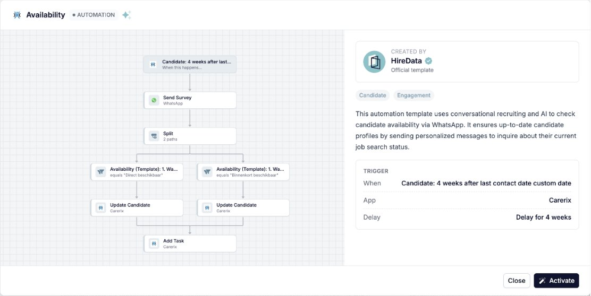
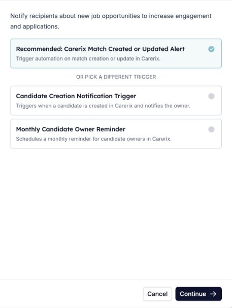

_Explore the power of automations in this concise video guide, covering everything from basic concepts to setting up your own automation. The video includes a detailed product demo and insights on event-triggered versus scheduled automations._

<iframe src="https://www.loom.com/embed/75f5e793351a48aaa98179881f670d91" title="Loom video" allowFullScreen className="w-full aspect-video rounded-xl"></iframe>

<CardGroup cols={3}>
  <Card title="Automation Builder: Overview" icon="diagram-project" href="/reference/automations/overview">
    Select a step and see what it does in a run.
  </Card>

  <Card title="Task catalogue" icon="list-check" href="/reference/automations/task-catalogue">
    Find the tasks available for each connected app and the reference for each one.
  </Card>

  <Card title="Follow a run" icon="route" href="/reference/automations/follow-a-run">
    Trace an event through its run, step data, task, and outcome.
  </Card>
</CardGroup>

## Start from a template

You don't have to build every automation from scratch. Click **New Automation** in [Automations](https://app.hiredata.com/automations) to open the template library: ready-made automations, and email and WhatsApp templates that come with a matching trigger. Filter by app or type, or search.

### Preview an automation template

Click a template to see what it does before you use it:

- the steps of the automation, as a diagram
- who created it, such as HireData or a partner
- its tags and a short description
- under **Trigger**: when it starts (**When**), the **App**, and any **Delay**

Click **Activate** to create the automation from the template, or **Close** to go back. Check the new automation and [test it](/automations/how-to-test-an-automation) before real candidates go through it.

### Start from an email or WhatsApp template

Pick an email or WhatsApp template and the preview shows the message, with the trigger to start it on the right. The recommended trigger is selected. Under **Or pick a different trigger** you can choose another one. Click **Continue** to create the automation with that template and trigger.

