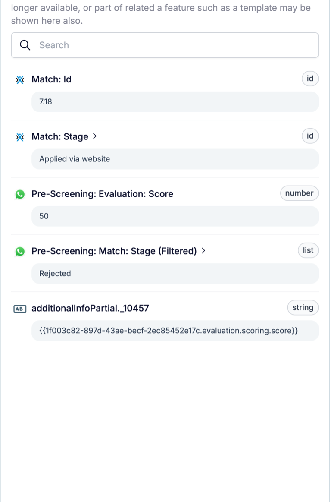

On engine 1.3, one set of steps changes any Carerix record, from candidates and matches to placements. One step can change several records at once, and every change is checked after it's written.

<Note>
  The new record steps are available for beta accounts, in automations on engine 1.3. Other accounts keep the old Carerix steps.
</Note>

## One set of steps for every Carerix record

The new steps replace the old Carerix steps **update field**, **add note**, **add task**, **add email** and **add publication**. You find them in the step drawer:

- **Records**: **Add** creates a record, **Update** changes one.
- **Lifecycle**: **Archive**, **Restore** and **Delete**.

### 1. Add and update any record

Add candidates, contacts, companies, jobs, meetings, notes, tasks and more. Update any field, including education, work history, skills and languages, or clear a field completely. Accounts that use the Carerix sales process can also add and update **leads** and **opportunities**.

### 2. Archive, restore or delete

**Archive** and **Restore** work for Carerix records. **Delete** only works for matches, because matches are the only records Carerix truly deletes.

### 3. Several records in one step

One step can change several records, such as every open match of a candidate. Add **conditions** so the step only writes when the record's current values allow it.

### 4. Every change is checked

After writing, the step reads the record back, so it can't report success when nothing was saved. When Carerix refuses a change, the run shows Carerix's own reason.

## What else changed?

- **Files** can be added to a record from a link, and removed by file name.
- **Fields follow your own Carerix forms**, and labels follow the Carerix screens.

For every setting, see the [Add](/reference/automations/steps/add) and [Update](/reference/automations/steps/update) references.

## Check it out yourself

Create a new automation in [Automations](https://app.hiredata.com/automations), click **+**, and pick **Add** or **Update** under **Records**.
