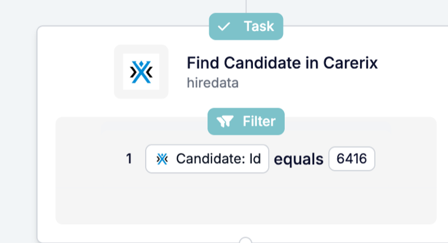

Often the record you need isn't the one that started the automation. **Find** looks it up, so later steps can update it, message it or attach its files.

<Note>
  This page describes Find on engine 1.3, available for beta accounts.
</Note>

## Look up a record mid-automation

In the step drawer, **Find** sits under **Search**: it looks for something that already exists.

### 1. Pick what to find

Find uses the same object picker as the new record steps, with the same categories, icons and colours. Look up a Carerix record, or a **HireData person**.

### 2. Match on fields that identify the record

Set the field values that identify the record, such as an id or an email address. Find keeps matching on fields that are turned off in Carerix, so running automations keep finding the same records.

### 3. Use the result in later steps

The record Find returns is available to later steps under the step's name. A common pattern: Find the record, then [Update](/reference/automations/steps/update) it.

## What else changed?

- **Run history** shows the names of the records Find returned, including HireData people.
- **Find Email** and **Search Domain** are no longer offered in new automations on engine 1.3.

For every setting, see the [Find reference](/reference/automations/steps/find).

## Check it out yourself

Open an automation in [Automations](https://app.hiredata.com/automations), click **+**, and pick **Find** under **Search**.
