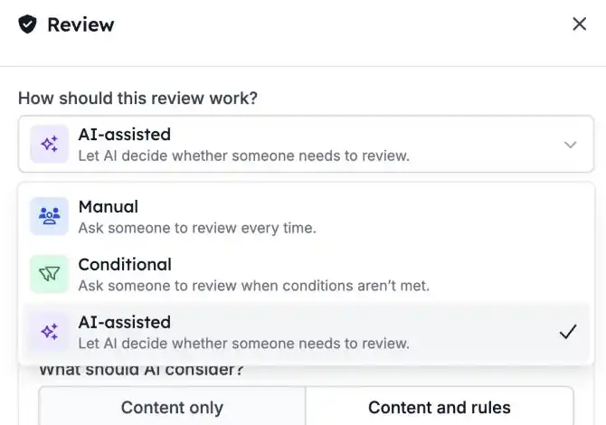
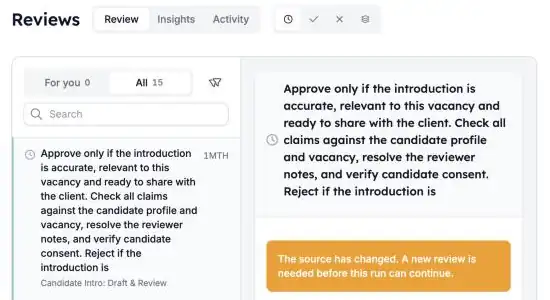

Some steps you want automated, but not without a human check first. With **Reviews**, an automation pauses until someone approves or rejects. Approve and the run continues; reject and it stops.

<Note>
  Reviews is part of the HireData beta and is switched on per workspace. Ask your HireData contact to turn it on for yours.
</Note>

## Pause a run until someone decides

Add a **Review** step where the automation should wait. In the [new automation builder](/automations/engine-1-3), click **\+** and pick **Review** under **Human in the loop**.

### 1. Choose how the review works

A Review step has three modes:

- **Manual**: a person always reviews. This is the default.
- **Conditional**: a person reviews only when the conditions you set call for it.
- **AI-assisted**: AI checks the content against your criteria first, and asks a person when it's unsure or information is missing.

Set what the reviewer sees: the content to review, the criteria, and optional context. You can insert variables from earlier steps.

### 2. Review from one queue

Open [Reviews](https://app.hiredata.com/reviews). **For you** shows the requests assigned to you. Admins also see **All**, and can reassign a request to someone else.

Filter by **Pending**, **Approved** or **Rejected**. Select a request to see the content, the criteria, and links to the automation and the run.

### 3. Approve or reject

- **Approve**: the run continues with the next step.
- **Reject**: the run stops.

You can decide from the review queue or straight from the run. A short undo window lets you take a decision back before it takes effect.

## What else to know

- **Test runs** create reviews you handle in the run itself. They stay out of the regular queue and out of **Insights**.
- **Insights** shows request volume and team workload. **Activity** shows the decision history.
- **If an automation changed** after a review was requested, an admin can replace the outdated request.

## Check it out yourself

Open an automation in [Automations](https://app.hiredata.com/automations), add a **Review** step before the action you want checked, and run a test. Then approve it from [Reviews](https://app.hiredata.com/reviews).
