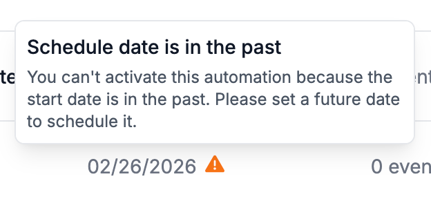
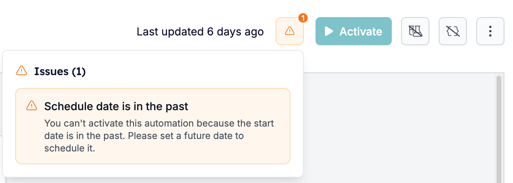

Some automations shouldn't wait for something to happen in your ATS. A monthly NPS survey, a newsletter or a yearly data check should go out on a date you choose. A scheduled automation runs at the time you set, for every record in the audience you select, once or on repeat.

## Set the schedule

<Steps>
  <Step title="Pick the object">
    Open the automation and click the **Start** block. Choose your app and the object the automation runs for, such as **Candidate**.
  </Step>
  <Step title="Choose Schedule">
    Under **Timing**, go to **AT A SET TIME** and click **Schedule**. You only see this option for objects that can be scheduled.
  </Step>
  <Step title="Set when it runs">
    - **Run at** is the date and time of the first run.
    - **Repeat every** sets how often it runs again: days, weeks, months, quarters, half a year or a year. Choose **Don't repeat** for a single run. For weeks and months, the line below shows the day it repeats on, such as "On day 28".
    - **Until** stops the repeats on a date. Switch on **Enable** to set one. Leave it off and the automation keeps repeating until you pause it.
  </Step>
  <Step title="Select the audience">
    Under **Audience Selection**, add filters so the automation only runs for the records you want.
  </Step>
  <Step title="Activate">
    Click **Activate**. The automation is now planned for the date in **Run at**.
  </Step>
</Steps>

## The start date must be in the future

You can only activate a scheduled automation while its **Run at** date is still ahead. If that date has passed, the automation isn't activated and keeps its previous status. The message reads: "This automation could not be scheduled because the configured start date is in the past."

HireData warns you before you get there:

- **In the automations list**, an orange warning icon appears next to the start date. Hover it to read the warning.
- **On the automation's page**, a warning button appears next to **Activate**. Click it to see the issue **Schedule date is in the past**.

<Frame caption="The warning next to a start date in the automations list.">
  
</Frame>

<Frame caption="The Issues box next to the Activate button.">
  
</Frame>

To fix it, set a new **Run at** date in the future and activate the automation again.

The same goes for a scheduled automation you paused. Pausing cancels its next run. If its start date has passed by the time you want it back, set a new **Run at** date first.

## What the status icon tells you

Hover the status icon of an automation to see what it means.

| Tooltip | What it means |
| --- | --- |
| **Not Yet Activated** | The automation has never been activated. |
| **Active** | The automation is on. |
| **Scheduled** | The automation is activated and its next run is planned. |
| **Scheduling Runs** | The automation is starting runs for its audience right now. |
| **Paused** | Nothing new runs until you activate the automation again. |
| **System Flagged The Automation** | HireData has flagged the automation. Check it, or contact support. |
| **Finished Scheduling Runs** | The last planned run is done and there is no next date, for example because the **Until** date has passed. |

## Good to know

- **The start is locked while runs are being scheduled.** While the status is **Scheduling Runs**, you can't change the trigger, the schedule, the audience filters or the automation type. Wait until it's done.
- **An automation that loses its schedule is paused.** If an active scheduled automation loses its schedule, or a new schedule can't be set while you edit it, HireData pauses it so it can't run at the wrong time.
- **A copy doesn't take over the schedule.** When you duplicate a scheduled automation, the copy isn't planned to run. Activate the copy to schedule it.
- **Activating several automations at once** from the list tells you how many worked, for example "2 of 3 automations activated. 1 could not be scheduled." Check the start date of the ones that failed.

## Check it out yourself

Open [Automations](https://app.hiredata.com/automations), click the **Start** block of an automation and choose **Schedule** under **AT A SET TIME**.

## Related

- [Test your automations](/automations/how-to-test-an-automation)
- [Why didn't my automation run?](/knowledge-base/why-didnt-my-automation-run)
- [Send an email newsletter to your audience](/apps/messaging/emails/sending-an-email-newsletter-to-your-audience)
- [Setup step reference](/reference/automations/steps/setup)
