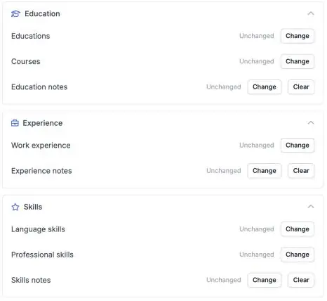

A complete candidate profile is easier to match. Your automations can now fill in a candidate's education, professional skills and languages in Carerix, so nobody has to copy them over by hand.

<Note>
  This is part of the HireData beta and works in the [new automation builder](/automations/engine-1-3). See [How the Beta Works](/beta/how-the-beta-works) to join.
</Note>

## Complete the candidate profile automatically

In a new automation, click **\+**, choose **Update** under **Records**, then **Carerix** and **Candidate**. Select the candidate and fill in the section you need.

<Frame caption="Education, Experience and Skills each have their own section in the Update Candidate step.">
  
</Frame>

### 1. Education

Set the name of the education, the **institute**, the diploma, the level or direction, the dates and whether the certificate was obtained.

### 2. Professional skills

Add a **skill** and its **specialisation**.

### 3. Language skills

Add a **language** with separate levels for **speaking**, **writing** and **reading**.

You can also add or update **courses** and **work history**.

## Before you use it

- **Add or change one entry at a time.** To change an existing education or skill, pick that entry in the step.
- **Test with a test candidate first**, and check in Carerix that the candidate's other entries stayed as they were.

## Check it out yourself

Create a new automation in [Automations](https://app.hiredata.com/automations), click **\+**, choose **Update** under **Records**, then **Carerix** and **Candidate**.
