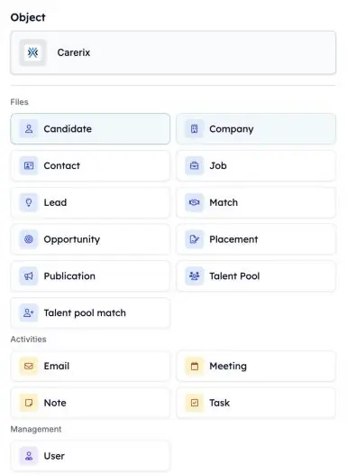
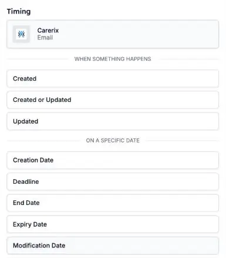

Your automations can now react to more of what happens in Carerix. Start one when a consultant logs a note, when an e-mail is sent or received, or when a candidate joins a talent pool, so the follow-up happens without anyone having to remember it.

<Note>
  This is part of the HireData beta. See [How the Beta Works](/beta/how-the-beta-works) to join.
</Note>

## Choose what starts your automation

Open your automation, click the **Start** block and pick **Carerix**. Under **Object**, choose what the automation should listen to. Then pick **when** it starts.

<Frame caption="Pick the Carerix record that starts the automation.">
  
</Frame>

### 1. E-mails

Start an automation when an e-mail is **sent or received** and added to Carerix. Drafts, the outbox, mailings and bulk e-mails don't start one.

### 2. Notes

Start an automation when a **note** is added in Carerix, for example after a consultant logs an intake call.

### 3. Talent pool matches

Start an automation when a candidate's **talent pool membership** changes, such as when they join a pool.

### 4. Leads and opportunities

If your team uses the Carerix sales process, start an automation from a **lead** or **opportunity**. See [Leads & Opportunities](/beta/leads-and-opportunities).

## Start on a date

Besides **when something happens**, you can start an automation **on a specific date**, such as a deadline or an end date. Your own Carerix date fields are in this list too. A date field you add in Carerix appears here the next day.

<Frame caption="Choose when the automation starts: when something happens, or on a date.">
  
</Frame>

## Check it out yourself

Open an automation in [Automations](https://app.hiredata.com/automations), click the **Start** block, choose **Carerix** and pick **Email**, **Note** or **Talent pool match**.
