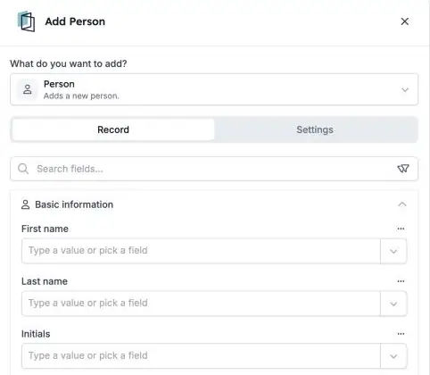

HireData keeps its own list of [people](/pages/people): the candidates, contacts and colleagues you work with. Your automations can now add, update, find and delete these people directly, with the same steps you use for other records.

<Note>
  This is part of the HireData beta and works in the [new automation builder](/automations/engine-1-3). It replaces the **Sync Person** step for new automations.
</Note>

## Keep your people list up to date

In a new automation, click **\+**. Choose **Add** or **Update** under **Records**, or **Delete** under **Lifecycle**, and pick **HireData** and **Person**.

<Frame caption="The Add Person step, with the person's details grouped in sections.">
  
</Frame>

### 1. Add and update people

Fill in every field that Sync Person could write, including **addresses** and **UTM campaign** details that show where someone came from.

### 2. Find the right person

Use [Find](/automations/look-up-records) with filters to choose which person a step changes. The run history shows the names of the people it found.

### 3. Delete with care

Deleting a person is **permanent**. If you undo a step that added a person, HireData deletes that person again.

## What else to know

- **Sync Person** isn't offered in new automations anymore. Automations that already use it keep running.
- **Test with a test person first**, so you don't change or delete someone by mistake.

## Check it out yourself

Create a new automation in [Automations](https://app.hiredata.com/automations), click **\+**, choose **Add** under **Records** and pick **HireData** and **Person**.
