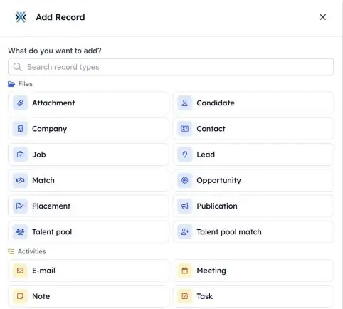
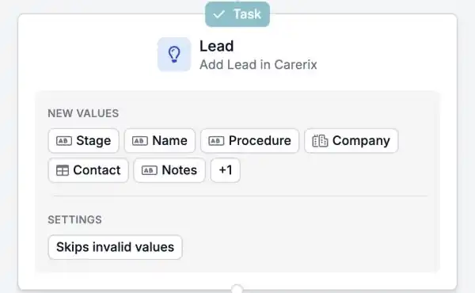

If your team uses the Carerix sales process, your automations can now follow your leads and opportunities too. Start a workflow when a lead comes in or changes, and keep Carerix up to date without retyping anything.

<Note>
  This is part of the HireData beta and works in the [new automation builder](/automations/engine-1-3). It needs the sales process switched on in your Carerix environment. The options you see depend on how Carerix is set up for you.
</Note>

## Run your sales workflows automatically

### 1. Start an automation from a lead or opportunity

Start an automation when a lead or opportunity is **created** or **updated** in Carerix, on a **schedule**, or **by hand**.

### 2. Find, add and update

- **Find** looks up an existing lead or opportunity.
- **Add** creates a new one. As in Carerix, **procedure** and **category** are required.
- **Update** changes one that already exists.

The fields and sections follow the lead and opportunity screens you already know from Carerix.

<Frame caption="Lead and Opportunity appear next to the other Carerix records.">
  
</Frame>

<Frame caption="A step that adds a lead in Carerix, with the values it fills in.">
  
</Frame>

### 3. Link your follow-up

Link **notes**, **tasks** and **e-mails** to a lead or opportunity, so your consultants see the whole history in one place.

## An example

A company fills in your staffing request form. One automation adds the company and the contact person in Carerix, creates a lead with the details from the form, and gives a consultant a task to call back.

## Check it out yourself

Create a new automation in [Automations](https://app.hiredata.com/automations), click **\+**, choose **Add** under **Records** and pick **Lead** or **Opportunity**.
