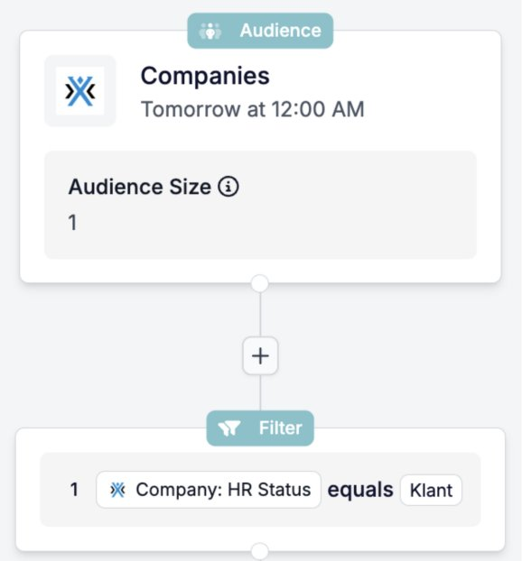
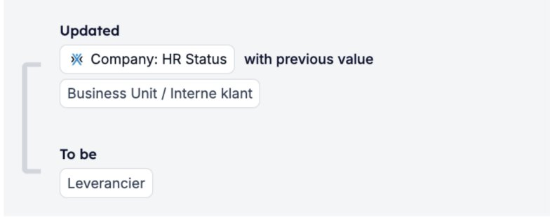

In Carerix kann ein Unternehmen einen Status pro Geschäftsbereich (Business Line) haben, etwa einen für HR und einen für Finance. HireData führt jeden dieser Status als eigenes Feld, benannt nach dem Geschäftsbereich, zum Beispiel **Company: HR Status**. Eine Automatisierung kann jetzt den Status genau eines Geschäftsbereichs prüfen oder ändern.

Früher kamen alle Status der Geschäftsbereiche als ein Feld an, **Company: Status**, sodass eine Automatisierung nicht erkennen konnte, welchen Geschäftsbereich sie gerade prüfte oder aktualisierte.

## Nach einem Geschäftsbereich filtern

Verwenden Sie das Feld des Geschäftsbereichs überall, wo Sie Unternehmen filtern:

- im Startfilter einer Automatisierung
- in einem **Filter**-Schritt
- in der Zielgruppe einer geplanten Automatisierung über Unternehmen

Zum Beispiel: **Company: HR Status** ist gleich dem Status, auf den Sie zielen. Unternehmen mit diesem Status in einem anderen Geschäftsbereich kommen nicht durch.

## Einen Geschäftsbereich aktualisieren

Wählen Sie in einer [**Update Field(s)**-Aufgabe in Carerix](/de/apps/carerix/update-fields-in-carerix-with-hiredata) das Statusfeld des Geschäftsbereichs, den Sie ändern möchten, etwa **Company: HR Status**, und wählen Sie den neuen Wert. Nur der Status dieses Geschäftsbereichs ändert sich. Die anderen Geschäftsbereiche behalten ihren Status.

Zum Beispiel: Sobald eine Vermittlung angelegt wird, setzen Sie den Status des Kunden für diesen Geschäftsbereich auf den Wert, den Ihr Team für aktive Kunden nutzt.

## Prüfen, was sich geändert hat

Öffnen Sie einen Run und klicken Sie auf den Update-Schritt. Er zeigt das Feld mit seinem vorherigen Wert und den neuen Wert unter **To be**.

## Verwandte Artikel

- [Felder in Carerix aktualisieren](/de/apps/carerix/update-fields-in-carerix-with-hiredata)
- [Filter](/de/reference/automations/steps/filter)
- [Carerix-Felder und -Beziehungen aktivieren](/de/apps/carerix/how-to-enable-carerix-fields-and-relationships-in-your-automations)
