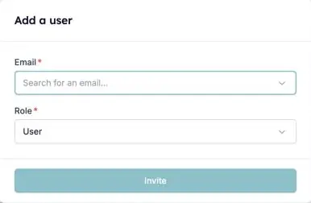

Sie haben die HireData-RMA in Carerix aktiviert, aber einige Kollegen fehlen in HireData. HireData synchronisiert Ihre Carerix-Benutzer bei der Verbindung und danach jeden Tag erneut. Fehlt jemand auch nach einer [manuellen Synchronisierung](/de/apps/carerix/manually-sync-carerix-with-hiredata) noch, steckt meist einer der folgenden Gründe dahinter.

### 1. Der Benutzer nutzt HireData bereits in einem anderen Konto

Eine Person hat ein HireData-Login, und dieses Login kann zu mehreren Konten gehören. Das kommt vor, wenn Ihre Organisation mehr als eine Carerix-Umgebung betreibt, zum Beispiel eine pro Marke oder Label.

Nutzt die Person HireData bereits über eine andere Umgebung, laden Sie sie zusätzlich in dieses Konto ein:

1. Öffnen Sie **Settings** und gehen Sie zu **Users**.
2. Klicken Sie auf **Add User**, geben Sie die E-Mail-Adresse der Person ein und wählen Sie ihre Rolle.
3. Die Person nimmt die Einladung über ihre E-Mail an.

<Frame caption="Laden Sie einen Kollegen ein, der HireData bereits in einem anderen Konto nutzt.">
  
</Frame>

Nach der Annahme öffnet die Person das Menü unter ihrem Namen, wählt **Switch Account** und wählt das benötigte Konto. Unter [Benutzer in Ihr Konto einladen](/de/introduction/invite-users-to-your-account) finden Sie Rollen und wie Sie eine Einladung erneut senden.

### 2. Der Benutzer hat keine E-Mail-Adresse in Carerix

HireData erkennt Benutzer an ihrer E-Mail-Adresse. Ein Carerix-Benutzer ohne E-Mail-Adresse kann keinem HireData-Benutzer zugeordnet werden. Tragen Sie die E-Mail-Adresse in Carerix ein und führen Sie dann eine [manuelle Synchronisierung](/de/apps/carerix/manually-sync-carerix-with-hiredata) durch.

### 3. Der Benutzer hat eine gemeinsame Platzhalter-Adresse

Adressen wie `projects@carerix.com` und `test@example.com` gehören nicht zu einer echten Person, deshalb synchronisiert HireData sie nie. Geben Sie dem Benutzer in Carerix eine eigene E-Mail-Adresse und synchronisieren Sie erneut.

## Probieren Sie es selbst aus

Öffnen Sie [Users in HireData](https://app.hiredata.com/settings/account/users), um zu sehen, wer synchronisiert ist, und laden Sie alle ein, die fehlen. Kommen Sie nicht weiter? Kontaktieren Sie uns über den Chat in HireData.
