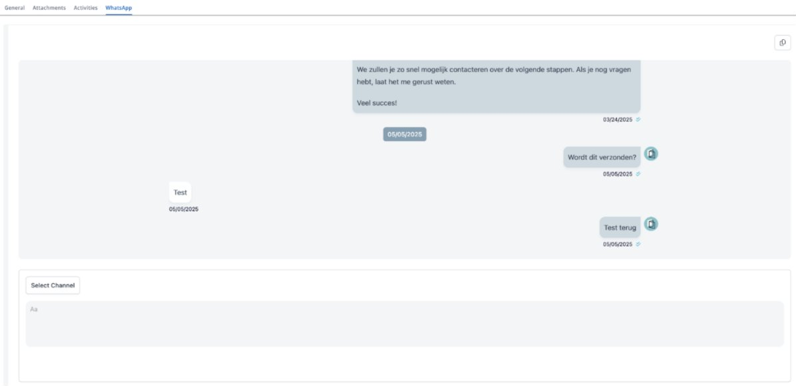

Wenn Sie in Carerix einen Kandidaten oder ein Match öffnen, zeigt der Tab **WhatsApp** die WhatsApp-Konversation mit diesem Kandidaten. Sie sehen den Chat dort, wo Sie ohnehin arbeiten, etwa bei der Vorbereitung eines Gesprächs, statt ihn im Posteingang zu suchen.

## Wo Sie ihn finden

- **Kandidat:** Öffnen Sie den Kandidaten und klicken Sie auf den Tab **WhatsApp** am Ende der Tab-Leiste.
- **Match:** Öffnen Sie das Match und klicken Sie auf den Tab **WhatsApp** neben **General**, **Attachments** und **Activities**. Er zeigt den Chat mit dem Kandidaten dieses Matches.

Der Tab gehört zur HireData-App in Carerix (Carerix RMA). Wenn Sie ihn nicht sehen, prüfen Sie, ob die App [verbunden](/de/apps/carerix/connect-with-carerix) ist.

## Was der Tab zeigt

- Jede Nachricht der Konversation, gesendet und empfangen, jeweils mit Datum.
- Dateien, die der Kandidat Ihnen geschickt hat, etwa einen Lebenslauf.
- Ein Nachrichtenfeld unten. Wählen Sie unter **Select Channel** einen Kanal, geben Sie Ihre Nachricht ein und senden Sie sie.

WhatsApp erlaubt eine freie Nachricht nur innerhalb von 24 Stunden nach der letzten Antwort des Kandidaten. Danach beginnen Sie mit einer genehmigten Vorlage. Siehe [Grundlagen des WhatsApp-Posteingangs](/de/apps/messaging/whatsapp/whatsapp-inbox-basics).

## Verwandte Artikel

- [Zähler für aktive WhatsApp-Chats in Carerix RMA](/de/apps/carerix/whatsapp-active-chats-counter-in-carerix-rma)
- [WhatsApp-Chats in Carerix protokollieren](/de/apps/carerix/logging-whatsapp-conversations-in-carerix-with-hiredata)
