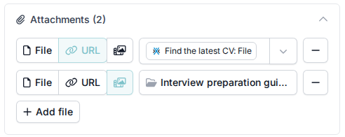
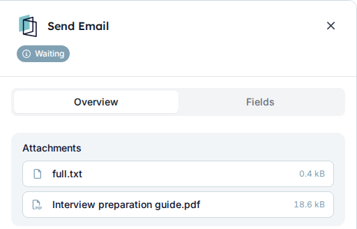

Die Aufgabe **Send Email** kann jetzt Dateien anhängen. Senden Sie den neuesten Lebenslauf eines Kandidaten an den Recruiter oder einen Kunden, oder fügen Sie dasselbe PDF, etwa einen Leitfaden zur Vorbereitung auf ein Vorstellungsgespräch, jeder E-Mail hinzu, die eine Automatisierung versendet.

## Wo Sie Anhänge hinzufügen

Öffnen Sie die Aufgabe **Send Email** in Ihrer Automatisierung. Unter **Settings** finden Sie den Bereich **Attachments**, neben **Recipient**, **CC and BCC** und **Sender**.

Klicken Sie auf **Add file**, um eine Zeile hinzuzufügen. Jede Zeile bietet drei Quellen zur Auswahl:

- **File** hängt eine Datei aus einem früheren Schritt der Automatisierung an, etwa den Lebenslauf eines Kandidaten. Wählen Sie sie unter **Choose an uploaded file**.
- **URL** hängt die Datei unter einer Webadresse an.
- **Media library** (das Bildsymbol) hängt eine Datei an, die Sie in HireData hochgeladen haben, etwa ein Standard-PDF.

Fügen Sie so viele Zeilen hinzu, wie Sie brauchen. Mit der Schaltfläche **−** entfernen Sie eine Zeile.

## Den neuesten Lebenslauf eines Kandidaten anhängen

Um eine Datei anzuhängen, die an einem Carerix- oder Spott-Datensatz gespeichert ist, suchen Sie sie zuerst mit einem **Find**-Schritt und hängen Sie sie dann an.

1. Fügen Sie vor der Aufgabe **Send Email** einen **Find**-Schritt hinzu, der die Dateien des Kandidaten abruft. Gibt es mehrere, kommt die neueste Datei zuerst, sodass Sie den neuesten Lebenslauf erhalten. Siehe [Datensätze nachschlagen](/de/automations/look-up-records).
2. Öffnen Sie in der Aufgabe **Send Email** den Bereich **Attachments** und klicken Sie auf **Add file**.
3. Lassen Sie **File** ausgewählt und wählen Sie die Datei aus Ihrem **Find**-Schritt, zum Beispiel **Find the latest CV: File**.
4. Speichern Sie die Aufgabe.

## Prüfen, was gesendet wurde

Öffnen Sie einen Run der Automatisierung. Der Schritt **Send Email** listet die Dateien auf, die an die E-Mail angehängt wurden.

<Tip>
  Testen Sie zuerst mit einem Testkandidaten und Ihrer eigenen Adresse und prüfen Sie die zugestellte E-Mail, bevor Sie die Automatisierung für echte Kandidaten einschalten.
</Tip>

Anhänge funktionieren in jeder Automatisierung, auch in Automatisierungen, die vor dem neuen Automatisierungs-Builder erstellt wurden.

## Verwandte Artikel

- [Aufgabe Send Email](/de/reference/automations/tasks/send-email) erklärt jede Einstellung der Aufgabe.
- [Datensätze nachschlagen](/de/automations/look-up-records) erklärt den Find-Schritt.
