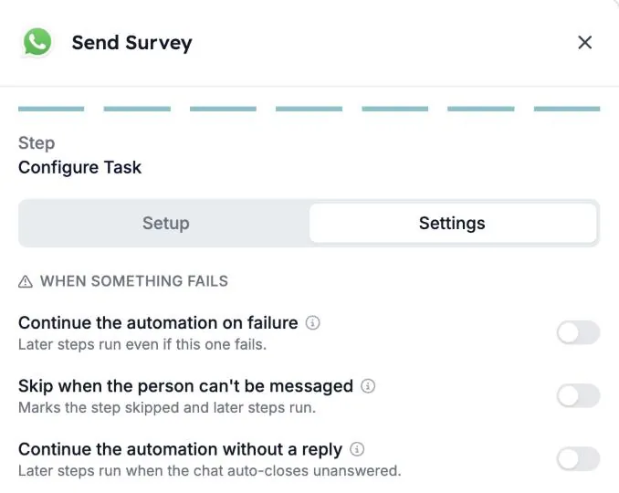
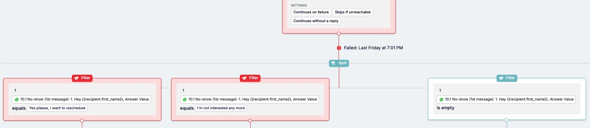

Nicht jeder Kandidat beantwortet Ihre WhatsApp-Nachricht. Manche antworten nie, andere sind gar nicht erreichbar. Jeder WhatsApp-Schritt in einer Automatisierung hat jetzt Einstellungen, die festlegen, was danach passiert: den Run stoppen oder weiterlaufen lassen, damit ein späterer Schritt nachfassen kann.

Diese Anleitung erklärt die drei Einstellungen, wie Sie sie aktivieren und wie Sie ein Follow-up für Kandidaten bauen, die nicht antworten.

## Die drei Einstellungen

Sie finden sie im WhatsApp-Schritt im Tab **Settings** unter **When something fails**.

| Einstellung | Was sie bewirkt |
| --- | --- |
| **Continue the automation on failure** | Spätere Schritte laufen, auch wenn der WhatsApp-Schritt fehlschlägt. |
| **Skip when the person can't be messaged** | Der Schritt wird als übersprungen markiert und spätere Schritte laufen. |
| **Continue the automation without a reply** | Spätere Schritte laufen, wenn der Chat ohne Antwort geschlossen wird. |

**Continue the automation without a reply** ist nur für WhatsApp-Gespräche verfügbar.

### Wer „nicht erreichbar“ ist

**Skip when the person can't be messaged** gilt für Personen, die:

- keine Telefonnummer haben
- sich abgemeldet haben
- blockiert sind
- bereits einen offenen Chat haben
- das Gesprächslimit der Automatisierung erreicht haben

## Was passiert, wenn Sie nichts ändern

- **Neue WhatsApp-Schritte** stoppen den Run, wenn der Schritt fehlschlägt und wenn der Kandidat nicht antwortet.
- **Bestehende WhatsApp-Schritte** behalten ihr bisheriges Verhalten. Die neuen Einstellungen bleiben aus, bis jemand sie aktiviert.

<Note>
  Kandidaten, die antworten und dann verstummen, sind nicht betroffen. Ihre Runs laufen immer weiter.
</Note>

## Eine Einstellung aktivieren

<Steps>
  <Step title="Den WhatsApp-Schritt öffnen">
    Öffnen Sie Ihre Automatisierung und klicken Sie auf den WhatsApp-Schritt, zum Beispiel **Send Survey**.
  </Step>
  <Step title="Zum Tab Settings wechseln">
    Wechseln Sie im letzten Bildschirm des Schritts, **Configure Task**, von **Setup** zu **Settings**.
  </Step>
  <Step title="Aktivieren, was Sie brauchen">
    Aktivieren Sie unter **When something fails** eine oder mehrere Einstellungen. Jede Einstellung hat eine kurze Beschreibung, und das Info-Symbol daneben liefert mehr Details.
  </Step>
  <Step title="Die Arbeitsfläche prüfen">
    Zurück auf der Arbeitsfläche der Automatisierung zeigt der Schritt die aktiven Einstellungen, etwa **Continues without a reply**, **Continues on failure** und **Skips if unreachable**.
  </Step>
</Steps>

## Beispiel: Kandidaten nachfassen, die nicht antworten

Angenommen, Sie senden einen WhatsApp-Survey und möchten es erneut versuchen oder den Datensatz des Kandidaten aktualisieren, wenn niemand antwortet.

1. Aktivieren Sie **Continue the automation without a reply** im WhatsApp-Schritt.
2. Fügen Sie nach dem Schritt einen **Split** mit einem **Filter** pro Ergebnis hinzu.
3. Nutzen Sie die Antwort des Kandidaten in den Filtern. Zum Beispiel einen Filter pro Antwortschaltfläche und einen Filter, in dem die Antwort **is empty** ist, für Kandidaten, die nicht geantwortet haben.
4. Fügen Sie unter dem Filter für „keine Antwort“ das Follow-up hinzu: eine Erinnerung, eine E-Mail oder ein Update in Ihrem ATS.

Der Schritt speichert auch den Grund, warum es nicht wie geplant lief, etwa „keine Antwort“ oder „abgemeldet“. Filter und Zweige können diesen Grund ebenfalls nutzen, zum Beispiel um nur Personen eine Erinnerung zu senden, die nicht geantwortet haben.

## Gut zu wissen

- **Eine Nachricht, die nie ankommt, zählt als Fehler, nicht als keine Antwort.** Nutzen Sie **Continue the automation on failure**, wenn spätere Schritte in diesem Fall trotzdem laufen sollen.
- **Die Einstellungen gelten pro Schritt.** Eine Automatisierung mit mehreren WhatsApp-Schritten braucht die Einstellungen bei jedem Schritt, an dem der Run weiterlaufen soll.
- **Stoppen ist weiterhin möglich.** Abläufe, die enden sollen, wenn der Kandidat nicht antwortet, können die Einstellungen ausgeschaltet lassen.

## Fehlerbehebung

| Was Sie sehen | Was Sie prüfen |
| --- | --- |
| Der Run stoppt beim WhatsApp-Schritt mit „Receiver did not reply“ | **Continue the automation without a reply** ist für diesen Schritt aus. Aktivieren Sie es und prüfen Sie, ob die folgenden Schritte den Fall ohne Antwort abdecken. |
| Spätere Schritte laufen nicht für Personen ohne Telefonnummer oder mit Abmeldung | Aktivieren Sie **Skip when the person can't be messaged**. |
| Spätere Schritte laufen nicht, wenn eine Nachricht nicht zugestellt wurde | Aktivieren Sie **Continue the automation on failure**. |

Unter [Gründe für abgebrochene Runs](/de/knowledge-base/run-cancellation-reasons) finden Sie weitere Gründe, warum ein Run stoppen kann.

## Verwandte Themen

- [Eine WhatsApp-Automatisierung in HireData erstellen](/de/apps/messaging/whatsapp/create-a-whatsapp-automation-in-hiredata)
- [Formulare in WhatsApp-Gesprächen nutzen](/de/apps/messaging/whatsapp/how-to-use-forms-in-whatsapp-conversations)
- Die Schritte [Filter](/de/reference/automations/steps/filter) und [Split](/de/reference/automations/steps/split)
- [Sicherheitsgrenzen für Automatisierungen](/de/settings/automation-safety-limits)
