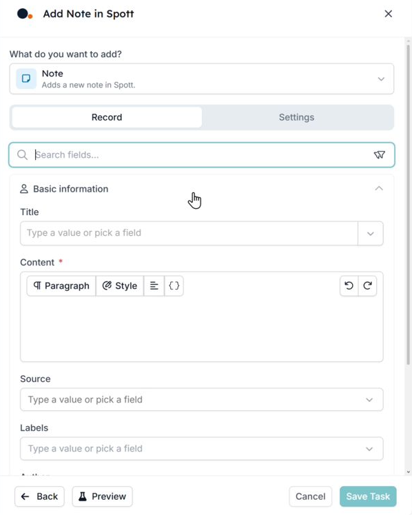
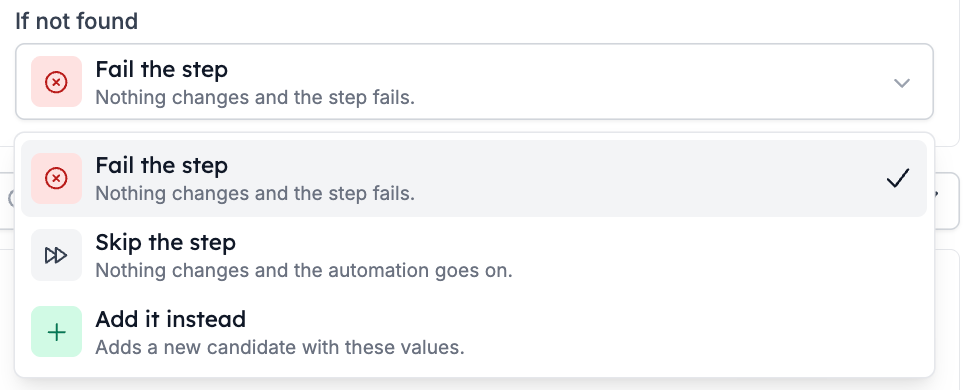
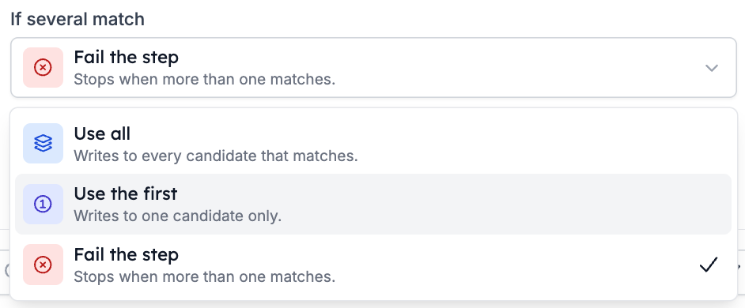
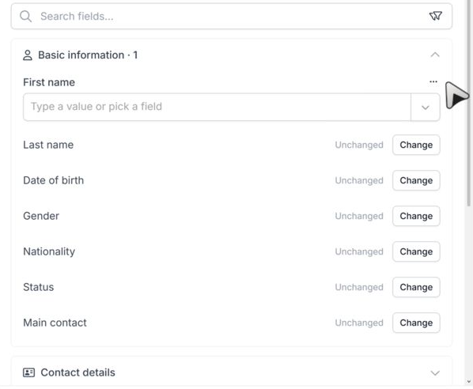
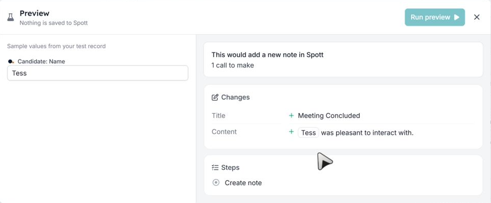
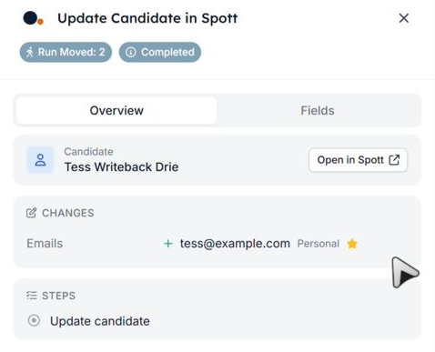

Ihre Automatisierungen können jetzt in Spott zurückschreiben. Halten Sie nach einem WhatsApp-Gespräch eine Notiz fest, verschieben Sie eine Bewerbung in die nächste Phase, wenn ein Kandidat ein Formular ausfüllt, oder halten Sie die Kontaktdaten eines Kandidaten aktuell, ohne dass jemand etwas in Spott abtippen muss.

## Schritt 1: Spott-Schritt hinzufügen

Klicken Sie in Ihrer Automatisierung auf **\+** und wählen Sie den benötigten Spott-Schritt. Es gibt einen Schritt pro Aktion und Spott-Objekt, etwa **Add Note in Spott**, **Update Candidate in Spott** oder **Delete Note in Spott**.

Unter **What do you want to add?** können Sie jederzeit zu einem anderen Spott-Objekt wechseln.

## Schritt 2: Zu ändernden Datensatz wählen

Bei einer Aktualisierung oder Löschung teilen Sie HireData mit, welcher Spott-Datensatz geändert werden soll:

- **Per ID**, zum Beispiel der Kandidat, der die Automatisierung gestartet hat.
- **Mit Bedingungen**, die den Datensatz finden, zum Beispiel der Kandidat mit einer bestimmten E-Mail-Adresse.

Legen Sie dann fest, was passiert, wenn der Datensatz nicht gefunden wird:

- **Fail the step:** Es ändert sich nichts und der Schritt schlägt fehl. Das ist die Standardeinstellung.
- **Skip the step:** Es ändert sich nichts und die Automatisierung läuft weiter.
- **Add it instead:** Fügt einen neuen Datensatz mit diesen Werten hinzu.

Finden Ihre Bedingungen mehr als einen Datensatz, wählen Sie **Use all**, **Use the first** oder **Fail the step**.

## Schritt 3: Felder ausfüllen

Geben Sie einen Wert ein oder wählen Sie ein Feld aus einem früheren Schritt der Automatisierung, etwa eine Formularantwort. Felder, die Sie nicht anfassen, zeigen **Unchanged** und bleiben in Spott unverändert. Klicken Sie auf **Change**, um einen neuen Wert zu setzen oder das Feld zu leeren.

Bei Listen, etwa den E-Mail-Adressen eines Kandidaten, können Sie ein Element hinzufügen, die ganze Liste ersetzen oder passende Elemente entfernen.

Einige Dinge erledigt HireData für Sie:

- **Antworten werden den Auswahlwerten in Spott zugeordnet**, nach Name oder Wert, sodass eine Formularantwort wie "ja" oder ein Phasenname bei der richtigen Option landet.
- **Zahlen und Datumsangaben** werden so gelesen, wie Ihr Workspace sie schreibt.
- **Neue Bewerbungen und Jobs** können einem bestimmten Pipeline-Track zugeordnet werden, eine Bewerbung auch einer Unterphase.
- **Ein Wert, der nicht gelesen werden kann**, stoppt den Schritt und zeigt an, um welchen Wert es ging, statt das Feld in Spott zu leeren.

<Tip>
  Eine Aktualisierung ändert nur die Felder, die Sie setzen. Würde sich nichts ändern, wird der Schritt übersprungen, statt dieselben Werte erneut zu speichern, und der Run erklärt den Grund.
</Tip>

## Schritt 4: Vorschau vor dem Speichern

Klicken Sie auf **Preview**, suchen Sie nach Namen einen Beispieldatensatz und klicken Sie auf **Run preview**. Sie sehen genau, was hinzugefügt oder geändert würde. In Spott wird nichts gespeichert.

## Schritt 5: Prüfen, was gespeichert wurde

Öffnen Sie einen Run und klicken Sie auf den Spott-Schritt. Sie sehen, welcher Datensatz geändert wurde, jedes geänderte Feld mit altem und neuem Wert und **Open in Spott**, um direkt zum Datensatz zu gelangen.

Geht etwas schief, erklärt der Run es in verständlichen Worten, etwa **Record not found**.

## Was noch nicht möglich ist

- **Jobs** können nicht gelöscht werden, weil Spott das nicht erlaubt.
- **Vermittlungen** können aktualisiert, aber nicht hinzugefügt oder gelöscht werden.

## Verwandte Artikel

- [Eine Spott-Automatisierung erstellen](/de/apps/spott/create-a-spott-automation-in-hiredata)
- [Eine Automatisierung testen](/de/automations/how-to-test-an-automation)
