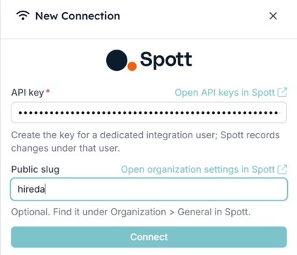
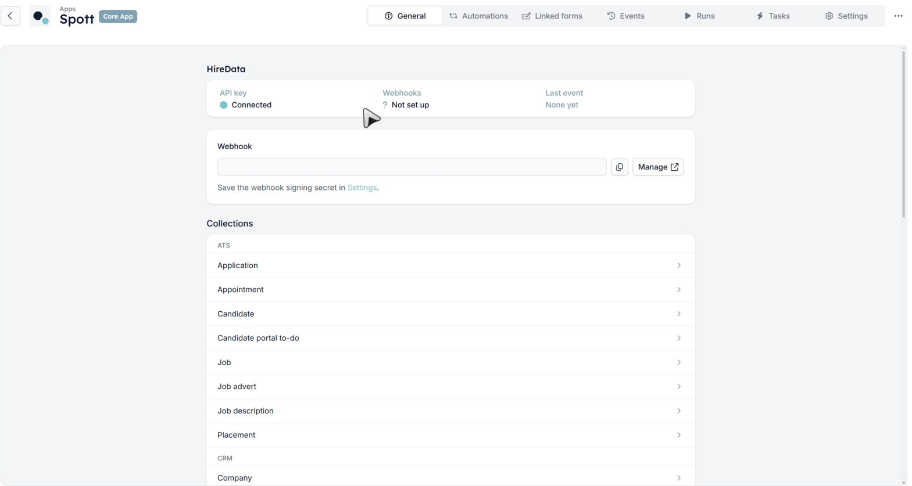

Verbinden Sie Spott einmalig, und Änderungen in Spott starten Ihre HireData-Automatisierungen.

## Bevor Sie beginnen

- Sie benötigen einen Spott-Benutzer, der in Spott API-Schlüssel und Webhook-Endpunkte anlegen kann.
- Sie benötigen einen HireData-Admin, um die App hinzuzufügen.

## Schritt 1: API-Schlüssel hinzufügen

1. Gehen Sie zu **Settings** > [**Apps**](https://app.hiredata.com/settings/apps). Spott steht ganz oben.
2. Öffnen Sie **Spott** und klicken Sie auf **Connect to Spott**.
3. Klicken Sie auf **Open API keys in Spott**, erstellen Sie einen neuen Schlüssel und kopieren Sie ihn. Verwenden Sie einen eigenen Integrationsbenutzer: Spott protokolliert Änderungen unter diesem Benutzer.
4. Fügen Sie den Schlüssel unter **API key** ein. Der **Public slug** ist optional; Sie finden ihn in Spott unter Organization > General.
5. Klicken Sie auf **Connect**. HireData prüft den Schlüssel bei Spott, bevor die Verbindung gespeichert wird.

Danach synchronisiert HireData Ihre Spott-Felddefinitionen und Benutzer. Die Zeitleiste **Data sync** auf dem Tab **General** zeigt jeden Schritt.

## Schritt 2: Webhook in Spott hinzufügen

Über einen Webhook meldet Spott HireData, was sich ändert. Sie richten ihn einmalig in Spott ein.

1. Kopieren Sie auf dem Tab **General** der Spott-Verbindung die Adresse unter **Webhook**. **Manage** öffnet die Webhook-Einstellungen in Spott.
2. Fügen Sie in Spott einen neuen Endpunkt hinzu, fügen Sie die Adresse ein und wählen Sie alle Events aus.
3. Kopieren Sie das Signing Secret, das Spott Ihnen anzeigt.
4. Öffnen Sie in HireData den Tab **Settings** der Spott-Verbindung und fügen Sie es als Webhook Signing Secret ein. Speichern Sie.

HireData akzeptiert nur Events, die mit diesem Secret signiert sind. Ohne Secret funktioniert der Webhook daher nicht.

## Schritt 3: Prüfen, ob Events ankommen

Ändern Sie einen Testkandidaten in Spott. Der Tab **General** zeigt dann, wann das letzte Event ankam, und das Event erscheint auf dem Tab **Events**.

Sie können jetzt [Ihre erste Spott-Automatisierung erstellen](/de/apps/spott/create-a-spott-automation-in-hiredata).

<Note>
  Die erste Synchronisierung importiert nicht alle Ihre Spott-Datensätze. Datensätze kommen an, wenn sie sich in Spott ändern, wenn eine Automatisierung sie abruft oder wenn eine geplante Automatisierung läuft.
</Note>
