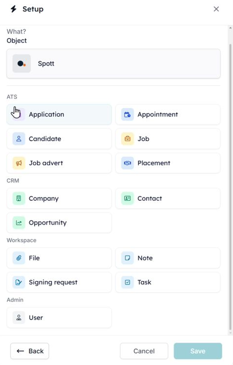
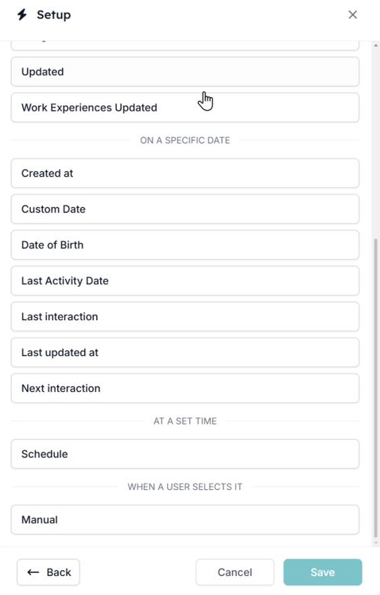

Sobald [Spott verbunden ist](/de/apps/spott/connect-with-spott), kann jede Änderung in Spott eine Automatisierung starten.

## Schritt 1: Spott-Objekt wählen

Gehen Sie zu [**Automations**](https://app.hiredata.com/automations) und erstellen Sie eine neue Automatisierung. Wählen Sie unter **Setup** **Spott** und dann das Objekt, um das es in der Automatisierung geht.

Die Objekte sind so gruppiert wie in Spott: ATS, CRM, Workspace und Admin. Die Namen folgen Spott, etwa **Job** und **Job advert**.

## Schritt 2: Festlegen, wie sie startet

- **Ein Event**, etwa eine Bewerbung, die erstellt, aktualisiert oder in eine andere Phase verschoben wird, oder eine Opportunity, die erstellt, aktualisiert, gelöscht oder in eine andere Phase verschoben wird.
- **An einem bestimmten Datum**, etwa eine Woche nach dem Startdatum einer Vermittlung. Wählen Sie eines der Datumsfelder des Objekts oder **Custom Date**.
- **Zu einer festen Zeit**: **Schedule** lässt die Automatisierung über eine Gruppe von Datensätzen laufen, zum Beispiel jeden Montag.
- **Wenn ein Benutzer sie auswählt**: **Manual** startet sie manuell für einen Datensatz.

## Schritt 3: Nur für einen Track oder eine Phase starten

Wenn Sie in Spott mehrere Pipeline-Tracks verwenden, können Sie eine Bewerbungsautomatisierung auf einen Track beschränken, und auf eine Phase innerhalb dieses Tracks.

- Fügen Sie einen Startfilter auf **Stage track IDs** hinzu, um den Track zu wählen.
- Fügen Sie einen Startfilter auf **Stage ID** hinzu, um die Phase zu wählen. Phasen mit gleichem Namen zeigen ihren Track daneben, damit Sie sie unterscheiden können.

Eine Bewerbung in einem anderen Track startet die Automatisierung nicht, auch wenn die Phase gleich heißt.

<Tip>
  **Track ID** ist als **(legacy)** markiert, weil Spott es entfernen will. Verwenden Sie stattdessen **Stage track IDs**; es funktioniert in Filtern genauso.
</Tip>

### Geplante Automatisierungen

Eine geplante Automatisierung bietet nur die Filter, nach denen Spott selbst suchen kann. Um die Zielgruppe weiter einzugrenzen, fügen Sie nach dem Start einen **Filter**-Schritt hinzu.

Spott meldet nicht, wie viele Datensätze passen, daher kann der Builder die Größe der Zielgruppe nicht vorab anzeigen. Die Automatisierung durchläuft trotzdem alle passenden Datensätze.

## Schritt 4: Nachricht hinzufügen

Fügen Sie einen Schritt wie **Send Email** oder eine WhatsApp-Nachricht hinzu. Jedes synchronisierte Spott-Feld steht als Variable zur Verfügung:

- Verknüpfte Datensätze kommen mit: Eine Bewerbung enthält Kandidat und Job, eine Vermittlung Kandidat, Kunde und Job.
- Scorecards von Bewerbungen und Jobs sind verfügbar.
- Kunden zeigen ihr letztes Kontaktdatum und mit wem der Kontakt war.

Um zu sehen, welche Felder für einen Datensatz ankamen, öffnen Sie das Event auf dem Tab **Events** oder sehen Sie sich das Objekt unter **Collections** an.

## Schritt 5: Testen und aktivieren

[Testen Sie die Automatisierung](/de/automations/how-to-test-an-automation) mit einem Testdatensatz und klicken Sie dann auf **Activate**.
