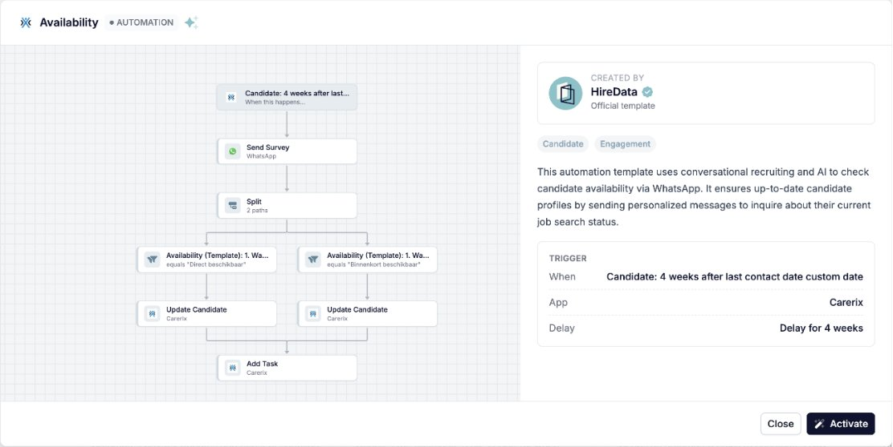
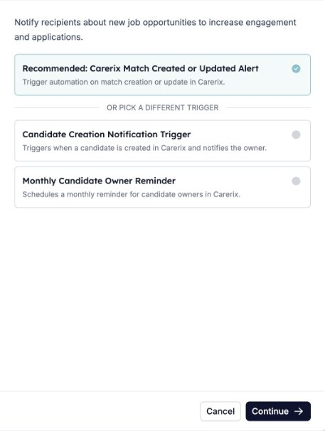

_Entdecken Sie die Möglichkeiten von Automatisierungen in dieser prägnanten Video-Anleitung, die alles von den Grundkonzepten bis zur Einrichtung Ihrer eigenen Automatisierung abdeckt. Das Video enthält eine detaillierte Produktdemo und Einblicke in ereignisgesteuerte vs. geplante Automatisierungen._

<iframe src="https://www.loom.com/embed/75f5e793351a48aaa98179881f670d91" title="Loom video" allowFullScreen className="w-full aspect-video rounded-xl"></iframe>

<CardGroup cols={3}>
  <Card title="Automatisierungs-Builder: Überblick" icon="diagram-project" href="/reference/automations/overview">
    Wählen Sie einen Schritt und sehen Sie, was er in einem Run tut.
  </Card>

  <Card title="Task-Katalog" icon="list-check" href="/reference/automations/task-catalogue">
    Finden Sie die für jede verbundene App verfügbaren Aufgaben und die Referenz zu jeder einzelnen.
  </Card>

  <Card title="Einen Run verfolgen" icon="route" href="/reference/automations/follow-a-run">
    Verfolgen Sie ein Event durch seinen Run, die Schrittdaten, die Aufgabe und das Ergebnis.
  </Card>
</CardGroup>

## Mit einer Vorlage beginnen

Sie müssen nicht jede Automatisierung von Grund auf bauen. Klicken Sie in [Automations](https://app.hiredata.com/automations) auf **New Automation**, um die Vorlagenbibliothek zu öffnen: fertige Automatisierungen sowie E-Mail- und WhatsApp-Vorlagen mit einem passenden Trigger. Filtern Sie nach App oder Typ, oder suchen Sie.

### Eine Automatisierungsvorlage ansehen

Klicken Sie auf eine Vorlage, um zu sehen, was sie tut, bevor Sie sie verwenden:

- die Schritte der Automatisierung als Diagramm
- wer sie erstellt hat, etwa HireData oder ein Partner
- ihre Tags und eine kurze Beschreibung
- unter **Trigger**: wann sie startet (**When**), die **App** und eine eventuelle **Delay**

Klicken Sie auf **Activate**, um die Automatisierung aus der Vorlage zu erstellen, oder auf **Close**, um zurückzugehen. Prüfen Sie die neue Automatisierung und [testen Sie sie](/de/automations/how-to-test-an-automation), bevor echte Kandidaten sie durchlaufen.

### Mit einer E-Mail- oder WhatsApp-Vorlage beginnen

Wählen Sie eine E-Mail- oder WhatsApp-Vorlage, und die Vorschau zeigt die Nachricht, rechts daneben den Trigger, mit dem sie startet. Der empfohlene Trigger ist ausgewählt. Unter **Or pick a different trigger** können Sie einen anderen wählen. Klicken Sie auf **Continue**, um die Automatisierung mit dieser Vorlage und diesem Trigger zu erstellen.

