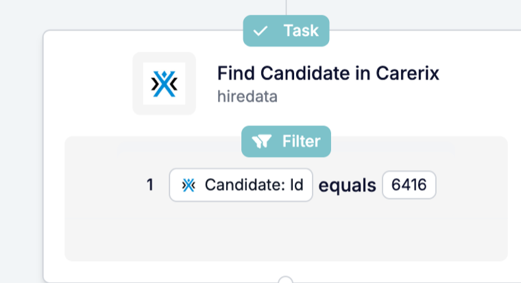

Oft ist der Datensatz, den Sie brauchen, nicht der, der die Automatisierung gestartet hat. **Find** schlägt ihn nach, damit spätere Schritte ihn aktualisieren, ihm eine Nachricht senden oder seine Dateien anhängen können.

<Note>
  Diese Seite beschreibt Find im [neuen Automation Builder](/de/automations/engine-1-3), Teil der HireData-Beta.
</Note>

## Einen Datensatz mitten in der Automatisierung nachschlagen

Klicken Sie in Ihrer Automatisierung auf **\+**: **Find** steht unter **Search** und sucht etwas, das bereits existiert, etwa einen Kandidaten, Kontakt oder eine HireData-Person.

### 1. Wählen Sie, was gesucht wird

Find nutzt dieselbe Objektauswahl wie die neuen Record Steps, mit denselben Kategorien, Symbolen und Farben. Schlagen Sie einen Carerix-Datensatz oder eine **HireData-Person** nach.

### 2. Nach Feldern suchen, die den Datensatz eindeutig machen

Legen Sie die Feldwerte fest, die den Datensatz erkennbar machen, etwa eine ID oder eine E-Mail-Adresse. Find sucht auch weiter nach Feldern, die in Carerix deaktiviert sind, damit laufende Automatisierungen dieselben Datensätze finden.

### 3. Das Ergebnis in späteren Schritten verwenden

Der Datensatz, den Find zurückgibt, steht späteren Schritten unter dem Namen des Schritts zur Verfügung. Ein häufiges Muster: den Datensatz mit Find suchen und dann mit [Update](/de/reference/automations/steps/update) aktualisieren.

## Was hat sich noch geändert?

- **Run History** zeigt die Namen der Datensätze, die Find gefunden hat, auch von HireData-Personen.
- **Find Email** und **Search Domain** werden im neuen Automation Builder nicht mehr angeboten.

Alle Einstellungen finden Sie in der [Find-Referenz](/de/reference/automations/steps/find).

## Probieren Sie es selbst aus

Öffnen Sie eine Automatisierung in [Automations](https://app.hiredata.com/automations), klicken Sie auf **\+** und wählen Sie **Find** unter **Search**.
