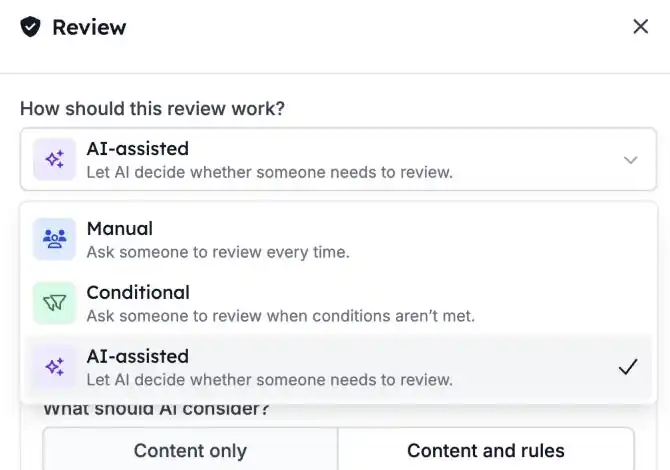
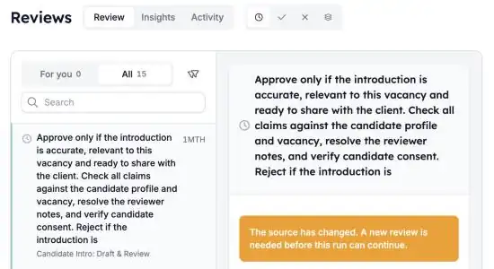

Manche Schritte möchten Sie automatisieren, aber nicht ohne vorherige Prüfung durch einen Menschen. Mit **Reviews** pausiert eine Automatisierung, bis jemand freigibt oder ablehnt. Bei Freigabe läuft der Run weiter; bei Ablehnung stoppt er.

<Note>
  Reviews ist Teil der HireData-Beta und wird pro Workspace aktiviert. Bitten Sie Ihren Ansprechpartner bei HireData, es für Ihren Workspace zu aktivieren.
</Note>

## Einen Run pausieren, bis jemand entscheidet

Fügen Sie einen **Review**-Schritt dort ein, wo die Automatisierung warten soll. Klicken Sie im [neuen Automation Builder](/de/automations/engine-1-3) auf **\+** und wählen Sie **Review** unter **Human in the loop**.

### 1. Wählen Sie, wie das Review funktioniert

Ein Review-Schritt hat drei Modi:

- **Manual**: Es prüft immer eine Person. Das ist die Standardeinstellung.
- **Conditional**: Eine Person prüft nur, wenn die von Ihnen festgelegten Bedingungen es verlangen.
- **AI-assisted**: KI prüft den Inhalt zuerst anhand Ihrer Kriterien und fragt eine Person, wenn sie unsicher ist oder Informationen fehlen.

Legen Sie fest, was der Prüfer sieht: den zu prüfenden Inhalt, die Kriterien und optional Kontext. Sie können Variablen aus früheren Schritten einfügen.

### 2. Aus einer Warteschlange prüfen

Öffnen Sie [Reviews](https://app.hiredata.com/reviews). **For you** zeigt die Anfragen, die Ihnen zugewiesen sind. Admins sehen auch **All** und können eine Anfrage jemand anderem zuweisen.

Filtern Sie nach **Pending**, **Approved** oder **Rejected**. Wählen Sie eine Anfrage aus, um den Inhalt, die Kriterien und Links zur Automatisierung und zum Run zu sehen.

### 3. Freigeben oder ablehnen

- **Approve**: Der Run läuft mit dem nächsten Schritt weiter.
- **Reject**: Der Run stoppt.

Sie können in der Warteschlange oder direkt im Run entscheiden. In einem kurzen Zeitfenster können Sie eine Entscheidung zurücknehmen, bevor sie wirksam wird.

## Gut zu wissen

- **Test-Runs** erzeugen Reviews, die Sie im Run selbst bearbeiten. Sie erscheinen nicht in der normalen Warteschlange und nicht in **Insights**.
- **Insights** zeigt das Anfragevolumen und die Auslastung des Teams. **Activity** zeigt den Verlauf der Entscheidungen.
- **Wurde eine Automatisierung geändert**, nachdem ein Review angefragt wurde, kann ein Admin die veraltete Anfrage ersetzen.

## Probieren Sie es selbst aus

Öffnen Sie eine Automatisierung in [Automations](https://app.hiredata.com/automations), fügen Sie vor der Aktion, die geprüft werden soll, einen **Review**-Schritt hinzu und starten Sie einen Test. Geben Sie ihn dann unter [Reviews](https://app.hiredata.com/reviews) frei.
