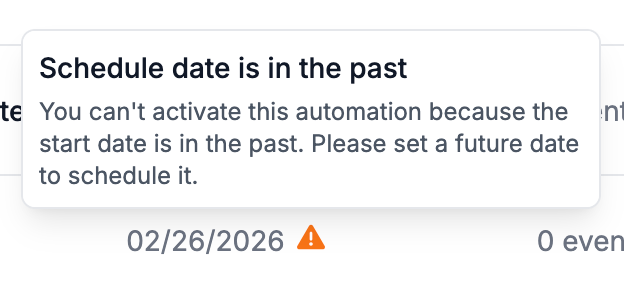
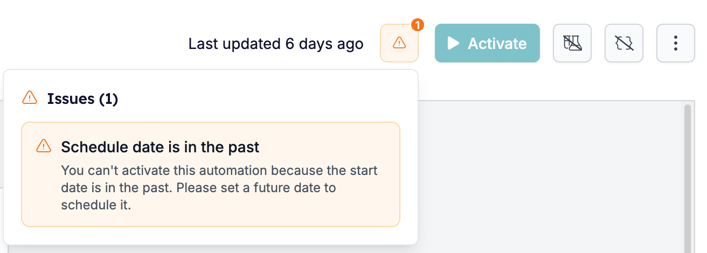

Manche Automatisierungen sollen nicht darauf warten, dass in Ihrem ATS etwas passiert. Eine monatliche NPS-Umfrage, ein Newsletter oder eine jährliche Datenprüfung soll an einem Datum Ihrer Wahl rausgehen. Eine geplante Automatisierung läuft zum eingestellten Zeitpunkt, für jeden Datensatz in der ausgewählten Zielgruppe, einmalig oder wiederholt.

## Den Zeitplan einrichten

<Steps>
  <Step title="Objekt wählen">
    Öffnen Sie die Automatisierung und klicken Sie auf den **Start**-Block. Wählen Sie Ihre App und das Objekt, für das die Automatisierung läuft, zum Beispiel **Candidate**.
  </Step>
  <Step title="Schedule wählen">
    Gehen Sie unter **Timing** zu **AT A SET TIME** und klicken Sie auf **Schedule**. Diese Option sehen Sie nur bei Objekten, die sich planen lassen.
  </Step>
  <Step title="Festlegen, wann sie läuft">
    - **Run at** ist Datum und Uhrzeit des ersten Laufs.
    - **Repeat every** legt fest, wie oft sie erneut läuft: Tage, Wochen, Monate, Quartale, ein halbes Jahr oder ein Jahr. Wählen Sie **Don't repeat** für einen einzigen Lauf. Bei Wochen und Monaten zeigt die Zeile darunter, an welchem Tag sie sich wiederholt, etwa "On day 28".
    - **Until** beendet die Wiederholung an einem Datum. Schalten Sie **Enable** ein, um eines festzulegen. Bleibt es aus, wiederholt sich die Automatisierung, bis Sie sie pausieren.
  </Step>
  <Step title="Zielgruppe auswählen">
    Fügen Sie unter **Audience Selection** Filter hinzu, damit die Automatisierung nur für die gewünschten Datensätze läuft.
  </Step>
  <Step title="Aktivieren">
    Klicken Sie auf **Activate**. Die Automatisierung ist jetzt für das Datum unter **Run at** geplant.
  </Step>
</Steps>

## Das Startdatum muss in der Zukunft liegen

Sie können eine geplante Automatisierung nur aktivieren, solange das Datum unter **Run at** noch bevorsteht. Ist es vorbei, wird die Automatisierung nicht aktiviert und behält ihren bisherigen Status. Die Meldung lautet: "This automation could not be scheduled because the configured start date is in the past."

HireData warnt Sie schon vorher:

- **In der Liste der Automatisierungen** erscheint ein oranges Warnsymbol neben dem Startdatum. Fahren Sie mit der Maus darüber, um die Warnung zu lesen.
- **Auf der Seite der Automatisierung** erscheint neben **Activate** eine Warnschaltfläche. Klicken Sie darauf, um das Problem **Schedule date is in the past** zu sehen.

<Frame caption="Die Warnung neben einem Startdatum in der Liste der Automatisierungen.">
  
</Frame>

<Frame caption="Das Feld Issues neben der Schaltfläche Activate.">
  
</Frame>

So beheben Sie es: Wählen Sie ein neues **Run at**-Datum in der Zukunft und aktivieren Sie die Automatisierung erneut.

Das gilt auch für eine geplante Automatisierung, die Sie pausiert haben. Das Pausieren storniert den nächsten Lauf. Ist das Startdatum vorbei, wenn Sie sie wieder einschalten möchten, wählen Sie zuerst ein neues **Run at**-Datum.

## Was das Statussymbol Ihnen sagt

Fahren Sie mit der Maus über das Statussymbol einer Automatisierung, um zu sehen, was es bedeutet.

| Tooltip | Bedeutung |
| --- | --- |
| **Not Yet Activated** | Die Automatisierung wurde noch nie aktiviert. |
| **Active** | Die Automatisierung ist eingeschaltet. |
| **Scheduled** | Die Automatisierung ist aktiviert und der nächste Lauf ist geplant. |
| **Scheduling Runs** | Die Automatisierung startet gerade Läufe für ihre Zielgruppe. |
| **Paused** | Nichts Neues läuft, bis Sie die Automatisierung wieder aktivieren. |
| **System Flagged The Automation** | HireData hat die Automatisierung nach einem Fehler gestoppt, zum Beispiel weil die App-Verbindung nicht mehr funktionierte oder Läufe nicht eingeplant werden konnten. Beheben Sie die Ursache und aktivieren Sie sie dann erneut. |
| **Finished Scheduling Runs** | Der letzte geplante Lauf ist erledigt und es gibt kein nächstes Datum, zum Beispiel weil das **Until**-Datum vorbei ist. |

## Gut zu wissen

- **Der Start ist gesperrt, während Läufe eingeplant werden.** Solange der Status **Scheduling Runs** lautet, können Sie Trigger, Zeitplan, Zielgruppenfilter und Typ der Automatisierung nicht ändern. Warten Sie, bis das erledigt ist.
- **Eine Automatisierung, die ihren Zeitplan verliert, wird pausiert.** Verliert eine aktive geplante Automatisierung ihren Zeitplan oder lässt sich beim Bearbeiten kein neuer festlegen, pausiert HireData sie, damit sie nicht zum falschen Zeitpunkt läuft.
- **Eine Kopie übernimmt den Zeitplan nicht.** Wenn Sie eine geplante Automatisierung duplizieren, ist die Kopie nicht geplant. Aktivieren Sie die Kopie, um sie einzuplanen.
- **Wenn Sie mehrere Automatisierungen gleichzeitig aktivieren**, zeigt eine Meldung, wie viele davon geklappt haben, etwa "2 of 3 automations activated. 1 could not be scheduled." Prüfen Sie das Startdatum der fehlgeschlagenen.

## Selbst ausprobieren

Öffnen Sie [Automations](https://app.hiredata.com/automations), klicken Sie auf den **Start**-Block einer Automatisierung und wählen Sie **Schedule** unter **AT A SET TIME**.

## Verwandte Themen

- [Automatisierungen testen](/de/automations/how-to-test-an-automation)
- [Warum ist meine Automatisierung nicht gelaufen?](/de/knowledge-base/why-didnt-my-automation-run)
- [Einen E-Mail-Newsletter an Ihre Zielgruppe senden](/de/apps/messaging/emails/sending-an-email-newsletter-to-your-audience)
- [Referenz: Setup-Schritt](/de/reference/automations/steps/setup)
