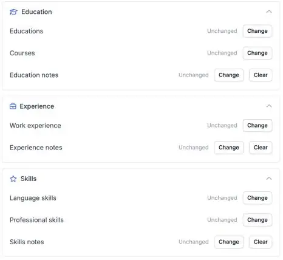

Ein vollständiges Kandidatenprofil lässt sich leichter matchen. Ihre Automatisierungen können jetzt die Ausbildung, Fachkenntnisse und Sprachen eines Kandidaten in Carerix ausfüllen, sodass niemand sie von Hand übertragen muss.

<Note>
  Dies ist Teil der HireData-Beta und funktioniert im [neuen Automation Builder](/de/automations/engine-1-3). Unter [So funktioniert die Beta](/de/beta/how-the-beta-works) erfahren Sie, wie Sie teilnehmen.
</Note>

## Das Kandidatenprofil automatisch vervollständigen

Klicken Sie in einer neuen Automatisierung auf **\+**, wählen Sie **Update** unter **Records**, dann **Carerix** und **Candidate**. Wählen Sie den Kandidaten aus und füllen Sie den benötigten Bereich aus.

<Frame caption="Education, Experience und Skills haben im Schritt Update Candidate jeweils einen eigenen Bereich.">
  
</Frame>

### 1. Ausbildung

Legen Sie den Namen der Ausbildung, das **Institut**, den Abschluss, das Niveau oder die Fachrichtung, die Daten und ob das Zeugnis erworben wurde fest.

### 2. Fachkenntnisse

Fügen Sie eine **Fähigkeit** und ihre **Spezialisierung** hinzu.

### 3. Sprachkenntnisse

Fügen Sie eine **Sprache** mit getrennten Niveaus für **Sprechen**, **Schreiben** und **Lesen** hinzu.

Sie können auch **Kurse** und **Berufserfahrung** hinzufügen oder aktualisieren.

## Bevor Sie es nutzen

- **Fügen Sie jeweils einen Eintrag hinzu oder ändern Sie jeweils einen.** Um eine bestehende Ausbildung oder Fähigkeit zu ändern, wählen Sie diesen Eintrag im Schritt aus.
- **Testen Sie zuerst mit einem Testkandidaten** und prüfen Sie in Carerix, ob die anderen Einträge des Kandidaten unverändert geblieben sind.

## Probieren Sie es selbst aus

Erstellen Sie eine neue Automatisierung in [Automations](https://app.hiredata.com/automations), klicken Sie auf **\+**, wählen Sie **Update** unter **Records**, dann **Carerix** und **Candidate**.
