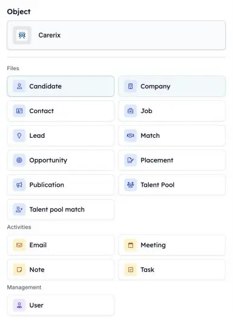
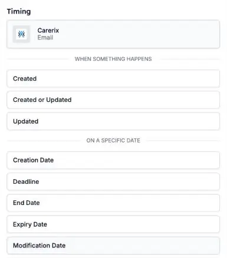

Ihre Automatisierungen können jetzt auf mehr von dem reagieren, was in Carerix passiert. Starten Sie eine, wenn ein Berater eine Notiz erfasst, wenn eine E-Mail gesendet oder empfangen wird oder wenn ein Kandidat einem Talentpool beitritt. So erfolgt das Follow-up, ohne dass jemand daran denken muss.

<Note>
  Dies ist Teil der HireData-Beta. Unter [So funktioniert die Beta](/de/beta/how-the-beta-works) erfahren Sie, wie Sie teilnehmen.
</Note>

## Wählen Sie, was Ihre Automatisierung startet

Öffnen Sie Ihre Automatisierung, klicken Sie auf den **Start**-Block und wählen Sie **Carerix**. Wählen Sie unter **Object**, worauf die Automatisierung reagieren soll. Wählen Sie dann, **wann** sie startet.

<Frame caption="Wählen Sie den Carerix-Datensatz, der die Automatisierung startet.">
  
</Frame>

### 1. E-Mails

Starten Sie eine Automatisierung, wenn eine E-Mail **gesendet oder empfangen** und zu Carerix hinzugefügt wurde. Entwürfe, der Postausgang, Mailings und Massen-E-Mails starten keine.

### 2. Notizen

Starten Sie eine Automatisierung, wenn in Carerix eine **Notiz** hinzugefügt wird, zum Beispiel nachdem ein Berater ein Erstgespräch erfasst hat.

### 3. Talentpool-Zuordnungen

Starten Sie eine Automatisierung, wenn sich die **Talentpool-Mitgliedschaft** eines Kandidaten ändert, etwa wenn er einem Pool beitritt.

### 4. Leads und Opportunities

Wenn Ihr Team den Vertriebsprozess von Carerix nutzt, starten Sie eine Automatisierung aus einem **Lead** oder einer **Opportunity**. Siehe [Leads & Opportunities](/de/beta/leads-and-opportunities).

## An einem Datum starten

Neben **wenn etwas passiert** können Sie eine Automatisierung auch **an einem bestimmten Datum** starten, etwa an einer Frist oder einem Enddatum. Ihre eigenen Carerix-Datumsfelder stehen ebenfalls in dieser Liste. Ein Datumsfeld, das Sie in Carerix hinzufügen, erscheint hier am nächsten Tag.

<Frame caption="Wählen Sie, wann die Automatisierung startet: wenn etwas passiert oder an einem Datum.">
  
</Frame>

## Probieren Sie es selbst aus

Öffnen Sie eine Automatisierung in [Automations](https://app.hiredata.com/automations), klicken Sie auf den **Start**-Block, wählen Sie **Carerix** und dann **Email**, **Note** oder **Talent pool match**.
