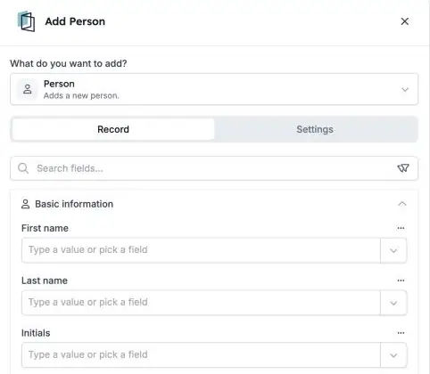

HireData führt eine eigene Liste von [Personen](/de/pages/people): die Kandidaten, Kontakte und Kollegen, mit denen Sie arbeiten. Ihre Automatisierungen können diese Personen jetzt direkt hinzufügen, aktualisieren, suchen und löschen, mit denselben Schritten wie für andere Datensätze.

<Note>
  Dies ist Teil der HireData-Beta und funktioniert im [neuen Automation Builder](/de/automations/engine-1-3). Es ersetzt den Schritt **Sync Person** für neue Automatisierungen.
</Note>

## Ihre Personenliste aktuell halten

Klicken Sie in einer neuen Automatisierung auf **\+**. Wählen Sie **Add** oder **Update** unter **Records** oder **Delete** unter **Lifecycle**, und wählen Sie **HireData** und **Person**.

<Frame caption="Der Schritt Add Person mit den Angaben zur Person in Bereichen.">
  
</Frame>

### 1. Personen hinzufügen und aktualisieren

Füllen Sie jedes Feld aus, das Sync Person schreiben konnte, einschließlich **Adressen** und **UTM-Kampagnendaten**, die zeigen, woher jemand kam.

### 2. Die richtige Person finden

Nutzen Sie [Find](/de/automations/look-up-records) mit Filtern, um festzulegen, welche Person ein Schritt ändert. Die Run History zeigt die Namen der gefundenen Personen.

### 3. Mit Bedacht löschen

Eine Person zu löschen ist **endgültig**. Wenn Sie einen Schritt rückgängig machen, der eine Person hinzugefügt hat, löscht HireData diese Person wieder.

## Gut zu wissen

- **Sync Person** wird in neuen Automatisierungen nicht mehr angeboten. Automatisierungen, die es bereits nutzen, laufen weiter.
- **Testen Sie zuerst mit einer Testperson**, damit Sie niemanden versehentlich ändern oder löschen.

## Probieren Sie es selbst aus

Erstellen Sie eine neue Automatisierung in [Automations](https://app.hiredata.com/automations), klicken Sie auf **\+**, wählen Sie **Add** unter **Records** und wählen Sie **HireData** und **Person**.
