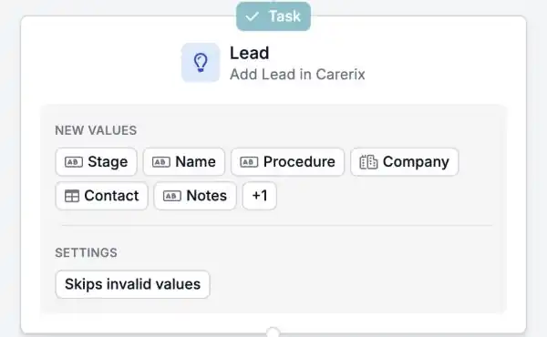

Wenn Ihr Team den Vertriebsprozess von Carerix nutzt, können Ihre Automatisierungen jetzt auch Ihren Leads und Opportunities folgen. Starten Sie einen Ablauf, wenn ein Lead eingeht oder sich ändert, und halten Sie Carerix aktuell, ohne etwas abzutippen.

<Note>
  Dies ist Teil der HireData-Beta und funktioniert im [neuen Automation Builder](/de/automations/engine-1-3). Der Vertriebsprozess muss in Ihrer Carerix-Umgebung aktiviert sein. Welche Optionen Sie sehen, hängt davon ab, wie Carerix für Sie eingerichtet ist.
</Note>

## Vertriebsabläufe automatisch ausführen

### 1. Eine Automatisierung aus einem Lead oder einer Opportunity starten

Starten Sie eine Automatisierung, wenn ein Lead oder eine Opportunity in Carerix **erstellt** oder **aktualisiert** wird, nach **Zeitplan** oder **manuell**.

### 2. Suchen, hinzufügen und aktualisieren

- **Find** sucht einen bestehenden Lead oder eine bestehende Opportunity.
- **Add** legt einen neuen an. Wie in Carerix sind **Prozedur** und **Kategorie** Pflichtfelder.
- **Update** ändert einen bestehenden.

Die Felder und Bereiche folgen den Lead- und Opportunity-Masken, die Sie aus Carerix kennen.

<Frame caption="Lead und Opportunity stehen neben den anderen Carerix-Datensätzen.">
  
</Frame>

<Frame caption="Ein Schritt, der in Carerix einen Lead anlegt, mit den Werten, die er ausfüllt.">
  
</Frame>

### 3. Ihr Follow-up verknüpfen

Verknüpfen Sie **Notizen**, **Aufgaben** und **E-Mails** mit einem Lead oder einer Opportunity, damit Ihre Berater den gesamten Verlauf an einem Ort sehen.

## Ein Beispiel

Ein Unternehmen füllt Ihr Formular für eine Personalanfrage aus. Eine Automatisierung legt das Unternehmen und den Ansprechpartner in Carerix an, erstellt einen Lead mit den Angaben aus dem Formular und gibt einem Berater die Aufgabe, zurückzurufen.

## Probieren Sie es selbst aus

Erstellen Sie eine neue Automatisierung in [Automations](https://app.hiredata.com/automations), klicken Sie auf **\+**, wählen Sie **Add** unter **Records** und wählen Sie **Lead** oder **Opportunity**.
