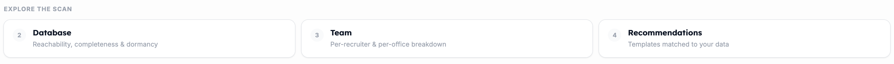
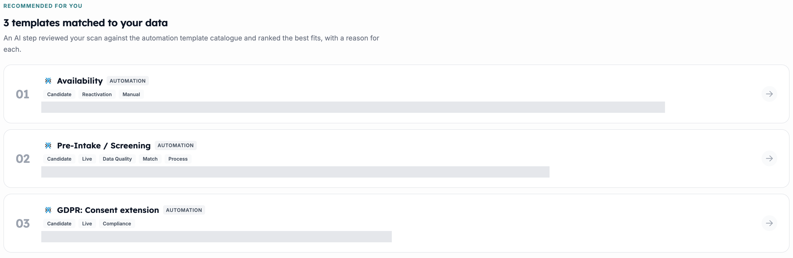

Ein Scan liest Ihre Recruiting-Datenbank aus Ihrer unterstützten ATS-Verbindung und zeigt in einem Bericht, wie erreichbar und aktuell Ihre Kandidaten sind, was Ihr Team erreicht und welche Automatisierungen die Lücken schließen würden.

<Note>
  Scan unterstützt Carerix, Vincere und ATS-Verbindungen über Kombo. Der Zugang mit Spott ist auf einen vereinbarten Piloten begrenzt. Wenden Sie sich an HireData, um den Zugang mit einer aktiven Spott-Verbindung zu vereinbaren, die als Ihre Haupt-App ausgewählt ist.
</Note>

## Was der Bericht zeigt

Der Bericht hat vier Tabs: **Overview**, **Database**, **Team** und **Recommendations**.

### Overview

Die Größe Ihrer Datenbank auf einen Blick, was HireData bereits für Sie geleistet hat, etwa Runs, gesendete E-Mails und Chats, und Links zu den anderen Tabs.

### Database

Wie vollständig und erreichbar Ihre Daten sind, mit getrennten Ansichten für **Candidates**, **Clients** und **Contacts**:

- **Erreichbarkeit:** wie viele Kandidaten Sie per E-Mail, Mobilnummer, WhatsApp und LinkedIn erreichen können und wie viele eingewilligt haben.
- **Inaktiver Pool:** mit wie vielen Kandidaten Sie zuletzt vor 0–90 Tagen, 90–180 Tagen, 180–365 Tagen oder vor mehr als einem Jahr gearbeitet haben.
- **Profilvollständigkeit:** wie viele Profile einen Lebenslauf, Fähigkeiten, Berufserfahrung, Ausbildung und einen bevorzugten Kanal haben.

### Team

Dieselben Zahlen pro Recruiter und pro Standort, auf den Tabs **Recruiters** und **Offices**. Eine Gruppe mit zu wenigen Datensätzen für einen Vergleich ist als **small sample** markiert.

### Recommendations

Eine gereihte Auswahl von Automatisierungsvorlagen, die auf die vom Scan gefundenen Lücken zielen, jeweils mit dem Grund für die Auswahl. Öffnen Sie eine, um sie anzusehen und zu testen, und aktivieren Sie sie, um eine Entwurfsautomatisierung zu erstellen, die Sie prüfen können, bevor sie live geht.

## Einen Spott-Pilotbericht lesen

Der Pilot liest Spott direkt aus und benötigt keine vorherige Datensynchronisierung. Er zählt Kandidaten, Kunden, Kontakte, Stellen, Bewerbungen und Platzierungen, wenn die jeweiligen Daten vollständig gelesen wurden.

- **Kandidaten und Kontakte:** Kandidaten zählen einmal pro Person. Auch Kontakte zählen einmal pro Person, selbst wenn sie Rollen bei mehreren Kunden haben.
- **Bewerbungen:** **Matches** zählt jede Bewerbung einmal, einschließlich Initiativbewerbungen ohne Stelle. Die Aufschlüsselung zeigt, wie viele Bewerbungen sich derzeit in jeder Phase befinden. Eine Phase kann zu mehreren Pipeline-Vorlagen gehören.
- **Erfolgreiche Matches und Platzierungen:** Ein erfolgreicher Match ist eine eindeutige Bewerbung mit einer verknüpften Platzierung. Mehrere Platzierungen zu einer Bewerbung zählen als ein erfolgreicher Match. Platzierungen zählen separat nach Platzierungsdatensatz. Für im Berichtszeitraum erfolgte Platzierungen gilt das Platzierungsdatum, nicht der Vertragsbeginn.
- **Recruiter-Abdeckung:** Aufteilungen nach Recruiter und Standort sind im ersten Piloten nicht verfügbar. Ein aktiver Spott-Benutzer ist nicht automatisch ein Recruiter. Zuständige Benutzer für Bewerbungen erfordern einen separaten Detailabruf. Globale Bewerbungszahlen belegen daher keine Recruiter-Ergebnisse.
- **Nicht verfügbare Zahlen:** Die vollständige datierte Phasenhistorie und historische Konversion sind im ersten Piloten nicht verfügbar. Auch Mobilnummern, WhatsApp-Erreichbarkeit und einige Profildetails sind nicht verfügbar. Eine Telefonnummer allein belegt keine Erreichbarkeit per Mobiltelefon oder WhatsApp.

Bei einem begrenzten oder unvollständigen Abruf bleiben die betroffenen Zahlen unbekannt. Unbekannte Zahlen fließen nicht in den Gesundheitswert, die KI-Zusammenfassung und Empfehlungen ein. Sie bedeuten weder fehlende Aktivität noch schlechte Datenqualität.

## Erneut ausführen

Klicken Sie auf **Run again**, um zu sehen, was sich seit dem letzten Scan geändert hat.

Kann eine Zahl nicht aus Ihrem ATS abgerufen werden, markiert der Bericht sie als fehlend, statt null anzuzeigen. **How this is measured** unten im Bericht erklärt, wie jede Zahl berechnet wird.

## Verwandte Artikel

- [Überblick über die Carerix-Integration](/de/apps/carerix/overview)
