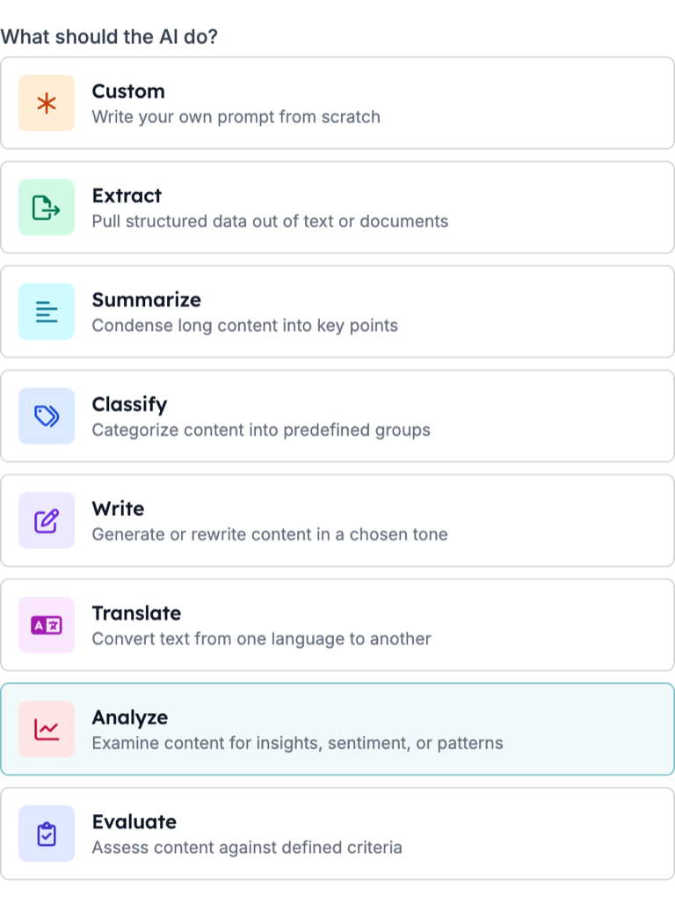
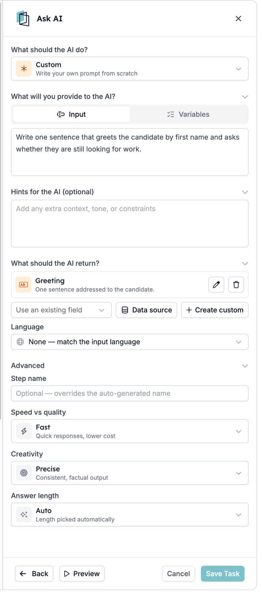
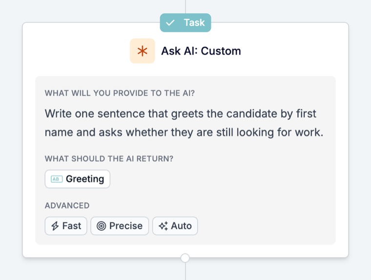

Ask AI ist der Schritt in einer Automatisierung, der die Daten des Runs liest und die Antworten liefert, nach denen Sie fragen: einen Fit-Score, eine Zusammenfassung, eine Kategorie oder einen sauberen Wert aus einem längeren Text. Die Antworten werden als Felder gespeichert, sodass die nächsten Schritte sie in einen Datensatz schreiben oder entscheiden können, wie es weitergeht.

Ein typisches Beispiel: Jeder neue Match erhält einen Fit-Score im Vergleich zur Stelle. Je nach Score matcht die Automatisierung den Kandidaten, lehnt ihn ab oder lädt ihn zu einer Vorauswahl ein. Ein anderes: Jeder Match erhält eine kurze Zusammenfassung für den Recruiter mit Stärken, Lücken und Warnzeichen.

Sie entscheiden, wie die Antworten genutzt werden. Spätere Schritte können automatisch darauf reagieren, ohne dass vorher jemand prüft, und Antworten können sich von Run zu Run unterscheiden. Testen Sie also, bevor eine Antwort einen Kandidaten ablehnt oder eine Nachricht sendet.

Diese Anleitung führt durch Einrichtung, Test und häufige Probleme. Eine Beschreibung jeder Einstellung finden Sie in der [Prompt-Referenz](/de/reference/automations/steps/prompt).

## Bevor Sie beginnen

Klären Sie zuerst zwei Dinge:

- **Die eine Frage, die beantwortet werden soll.** Zum Beispiel: „Passt dieser Kandidat gut zu dieser Stelle?“ Ein Schritt, der eine klare Frage beantwortet, lässt sich leichter testen und ihm lässt sich leichter vertrauen als einem, der fünf Aufgaben erledigt.
- **Was mit der Antwort passiert.** Schreiben Sie sie in den Match, leiten Sie den Kandidaten weiter oder senden Sie eine Nachricht. Wenn nichts die Antwort nutzt, kostet der Schritt bei jedem Run nur Zeit und Geld.

## Den Schritt einrichten

### 1. Ask AI zur Automatisierung hinzufügen

Öffnen Sie die Automatisierung, klicken Sie auf **\+**, wo der Schritt hin soll, und wählen Sie **Prompt**. Das geöffnete Panel trägt die Überschrift **Ask AI**.

Setzen Sie den Schritt nach den Trigger oder die Aufgabe, die die benötigten Daten lädt. Ask AI kann nur lesen, was der Run bereits hat.

### 2. Wählen Sie, was die KI tun soll

Wählen Sie unter **What should the AI do?** die passende Aufgabe:

| Wählen Sie | Wenn Sie |
| --- | --- |
| **Extract** | Bestimmte Werte aus einem Text ziehen möchten, etwa einen Straßennamen aus einer Adresse |
| **Summarize** | Einen langen Text auf ein paar Zeilen für einen Recruiter kürzen möchten |
| **Classify** | Einen Datensatz einer Ihrer eigenen Kategorien zuordnen möchten |
| **Write** | Einen Text in einem gewählten Ton entwerfen oder umschreiben möchten |
| **Translate** | Einen Text in eine andere Sprache übertragen möchten |
| **Analyze** | Etwas beurteilen möchten, etwa wie gut ein Kandidat zu einer Stelle passt |
| **Evaluate** | Einen Text anhand von Kriterien prüfen möchten, die Sie beschreiben |
| **Custom** | Die gesamte Anweisung selbst schreiben möchten |

Jede Option außer **Custom** legt die Ausgabefelder an, die diese Aufgabe üblicherweise liefert, sodass Sie mit bestehenden Feldern beginnen.

### 3. Daten und Anweisung angeben

Unter **What will you provide to the AI?**:

- Schreiben Sie in **Input** die Anweisung und fügen Sie die nötigen Variablen ein, etwa die Stellenbezeichnung und die Erfahrung des Kandidaten.
- Fügen Sie unter **Variables** Felder hinzu, die neben der Anweisung mitgegeben werden sollen, ohne sie in den Text zu schreiben.

Nutzen Sie **Hints for the AI (optional)** für Kontext und Regeln, etwa „Sie sind Recruiter. Wenn der Lebenslauf keinen Führerschein nennt, sagen Sie das, statt zu raten.“

### 4. Festlegen, was zurückkommt

Fügen Sie unter **What should the AI return?** ein Ausgabefeld pro Antwort hinzu:

- **Use an existing field**, um die Antwort einem Feld zuzuordnen, das die Automatisierung bereits kennt.
- **Create custom**, um ein neues Feld anzulegen. Wählen Sie den Typ, der zur Antwort passt: **Number** für einen Score, **Yes / No** für eine Prüfung, **List** für eine Ihrer eigenen Optionen, **Text** für eine Zusammenfassung. Fügen Sie bei einer **List** die erlaubten Werte unter **Options** hinzu.
- Füllen Sie **What is it for? (optional)** aus. Das sagt dem Modell, was in das Feld gehört.

Geben Sie jedem Feld einen eigenen **Reference as**-Namen. Über diesen Namen finden spätere Schritte die Antwort.

<Tip>
  Nutzen Sie ein **List**- oder **Yes / No**-Feld für alles, worauf ein späterer Schritt verzweigt. Eine Liste kann nur eine Ihrer Optionen liefern; Freitext liefert jedes Mal einen anderen Satz.
</Tip>

### 5. Sprache und Modelloptionen einstellen

- **Language**: Lassen Sie **None** stehen, damit in der Sprache der Eingabe geantwortet wird, oder legen Sie eine feste Sprache fest, wenn der Datensatz oder die Nachricht eine erwartet.
- **Advanced**: Wählen Sie **Speed vs quality**, **Creativity** und **Answer length**. Für Scores und Prüfungen liefert **Precise** die einheitlichsten Antworten.

Nach dem Speichern erscheint der Schritt auf der Arbeitsfläche mit seinem Prompt, einem Chip pro Ausgabefeld und den Advanced-Einstellungen:

## Mit Preview testen

Klicken Sie unten im Panel auf **Preview**, dann auf **Generate an example**, um realistische Beispieldaten einzufügen, und führen Sie den Schritt vor dem Speichern aus. Sie können die Beispielwerte ändern, um einen bestimmten Fall zu testen. Prüfen Sie jedes Ausgabefeld, nicht nur das erste.

Testen Sie mehr als einen Fall: einen starken Kandidaten, einen schwachen und einen Datensatz mit fehlenden Informationen. Ist die Antwort für den fehlenden Fall geraten, fügen Sie einen Hinweis hinzu, was zu tun ist, wenn die Information fehlt.

## Die Antwort in späteren Schritten nutzen

In späteren Schritten finden Sie jede Antwort unter dem automatischen Namen des Schritts, mit einem Schlüssel auf Basis des **Reference as**-Werts, etwa `output.fit_score`. Steht Ask AI in einem [Loop](/de/reference/automations/steps/loop), nutzen Sie die Antwort innerhalb dieses Loops oder schreiben Sie sie dort in einen Datensatz; Schritte nach dem Loop können sie nicht lesen. Der Schritt erfasst außerdem:

| Variable | Enthält |
| --- | --- |
| `is_successful` | Ob das Modell eine Antwort geliefert hat, die zu den Feldern passt |
| `reasoning` | Wie das Modell zur Antwort kam |
| `error_message` | Warum es nicht antworten konnte, leer bei Erfolg |

Häufige nächste Schritte:

- **In den Datensatz schreiben.** Eine [Update](/de/reference/automations/steps/update)-Aufgabe schreibt die Zusammenfassung oder den Score in den Match oder Kandidaten.
- **Nur weitermachen, wenn es passt.** Ein [Filter](/de/reference/automations/steps/filter) lässt den Run nur weiterlaufen, wenn ein Score oder Listenwert eine Bedingung erfüllt. Runs, die sie nicht erfüllen, stoppen dort.
- **Unterschiedliche Ergebnisse auf unterschiedliche Wege schicken.** Ein [Split](/de/reference/automations/steps/split) mit einem Filter in jedem Zweig, etwa ein Zweig zum Matchen, einer zum Ablehnen und einer zur Einladung zur Vorauswahl.

## Worauf Sie achten sollten

- **Die Antwort wird sofort genutzt.** Testen Sie mit Preview und einigen echten Datensätzen, bevor die Automatisierung auf die Antwort reagiert, besonders bevor sie einen Kandidaten ablehnt oder eine Nachricht sendet.
- **Ein Schritt ohne Antwort stoppt seinen Run.** Kann das Modell nicht antworten, zeigt der Schritt Cancelled mit dem Grund in der Timeline, und die folgenden Schritte laufen nicht. Innerhalb eines [Split](/de/reference/automations/steps/split) oder [Loop](/de/reference/automations/steps/loop) stoppt nur dieser Zweig oder diese Iteration; andere Zweige und die Schritte nach dem Split oder Loop können weiterlaufen. Siehe [Gründe für abgebrochene Runs](/de/knowledge-base/run-cancellation-reasons).
- **Eine unerwartete Antwort stoppt den Run nicht.** Hängt ein späterer Schritt von der Antwort ab, prüfen Sie sie zuerst mit einem [Filter](/de/reference/automations/steps/filter).
- **Für eine Zeile in einer E-Mail** ist eine [KI-Variable](/de/variables/ai-variables) in der Vorlage einfacher als ein Schritt. Nutzen Sie Ask AI, wenn die Antwort gespeichert werden oder den Run steuern muss.

## Fehlerbehebung bei Ask AI

| Was Sie sehen | Was Sie prüfen |
| --- | --- |
| Die Antwort ist vage oder ignoriert diesen Datensatz | Die Anweisung hat keine Variablen. Fügen Sie die nötigen Felder in **Input** ein oder unter **Variables** hinzu. |
| Ein Ausgabefeld ist immer leer oder wird überschrieben | Zwei Felder haben dasselbe **Reference as**. Geben Sie jedem Feld einen eigenen Namen. |
| Die Antwort ist in der falschen Sprache | **Language** steht auf **None** und folgt daher der Eingabe. Legen Sie eine feste Sprache fest. |
| Antworten unterscheiden sich stark bei ähnlichen Datensätzen | Stellen Sie **Creativity** auf **Precise** und machen Sie die Anweisung konkreter, was eine gute Antwort enthält. |
| Der Run zeigt Cancelled beim Ask-AI-Schritt | Das Modell konnte keine Antwort liefern, die zu den Feldern passt. Lesen Sie den Grund in der Timeline, prüfen Sie die Eingaben und vereinfachen Sie die Felder. |
| Ein späterer Schritt nutzt einen falschen Wert | Prüfen Sie die Ausgabe vor diesem Schritt mit einem **Filter** und testen Sie den Fall in **Preview**. |
| Der Name des Schritts auf der Arbeitsfläche hat sich nicht geändert | **Step name** ändert nur die Überschrift des Panels. Die Karte und die Variablennamen behalten den automatischen Namen. |

Verhält sich der Schritt weiterhin nicht wie erwartet, kontaktieren Sie [support@hiredata.com](mailto:support@hiredata.com) mit dem Namen der Automatisierung, dem Ask-AI-Schritt, einem Beispieldatensatz und der erwarteten Antwort.
