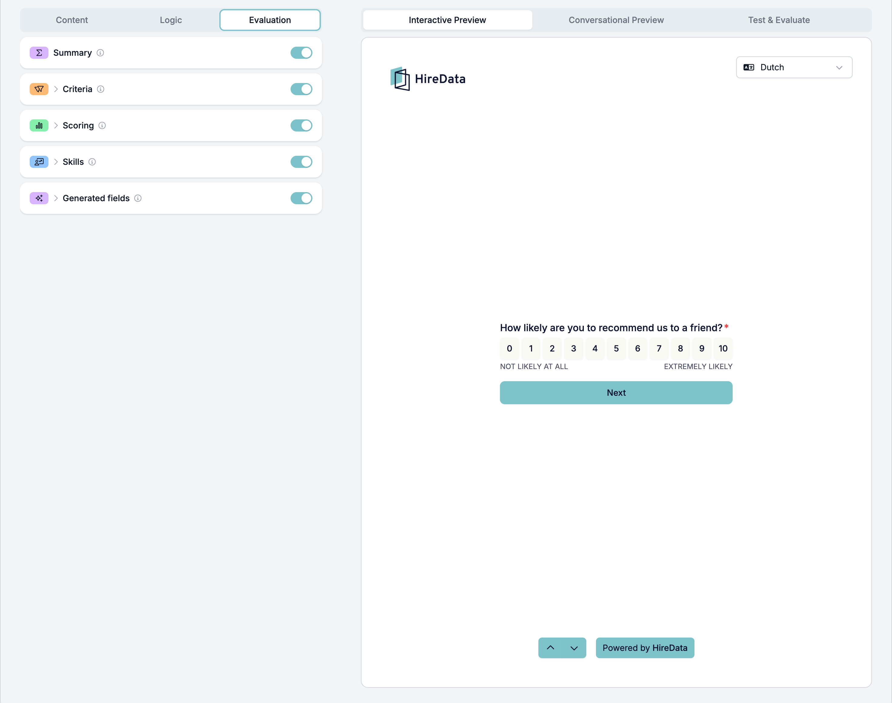
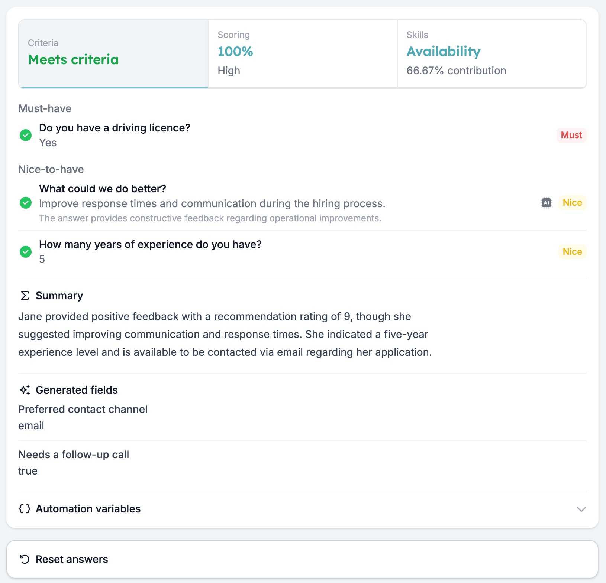
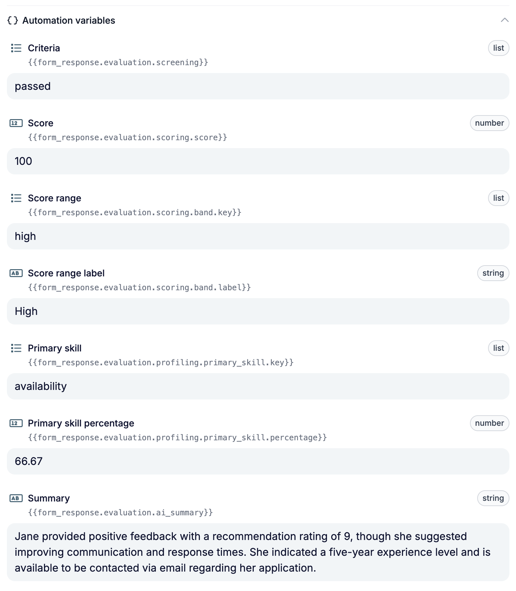

Formularauswertungen übernehmen die erste Runde der Vorauswahl. Sie beschreiben Ihre K.-o.-Fragen und wie eine gute Antwort aussieht einmal, und jede ausgefüllte Antwort wird gleich geprüft: ein Kriterienurteil, eine Punktzahl, ein Fähigkeitsprofil, eine Zusammenfassung für Ihren Recruiter oder eigene Ausgaben. Die Entscheidungen trifft weiterhin Ihr Team.

Diese Anleitung erklärt, wie Sie die Auswertungen einrichten, ihre Ergebnisse prüfen und häufige Einrichtungsprobleme lösen.

## Wählen Sie, was Sie brauchen

Sie können eine Auswertung aktivieren oder mehrere kombinieren.

| Auswertung | Nutzen Sie sie, um | Ergebnis |
| --- | --- | --- |
| **Summary** | Ihrem Team einen kurzen Überblick über die Antwort zu geben. | Ein von KI geschriebener Absatz; keine Einstellungen nötig. |
| **Criteria** | Ihre Must-haves (K.-o.-Fragen) und Nice-to-haves zu prüfen. | Meets criteria, Partially meets criteria, Does not meet criteria oder Incomplete. |
| **Scoring** | Antworten Punkte zu geben. | Ein Prozentwert und ein Label für den Punktebereich, etwa Low, Medium oder High. |
| **Skills** | Zu erkennen, welche eingerichteten Fähigkeiten die Antworten zeigen. | Ein Prozentwert pro Fähigkeit und die stärkste Fähigkeit. |
| **Generated fields** | Werte aus der gesamten Antwort zu extrahieren oder zu erzeugen. | Ein Wert für jede Ausgabe, die Sie definieren. |

Nutzen Sie zum Beispiel Criteria, um eine erforderliche Qualifikation zu prüfen, und Scoring, um Punkte für relevante Erfahrung zu vergeben. Eine Punktzahl ersetzt das Kriterienurteil nicht: Prüfen Sie beides, wenn Sie entscheiden, wie es weitergeht.

## Eine Auswertung einrichten

### 1. Die Auswertung für das Formular aktivieren

Öffnen Sie Ihr Formular und wählen Sie **Evaluation** neben **Content** und **Logic**. Aktivieren Sie die benötigten Auswertungen und klicken Sie auf den Namen einer Auswertung, um ihre Einstellungen zu öffnen.

### 2. Die Fragen auswählen und einrichten

Aktivieren Sie für **Criteria**, **Scoring** und **Skills** jede Frage, die Sie auswerten möchten.

<Warning>
  Sowohl der Schalter auf Formularebene als auch der auf Frageebene muss aktiv sein. Wenn Sie eine Auswertung für das Formular deaktivieren, wertet sie nicht mehr aus, auch wenn die Schalter der Fragen noch aktiv sind.
</Warning>

Richten Sie jede ausgewählte Frage ein:

- **Criteria:** Wählen Sie **Must-have** für eine K.-o.-Frage (Killer Question), bei der eine falsche Antwort bedeutet, dass der Kandidat Ihre Kriterien nicht erfüllt. Wählen Sie **Nice-to-have** für etwas, das hilft zu entscheiden, wen Sie zuerst anrufen, ohne jemanden auszuschließen. Legen Sie dann die erwartete Antwort oder die KI-Anweisungen fest.
- **Scoring:** Legen Sie die maximale Punktzahl der Frage fest und bestimmen Sie, wann Punkte vergeben werden. Wenn Sie KI nutzen, muss das Maximum größer als null sein.
- **Skills:** Fügen Sie die zu bewertenden Fähigkeiten hinzu und legen Sie fest, welche Antworten mit welcher Gewichtung zu jeder Fähigkeit beitragen. Fügen Sie mindestens eine Fähigkeit hinzu, bevor Sie die KI-Bewertung nutzen.

**Summary** arbeitet mit der gesamten Antwort und braucht keine Einrichtung pro Frage. Aktivieren Sie für **Generated fields** die Auswertung und fügen Sie mindestens eine Ausgabe über **Create custom**, **Suggest with AI** oder **Data source** hinzu.

### 3. Antwortregeln oder KI wählen

Wählen Sie unter **How to evaluate?**:

- **Use answer rules** für feste Werte oder Vergleiche, etwa eine gewählte Option oder eine Mindestanzahl an Jahren. Regeln liefern für dieselbe Antwort immer dasselbe Ergebnis.
- **Evaluate with AI**, wenn die Deutung der Antwort wichtig ist, etwa bei einer Erklärung in Freitext. Schreiben Sie konkrete Anweisungen dazu, nach welchen Belegen die KI suchen soll.

Die KI-Anweisung wird für dieselbe Frage von Criteria, Scoring und Skills gemeinsam genutzt. Halten Sie die Anweisungen über alle Auswertungen, die diese Frage nutzen, einheitlich.

Alle Einstellungen finden Sie unter [Criteria](/de/reference/forms/evaluation/criteria), [Scoring](/de/reference/forms/evaluation/scoring), [Skills](/de/reference/forms/evaluation/skills) und [Generated fields](/de/reference/forms/evaluation/generated-fields).

## Ihre Ergebnisse testen

Öffnen Sie **Test & Evaluate** im Vorschaubereich. Geben Sie Antworten manuell ein oder nutzen Sie **Autofill with AI**, um eine Testantwort zu erstellen. Die Auswertung läuft automatisch, wenn Sie eine Antwort eingeben oder ändern.

<Note>
  Eine Auswertung speichert zuerst das Formular, einschließlich ungespeicherter Änderungen. Es entsteht keine eingereichte Antwort, die Zahl der Antworten steigt nicht und es startet keine Automatisierung.
</Note>

Testen Sie Antworten, die Ihre Anforderungen erfüllen, Antworten, die sie nicht erfüllen, und unbeantwortete Fragen. Testen Sie bei Scoring auch Werte knapp unter und genau an jeder Schwelle.

Öffnen Sie die Ergebnisbereiche und prüfen Sie die Details pro Frage:

- **Criteria:** Prüfen Sie, welche Anforderungen erfüllt oder nicht erfüllt wurden und bei KI-Auswertungen die Begründung.
- **Scoring:** Prüfen Sie die Punkte pro Frage und den Gesamtprozentwert.
- **Skills:** Prüfen Sie, wie jede Antwort zum Fähigkeitsprofil beiträgt.

Vergleichen Sie die Zusammenfassung und die erzeugten Ausgaben mit den ursprünglichen Antworten. Fragt eine Ausgabe nach Informationen, die fehlen könnten, erklären Sie mit **Hints for the AI (optional)**, wie fehlende Informationen behandelt werden sollen, etwa indem die Ausgabe leer bleibt.

Unter [Test & Evaluate](/de/reference/forms/testing/test-and-evaluate) finden Sie die Testszenarien und Ergebnisbereiche.

## Die Ergebnisse verstehen

**Criteria nutzt ein Urteil in fester Reihenfolge.** Ein beantwortetes Must-have, das nicht erfüllt ist, ergibt **Does not meet criteria**. Andernfalls ergibt eine fehlende Antwort auf eine ausgewertete Frage **Incomplete**. Sind alle ausgewerteten Fragen beantwortet, ergibt ein nicht erfülltes Nice-to-have **Partially meets criteria**; ist alles erfüllt, lautet das Ergebnis **Meets criteria**. Prüfen Sie Fragen, die durch Formularlogik übersprungen wurden, wenn Sie ein unvollständiges Ergebnis untersuchen.

**Scoring basiert auf der Gesamtpunktzahl.** Der Prozentwert ist die erreichte Punktzahl geteilt durch die addierten Maximalpunkte der eingerichteten Fragen. Eine unbeantwortete bewertete Frage bringt null Punkte, zählt aber zum Maximum. Zutreffende Regeln werden addiert, begrenzt auf das Maximum der Frage.

**Prozentwerte bei Skills zeigen relative Anteile.** Sie beschreiben den Anteil jeder Fähigkeit am Gesamtgewicht. Eine Fähigkeit bei 80 % bedeutet nicht, dass die Person eine Kompetenzbewertung von 80 % erreicht hat.

**Generated fields laufen nach Criteria, Scoring und Skills.** Sie können die Antworten und diese Auswertungsergebnisse nutzen, um die definierten Ausgaben zu erzeugen.

## Probleme bei einer Auswertung beheben

| Was Sie sehen | Was Sie prüfen |
| --- | --- |
| Es erscheint kein Ergebnis | Aktivieren Sie die Auswertung für das Formular, aktivieren Sie die relevanten Fragen und richten Sie ihre Regeln oder KI-Einstellungen ein. Geben Sie eine Testantwort ein. |
| Ein regelbasiertes Kriterium beeinflusst das Urteil nie | Prüfen Sie, ob es Bedingungen hat. Ein Kriterium ohne Bedingungen wird übersprungen. |
| KI-Scoring gibt einen Fehler zurück | Setzen Sie die maximale Punktzahl der Frage auf eine Zahl größer als null. |
| Die KI-Bewertung der Fähigkeiten gibt einen Fehler zurück | Fügen Sie dem Formular mindestens eine Fähigkeit hinzu. |
| Eine Punktzahl hat einen Prozentwert, aber kein Bereichslabel | Legen Sie einen Punktebereich mit einem Minimum von 0 % an und prüfen Sie die anderen Schwellen. |
| Die Punktzahl ist niedriger als erwartet | Prüfen Sie unbeantwortete oder übersprungene bewertete Fragen und die Maximalpunkte jeder Frage. |
| Generated fields liefern nichts | Fügen Sie mindestens ein Ausgabefeld hinzu. |
| KI-Ergebnisse passen nicht zu Ihrer beabsichtigten Auswertung | Prüfen Sie die gemeinsamen KI-Anweisungen der Frage, die Fähigkeitsbeschreibungen oder die Hinweise der Generated fields und testen Sie erneut. |

## Die Auswertungsergebnisse nutzen

Ausgefüllte Antworten werden ausgewertet und die Ergebnisse mit ihnen gespeichert. Nutzen Sie **Export CSV** oder **Export Excel** im Drei-Punkte-Menü des Builders, um Ergebnisse zu exportieren, einschließlich Fähigkeitsprozentwerten und Generated fields.

Um ein Ergebnis in einer Automatisierung zu nutzen, öffnen Sie **Automation variables** unten in **Test & Evaluate** und kopieren Sie die Variable neben Ihrem Testwert. Das Kriterienurteil nutzt zum Beispiel `{{form_response.evaluation.screening}}` mit den Werten `passed`, `passed_with_restrictions`, `rejected` oder `incomplete`.

Da jede Antwort ausgewertet wird, sobald sie ausgefüllt ist, kann eine Automatisierung jeden Kandidaten sofort nachfassen. Setzen Sie den Match zum Beispiel in die nächste Phase, wenn das Ergebnis **Meets criteria** lautet, und senden Sie Kandidaten, die Ihre Kriterien nicht erfüllen, ein kurzes Update, damit niemand warten muss.

<Warning>
  Es gibt noch keinen Freigabeschritt: Eine Automatisierung nutzt das Ergebnis, sobald es gespeichert ist. Testen Sie Ihre KI-Anweisungen in **Test & Evaluate**, bevor ein Ergebnis eine Nachricht an Kandidaten auslöst.
</Warning>

Ein ausgearbeitetes Beispiel finden Sie unter [Bewerber mit einem Vorauswahlformular prüfen und bewerten](/de/knowledge-base/cookbook/pre-screening-form).

Sieht ein Ergebnis weiterhin falsch aus, kontaktieren Sie [support@hiredata.com](mailto:support@hiredata.com) mit dem Namen des Formulars, der betroffenen Auswertung und Frage, der getesteten Antwort sowie dem erwarteten und tatsächlichen Ergebnis.
