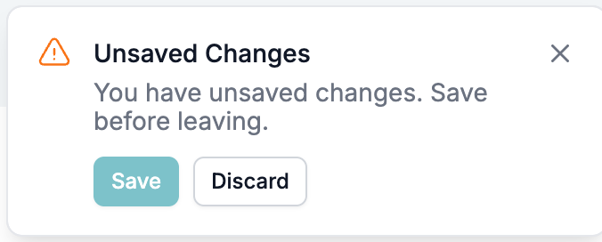

Eine E-Mail-Vorlage ist eine Nachricht, die Sie einmal schreiben und viele Male versenden, in einer Automatisierung oder einem Newsletter. Öffnen Sie **Settings**, dann **Emails** unter **Templates**, und klicken Sie auf **New Email**. Wählen Sie **Blank Email** oder eine der fertigen Vorlagen, und die neue Vorlage öffnet sich im Builder.

Diese Seite kartiert den Builder. Für eine Anleitung, die eine E-Mail von leer bis fertig begleitet, lesen Sie [Eine E-Mail-Vorlage in HireData einrichten](/de/apps/messaging/emails/setting-up-an-email-template-in-hiredata).

## Der Builder auf einen Blick

Der Builder hat drei Teile.

- Das **Subject**-Feld oben quer über die Breite. Es ist die Zeile, die der Empfänger in seinem Posteingang sieht, und es akzeptiert Variablen.
- Die E-Mail selbst, in der Breite, die Ihre Empfänger sehen. Sie wählen und bearbeiten alles direkt darin.
- Die Seitenleiste rechts mit drei Tabs: **Styles** für die Einstellungen dessen, was Sie ausgewählt haben, **Add** für neue Blöcke, Layouts und Sektionsvorlagen, und **Global** für die Einstellungen der ganzen E-Mail.

Eine Vorlage enthält Sektionen, und eine Sektion enthält die Blöcke, die der Empfänger liest. [Template](/de/reference/email-builder/template) erklärt, wie die Ebenen ineinander verschachtelt sind.

## Auswählen und bearbeiten

- **Fahren Sie mit der Maus** über einen Block oder eine Sektion, um ihn mit seinem Namen zu umranden.
- **Klicken** Sie, um ihn auszuwählen. Seine Einstellungen öffnen sich in **Styles**.
- **Klicken Sie erneut auf einen ausgewählten Textblock** oder doppelklicken Sie darauf, um den Text zu bearbeiten.
- **Escape** beendet zuerst das Bearbeiten und hebt dann die Auswahl auf.
- **Tastatur:** **Tab** wählt den ersten Block, mit den Pfeiltasten wechseln Sie zwischen Blöcken, **Enter** bearbeitet und **Delete** entfernt.

Ein ausgewählter Block zeigt eine Aktionsleiste mit **Move**, **Add below**, **Duplicate** und **Delete** sowie ein Menü mit den Einstellungen für diese Blockart. Bei einem Block, der höher als der Bildschirm ist, bleibt das Menü sichtbar.

### Text

- **Enter** beginnt eine neue Zeile im Absatz oder in der Überschrift. Es entsteht kein neuer Block.
- **Listen:** Machen Sie Zeilen zu einer Aufzählung oder nummerierten Liste. Enter setzt die Liste fort.
- **Das Textmenü** legt Schriftart, Größe, Farbe, Hervorhebung, Ausrichtung, Liste und Link fest, weiteres unter **More**. Es formatiert den ganzen Block oder nur den ausgewählten Text.
- **Links:** Die Link-Schaltfläche öffnet ein Menü, um einen Link hinzuzufügen, zu ändern oder zu entfernen. Einem Link ohne "https" wird es automatisch hinzugefügt.

## Hinzufügen, kopieren und verschieben

- **Der Tab Add** listet Layouts, Sektionsvorlagen und Inhaltsblöcke. Ziehen Sie einen auf die E-Mail: Eine Linie zeigt, wo er landet.
- **Add below** fügt einen Block unter dem ausgewählten ein. Ein neuer Textblock startet direkt im Bearbeitungsmodus.
- **Duplicate** kopiert einen Block oder eine Sektion, einschließlich der Übersetzungen.
- **Move** zieht einen Block oder eine Sektion an die Linie, an der Sie loslassen. Escape bricht ab.
- **Sektionen** stehen nur auf der obersten Ebene der E-Mail, nie in einer anderen Sektion.
- **Eine geleerte Sektion oder Spalte** behält ihren Platz und zeigt einen Bereich, in dem Sie einen Block ablegen oder hinzufügen können.

## Einen Block auswählen {#choosing-a-block}

| Block | Was er in die E-Mail setzt |
| --- | --- |
| [Section](/de/reference/email-builder/sections) | ein Band quer über die E-Mail, mit eigenem Hintergrund, Innenabstand und Rahmen |
| Geteilte Sektion | eine Sektion, die in Spalten nebeneinander geteilt ist, mit eigenem Layout und Abstand. Sie wird als ein Block ausgewählt und verschoben |
| [Paragraph](/de/reference/email-builder/blocks/paragraph) | Fließtext, auch Aufzählungen und nummerierte Listen |
| [Heading](/de/reference/email-builder/blocks/heading) | eine Überschrift, auf der Ebene, die Sie wählen |
| [Form](/de/reference/email-builder/blocks/form) | Schaltflächen, die eine Frage aus einem Ihrer Formulare beantworten |
| [Image](/de/reference/email-builder/blocks/image) | ein Bild aus Ihrer Medienbibliothek oder eines aus einer Variablen |
| [Socials](/de/reference/email-builder/blocks/socials) | eine Reihe von Social-Icons, eines pro Link |
| [Button](/de/reference/email-builder/blocks/button) | ein Call-to-Action, der eine URL öffnet |
| Divider | eine Linie zwischen Blöcken |
| Whitespace | Leerraum zwischen Blöcken |
| [HTML](/de/reference/email-builder/blocks/html) | Markup, das Sie selbst schreiben |
| [Signature](/de/reference/email-builder/blocks/signature) | ein Bild neben einem Block mit Grußtext |

Spalten fügen Sie als geteilte Sektion hinzu. Spalten in E-Mails von vor dieser Änderung bleiben erhalten und lassen sich weiterhin duplizieren.

## Abstände

Wählen Sie einen Block und klicken Sie auf **Spacing**, um seine Außen- und Innenabstände auf der Arbeitsfläche zu sehen. Ziehen Sie einen Griff oder geben Sie einen Wert ein, und ändern Sie mit dem Schloss mehrere Seiten zugleich. **Done** übernimmt die Werte. Das Abstandsfeld in **Styles** ändert dieselben Werte. Paragraph-, Heading- und Socials-Blöcke haben auch einen linken und rechten Außenabstand.

## Einstellungen für die ganze E-Mail

Der Tab **Global** enthält die Vorlageneinstellungen und **All sections**. Eine Änderung unter **All sections** gilt für jede Sektion, auch für Sektionen, die Sie später hinzufügen.

**Section width** legen Sie einmal für die ganze E-Mail fest: **Default**, **Wide** (640px), **Large** (700px) oder **Custom** (zwischen 640 und 1240 Pixeln). Auch Hintergrund, Linkfarbe und Schriftarten legen Sie hier fest.

## Die Toolbar

Die Toolbar verläuft oben im Builder, von **Save** bis zu den vier Drawer-Schaltflächen rechts.

**Save** speichert Ihre Änderungen. **Undo** und **Redo** stehen daneben und funktionieren auch mit den üblichen Tastenkürzeln. Jede Aktion ist ein Schritt, etwa ein ganzer Ziehvorgang oder eine Änderung in einem Feld der Seitenleiste.

Zwei Schaltflächen folgen darauf:

- Das Auge öffnet eine [Vorschau](/de/reference/email-builder/testing#the-preview) der fertigen E-Mail, in Mobil-, Tablet- oder Desktop-Breite, mit einer Sprachauswahl und einer **Copy Preview URL**-Schaltfläche. Der Tooltip warnt, dass die E-Mail zuerst gespeichert wird.
- Der Papierflieger öffnet [Test Email](/de/reference/email-builder/testing#sending-a-test-email). Er sendet die E-Mail mit realistisch ausgefüllten Werten an Sie.

**Brand** wählt die Marke, aus der die Farben, Schriftarten und das Logo der E-Mail stammen.

Zwei Umschalter folgen auf die Brand-Auswahl:

- **Show variable values** ist ein Anzeige-Umschalter für die Arbeitsfläche. Um eine E-Mail mit echten Werten zu lesen, verwenden Sie die [Vorschau](/de/reference/email-builder/testing#the-preview).
- **Show code editor** öffnet das generierte Markup. Er erscheint nur für Konten, die Vorlagen direkt bearbeiten dürfen.

Vier Schaltflächen am Ende öffnen Drawer über der E-Mail:

- **Show variable list** listet die Variablen auf, die diese E-Mail verwenden kann, und fügt eigene hinzu. Siehe [Variablen](/de/reference/email-builder/variables).
- **Manage Template** veröffentlicht die geöffnete E-Mail in der geteilten Vorlagenbibliothek. Sie erscheint nur für Konten, die diese Bibliothek pflegen.
- **Show objects** verknüpft Datensätze wie eine Vakanz oder einen Match mit der E-Mail. Ihre Felder werden dann zu [Variablen](/de/reference/email-builder/variables#bringing-in-a-records-fields), die Sie hineinschreiben können.
- **Manage Languages** legt die Standardsprache der E-Mail und ihre [Übersetzungen](/de/reference/email-builder/translations) fest.

## Brand und Theme

Jede Farbe und Schriftart in einer neuen E-Mail beginnt als Wert aus der Marke, die Sie in **Brand** wählen. Das Panel benennt den Wert, statt einen Hex-Code zu zeigen, etwa "Theme: Palette Surface Color".

Wechseln Sie **Brand**, und die ganze E-Mail wird neu gestylt, einschließlich der Blöcke, die Sie bereits geschrieben haben. Ersetzen Sie einen dieser Werte durch eine eigene Farbe, und dieses eine Bedienelement folgt der Marke nicht mehr. Siehe [Template](/de/reference/email-builder/template#brand-theme-and-metadata) für die Einstellungen, die das entscheiden, und für den Unterschied zwischen dem Wechseln der Marke und dem Setzen eines Themes.

## Speichern

Der E-Mail-Builder speichert nicht, während Sie tippen. **Save** speichert. Die Vorschau-Schaltfläche und **Send test email** speichern jeweils, bevor sie laufen, sodass beide alles übernehmen, was Sie geändert haben. Siehe [Testen](/de/reference/email-builder/testing).

Machen Sie jede Änderung rückgängig, gilt die E-Mail nicht mehr als ungespeichert.

Versuchen Sie, den Builder mit ungespeicherten Änderungen zu verlassen, erscheint eine Warnung. Sie bietet an, sie zu speichern (**Save**) oder sie zu verwerfen (**Discard**) und fortzufahren.

Laden Sie die Seite stattdessen neu oder schließen Sie den Tab, bittet Ihr Browser um Bestätigung, bevor Sie die Änderungen verlieren.

## Verwandte Themen

- [Eine E-Mail-Vorlage in HireData einrichten](/de/apps/messaging/emails/setting-up-an-email-template-in-hiredata) begleitet eine E-Mail von leer bis fertig.
- [Bilder zu Ihren E-Mails hinzufügen](/de/apps/messaging/emails/adding-images-to-your-emails) behandelt die Medienbibliothek.
- [Variablen](/de/reference/email-builder/variables) behandelt die Auswahl, die Fallbacks und wie ein fehlender Wert aussieht.
- [Übersetzungen](/de/reference/email-builder/translations) behandelt das Versenden einer E-Mail in mehreren Sprachen.
- [Testen](/de/reference/email-builder/testing) behandelt die Vorschau, den Test-Versand und was keines von beiden beweist.
- [Formular-Builder: Überblick](/de/reference/forms/overview) behandelt die Formulare, auf die ein Form-Block zeigen kann.
