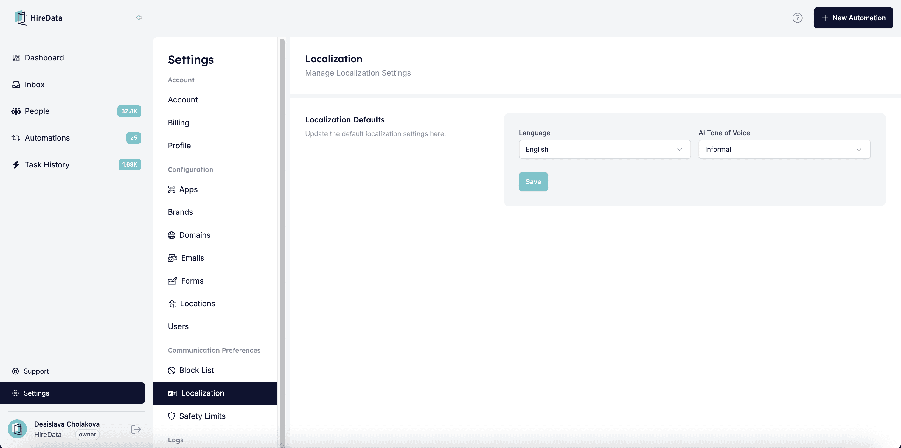
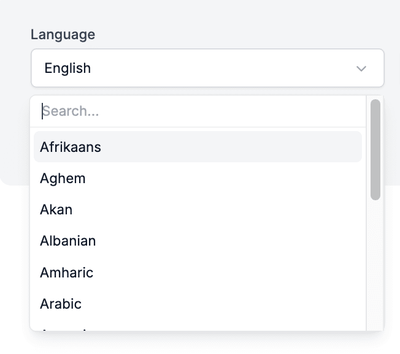
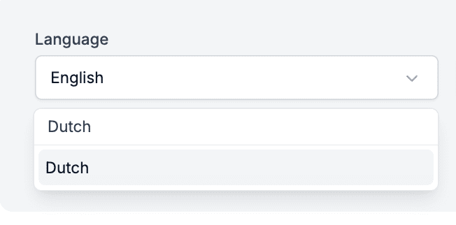
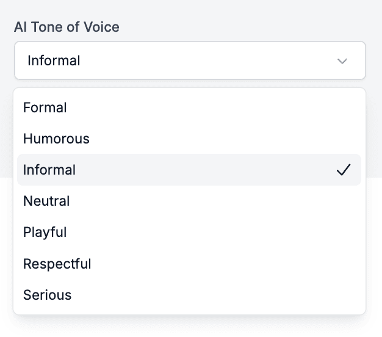
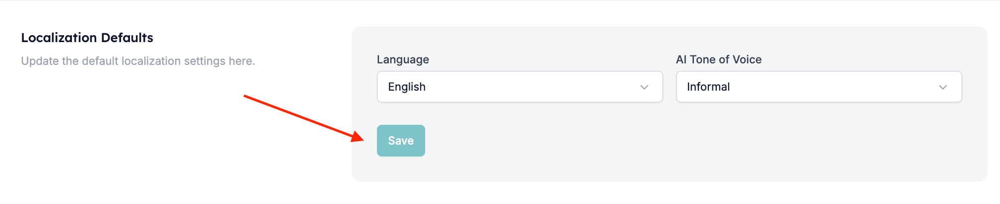
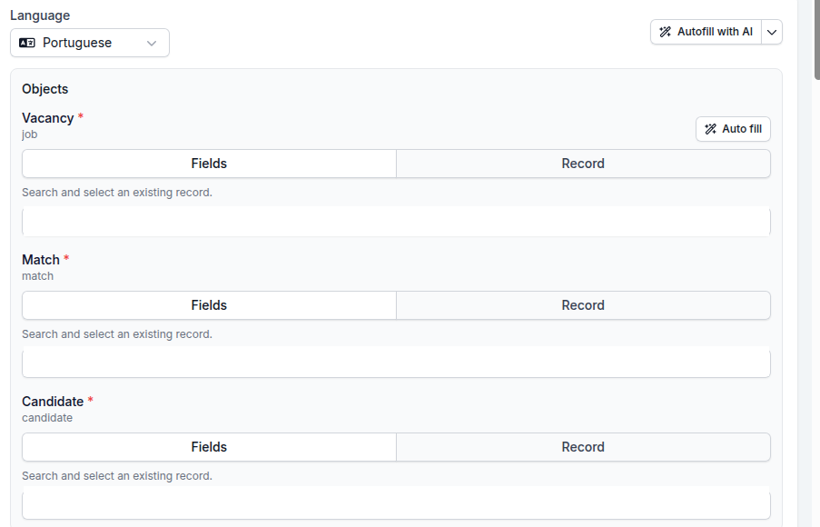
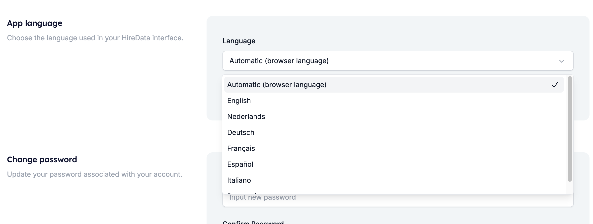

_Das Anpassen der Lokalisierungseinstellungen Ihres HireData-Kontos stellt sicher, dass Ihre Kommunikation zu Ihrer Zielgruppe und Marke passt. Diese Anleitung führt Sie durch das Konfigurieren dieser Einstellungen und das Anpassen an Ihre spezifischen Anforderungen._

## Schritt 1: Die Localization-Seite öffnen

Navigieren Sie zum Menü **Settings** in HireData und öffnen Sie die Seite **Localization**. Dort können Sie eine Standardsprache für Ihre Vorlagen und einen AI Tone of Voice für Ihre WhatsApp-Konversationen auswählen.

## Schritt 2: Die Standard-Lokalisierungseinstellungen aktualisieren

### **2.1. Eine Standardsprache festlegen**

Klicken Sie auf die **Language**-Box, um eine umfangreiche Liste der verfügbaren Sprachen zu öffnen.

_Wenn die gewünschte Sprache nicht sofort sichtbar ist, verwenden Sie die Suchleiste, um sie schnell zu finden:_

### **2.2. Einen Tone of Voice festlegen**

Klicken Sie auf die **Tone of Voice**-Box, um die verfügbaren Optionen anzusehen, und wählen Sie den Ton, der am besten zu Ihrem Branding und Ihren Kommunikationsanforderungen passt.

## Schritt 3: Prüfen und speichern

Überprüfen Sie Ihre ausgewählte Sprache und Ihre Tone-of-Voice-Einstellungen. Klicken Sie auf die Schaltfläche **Save**, um die Änderungen zu übernehmen.

## Feldwerte in der Sprache des Kandidaten

Werte aus Ihrem ATS, etwa die Branche einer Stelle, die Art des Arbeitsplatzes oder die geforderten Sprachen, erscheinen jetzt in der Sprache des Formulars, der WhatsApp-Nachricht oder der E-Mail, in der sie stehen. Ein portugiesisches Pre-Screening-Formular zeigt **Presencial** statt **On site**, auch wenn Ihr Konto auf Englisch eingestellt ist.

Das gilt auch für Werte aus verknüpften Datensätzen, etwa die Stelle hinter einem Match, und für Auswahloptionen in einem Formular.

HireData wählt das Label in dieser Reihenfolge:

1. Die Sprache des Formulars, der Nachricht oder der E-Mail.
2. Die Standardsprache Ihres Kontos auf der Seite **Localization**.
3. Der ursprüngliche Wert aus Ihrem ATS, wenn es keine Übersetzung gibt.

<Note>
  HireData kann nur eine Übersetzung anzeigen, die in Ihrem ATS vorhanden ist. In Carerix müssen die Übersetzungen Ihrer Listenwerte aktiviert und ausgefüllt sein.
</Note>

Um ein Formular zu prüfen, öffnen Sie **Test & Evaluate**, wählen die Sprache und einen echten **Vacancy**, **Match** oder **Candidate**. Die Fragen zeigen dann die Werte, die dieser Datensatz erhält.

## Ihre eigene App-Sprache festlegen

Die Localization-Seite legt die Sprache für das gesamte Konto fest. Jeder Benutzer wählt die Sprache seiner eigenen HireData-Oberfläche separat.

Öffnen Sie **Settings**, dann **Profile**, und gehen Sie zu **App language**. Wählen Sie eine Sprache und klicken Sie auf **Save language**.

Der Standard ist **Automatic (browser language)**, was der Sprache folgt, die Ihr Browser anfragt. Sie können auch English, Nederlands, Deutsch, Français, Español, Italiano oder Português wählen.

Wenn keine Benutzereinstellung greift und keine Browser-Sprache zugeordnet werden kann, fällt HireData auf die Kontosprache von der Localization-Seite zurück.

<Note>
  Diese Einstellung ändert nur die HireData-Oberfläche. Die Sprache der E-Mails, Nachrichten und Inhalte, die Sie versenden, richtet sich weiterhin nach dem Kontostandard und der von Ihnen verwendeten Vorlage. Die Übersetzung der Oberfläche ist noch in Arbeit, daher bleiben Teile der App auf Englisch.
</Note>
