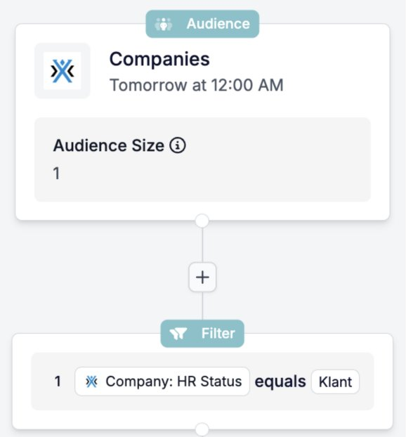
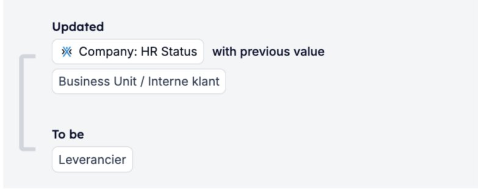

Dans Carerix, une entreprise peut avoir un statut par ligne métier (business line), par exemple un pour HR et un pour Finance. HireData affiche chacun de ces statuts comme un champ à part, nommé d'après la ligne métier, par exemple **Company: HR Status**. Une automatisation peut désormais vérifier ou modifier le statut d'une seule ligne métier.

Avant, tous les statuts de ligne métier arrivaient dans un seul champ, **Company: Status**, et une automatisation ne pouvait pas savoir quelle ligne métier elle consultait ou mettait à jour.

## Filtrer sur une ligne métier

Utilisez le champ de la ligne métier partout où vous filtrez des entreprises :

- le filtre de départ d'une automatisation
- une étape **Filter**
- l'audience d'une automatisation planifiée sur des entreprises

Par exemple, **Company: HR Status** est égal au statut que vous ciblez. Les entreprises qui ont ce statut dans une autre ligne métier ne passent pas.

## Mettre à jour une ligne métier

Dans une [tâche **Update Field(s)** dans Carerix](/fr/apps/carerix/update-fields-in-carerix-with-hiredata), choisissez le champ de statut de la ligne métier à modifier, comme **Company: HR Status**, puis la nouvelle valeur. Seul le statut de cette ligne métier change. Les autres lignes métier gardent le leur.

Par exemple : quand un placement est créé, passez le statut du client pour cette ligne métier à la valeur que votre équipe utilise pour les clients actifs.

## Vérifier ce qui a changé

Ouvrez une exécution et cliquez sur l'étape de mise à jour. Elle affiche le champ avec sa valeur précédente, et la nouvelle valeur sous **To be**.

## Articles liés

- [Mettre à jour des champs dans Carerix](/fr/apps/carerix/update-fields-in-carerix-with-hiredata)
- [Filter](/fr/reference/automations/steps/filter)
- [Activer les champs et relations Carerix](/fr/apps/carerix/how-to-enable-carerix-fields-and-relationships-in-your-automations)
