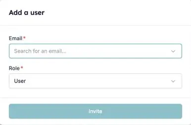

Vous avez activé la RMA HireData dans Carerix, mais certains de vos collègues ne sont pas dans HireData. HireData synchronise vos utilisateurs Carerix lors de la connexion, puis chaque jour. Si quelqu'un manque encore après une [synchronisation manuelle](/fr/apps/carerix/manually-sync-carerix-with-hiredata), l'une des raisons ci-dessous en est généralement la cause.

### 1. L'utilisateur utilise déjà HireData dans un autre compte

Une personne a un seul identifiant HireData, et cet identifiant peut appartenir à plusieurs comptes. C'est le cas quand votre organisation utilise plusieurs environnements Carerix, par exemple un par marque ou par label.

Si la personne utilise déjà HireData via un autre environnement, invitez-la aussi dans ce compte :

1. Ouvrez **Settings** et allez dans **Users**.
2. Cliquez sur **Add User**, saisissez l'adresse e-mail de la personne et choisissez son rôle.
3. La personne accepte l'invitation depuis sa boîte e-mail.

<Frame caption="Invitez un collègue qui utilise déjà HireData dans un autre compte.">
  
</Frame>

Une fois l'invitation acceptée, la personne ouvre le menu sous son nom, choisit **Switch Account** et sélectionne le compte dont elle a besoin. Consultez [Inviter des utilisateurs dans votre compte](/fr/introduction/invite-users-to-your-account) pour les rôles et le renvoi d'une invitation.

### 2. L'utilisateur n'a pas d'adresse e-mail dans Carerix

HireData reconnaît les utilisateurs à leur adresse e-mail. Un utilisateur Carerix sans adresse ne peut pas être associé à un utilisateur HireData. Ajoutez l'adresse e-mail dans Carerix, puis lancez une [synchronisation manuelle](/fr/apps/carerix/manually-sync-carerix-with-hiredata).

### 3. L'utilisateur a une adresse partagée générique

Des adresses comme `projects@carerix.com` et `test@example.com` n'appartiennent pas à une seule personne réelle : HireData ne les synchronise donc jamais. Donnez à l'utilisateur sa propre adresse e-mail dans Carerix et synchronisez à nouveau.

## Essayez par vous-même

Ouvrez [Users dans HireData](https://app.hiredata.com/settings/account/users) pour voir qui est synchronisé et inviter les personnes manquantes. Toujours bloqué ? Contactez-nous via le chat dans HireData.
