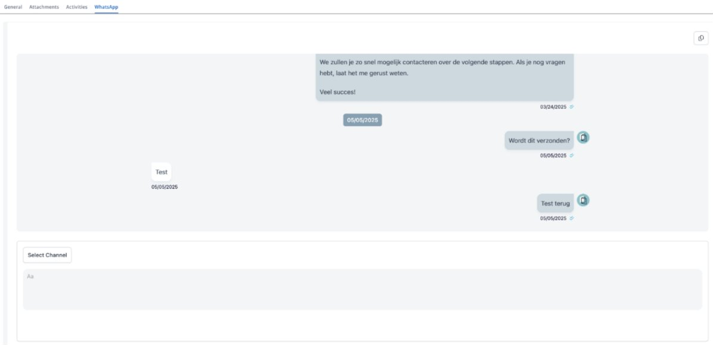

Quand vous ouvrez un candidat ou un match dans Carerix, l'onglet **WhatsApp** affiche la conversation WhatsApp avec ce candidat. Vous voyez la discussion là où vous travaillez déjà, par exemple en préparant un appel, au lieu de la chercher dans la boîte de réception.

## Où le trouver

- **Candidat :** ouvrez le candidat et cliquez sur l'onglet **WhatsApp**, à la fin de la rangée d'onglets.
- **Match :** ouvrez le match et cliquez sur l'onglet **WhatsApp**, à côté de **General**, **Attachments** et **Activities**. Il affiche la discussion avec le candidat de ce match.

L'onglet fait partie de l'app HireData dans Carerix (Carerix RMA). Si vous ne le voyez pas, vérifiez que l'app est [connectée](/fr/apps/carerix/connect-with-carerix).

## Ce que montre l'onglet

- Chaque message de la conversation, envoyé ou reçu, avec sa date.
- Les fichiers que le candidat vous a envoyés, comme un CV.
- Une zone de message en bas. Choisissez un canal sous **Select Channel**, saisissez votre message et envoyez-le.

WhatsApp ne permet d'envoyer un message libre que dans les 24 heures suivant la dernière réponse du candidat. Ensuite, commencez par un modèle approuvé. Voir [Les bases de la boîte de réception WhatsApp](/fr/apps/messaging/whatsapp/whatsapp-inbox-basics).

## Articles liés

- [Compteur de conversations WhatsApp actives dans Carerix RMA](/fr/apps/carerix/whatsapp-active-chats-counter-in-carerix-rma)
- [Consigner les conversations WhatsApp dans Carerix](/fr/apps/carerix/logging-whatsapp-conversations-in-carerix-with-hiredata)
