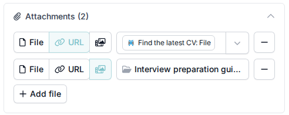
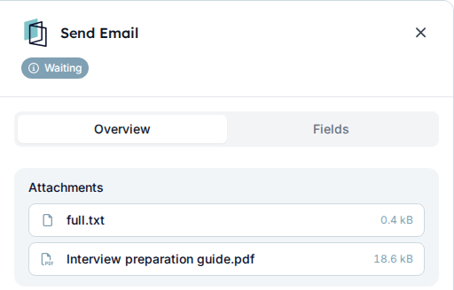

La tâche **Send Email** peut maintenant joindre des fichiers. Envoyez le dernier CV d'un candidat au recruteur ou à un client, ou ajoutez le même PDF, comme un guide de préparation à l'entretien, à chaque e-mail envoyé par une automatisation.

## Où ajouter des pièces jointes

Ouvrez la tâche **Send Email** dans votre automatisation. Sous **Settings**, vous trouvez la section **Attachments**, à côté de **Recipient**, **CC and BCC** et **Sender**.

Cliquez sur **Add file** pour ajouter une ligne. Chaque ligne propose trois sources :

- **File** joint un fichier issu d'une étape précédente de l'automatisation, comme le CV d'un candidat. Choisissez-le dans **Choose an uploaded file**.
- **URL** joint le fichier situé à une adresse web.
- **Media library** (l'icône d'image) joint un fichier que vous avez importé dans HireData, comme un PDF standard.

Ajoutez autant de lignes que nécessaire. Le bouton **−** supprime une ligne.

## Joindre le dernier CV d'un candidat

Pour joindre un fichier enregistré sur un enregistrement Carerix ou Spott, trouvez-le d'abord avec une étape **Find**, puis joignez-le.

1. Avant la tâche **Send Email**, ajoutez une étape **Find** qui recherche les fichiers du candidat. S'il y en a plusieurs, le plus récent vient en premier : vous obtenez donc le dernier CV. Voir [Rechercher des enregistrements](/fr/automations/look-up-records).
2. Dans la tâche **Send Email**, ouvrez **Attachments** et cliquez sur **Add file**.
3. Laissez **File** sélectionné et choisissez le fichier de votre étape **Find**, par exemple **Find the latest CV: File**.
4. Enregistrez la tâche.

## Vérifier ce qui a été envoyé

Ouvrez une exécution de l'automatisation. L'étape **Send Email** liste les fichiers joints à l'e-mail.

<Tip>
  Testez d'abord avec un candidat de test et votre propre adresse, et vérifiez l'e-mail reçu avant d'activer l'automatisation pour de vrais candidats.
</Tip>

Les pièces jointes fonctionnent dans toutes les automatisations, y compris celles créées avant le nouveau builder d'automatisations.

## Articles liés

- [Tâche Send Email](/fr/reference/automations/tasks/send-email) explique chaque réglage de la tâche.
- [Rechercher des enregistrements](/fr/automations/look-up-records) explique l'étape Find.
