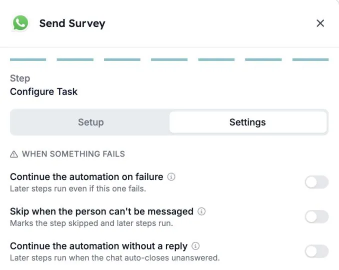
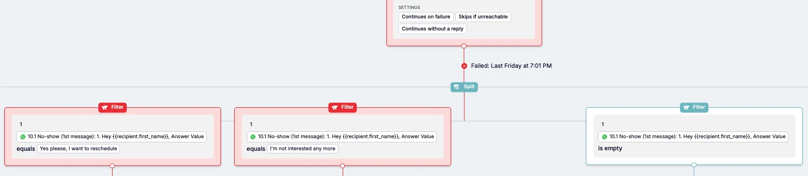

Tous les candidats ne répondent pas à votre WhatsApp. Certains ne répondent jamais, d'autres ne peuvent pas du tout être contactés. Chaque étape WhatsApp d'une automatisation a désormais des réglages qui décident de la suite : arrêter l'exécution, ou continuer pour qu'une étape suivante assure la relance.

Ce guide explique les trois réglages, comment les activer et comment créer une relance pour les candidats qui ne répondent pas.

## Les trois réglages

Vous les trouvez dans l'étape WhatsApp, dans l'onglet **Settings**, sous **When something fails**.

| Réglage | Effet |
| --- | --- |
| **Continue the automation on failure** | Les étapes suivantes s'exécutent, même si l'étape WhatsApp échoue. |
| **Skip when the person can't be messaged** | L'étape est marquée comme ignorée et les étapes suivantes s'exécutent. |
| **Continue the automation without a reply** | Les étapes suivantes s'exécutent quand la conversation se ferme sans réponse. |

**Continue the automation without a reply** n'est disponible que pour les conversations WhatsApp.

### Qui « ne peut pas être contacté »

**Skip when the person can't be messaged** s'applique aux personnes qui :

- n'ont pas de numéro de téléphone
- se sont désinscrites
- sont bloquées
- ont déjà une conversation ouverte
- ont atteint la limite de conversations de l'automatisation

## Ce qui se passe si vous ne changez rien

- **Les nouvelles étapes WhatsApp** arrêtent l'exécution quand l'étape échoue et quand le candidat ne répond pas.
- **Les étapes WhatsApp existantes** gardent leur comportement précédent. Les nouveaux réglages restent désactivés jusqu'à ce que quelqu'un les active.

<Note>
  Les candidats qui répondent puis ne donnent plus de nouvelles ne sont pas concernés. Leurs exécutions continuent toujours.
</Note>

## Activer un réglage

<Steps>
  <Step title="Ouvrez l'étape WhatsApp">
    Ouvrez votre automatisation et cliquez sur l'étape WhatsApp, par exemple **Send Survey**.
  </Step>
  <Step title="Allez dans l'onglet Settings">
    Sur le dernier écran de l'étape, **Configure Task**, passez de **Setup** à **Settings**.
  </Step>
  <Step title="Activez ce dont vous avez besoin">
    Sous **When something fails**, activez un ou plusieurs réglages. Chaque réglage a une courte description, et l'icône d'information à côté donne plus de détails.
  </Step>
  <Step title="Vérifiez le canevas">
    De retour sur le canevas de l'automatisation, l'étape affiche les réglages actifs, comme **Continues without a reply**, **Continues on failure** et **Skips if unreachable**.
  </Step>
</Steps>

## Exemple : relancer les candidats qui ne répondent pas

Imaginons que vous envoyez un sondage WhatsApp et souhaitez réessayer, ou mettre à jour le dossier du candidat, quand personne ne répond.

1. Activez **Continue the automation without a reply** dans l'étape WhatsApp.
2. Après l'étape, ajoutez un **Split** avec un **Filter** par résultat.
3. Utilisez la réponse du candidat dans les filtres. Par exemple, un filtre par bouton de réponse, et un filtre où la réponse **is empty** pour les candidats qui n'ont pas répondu.
4. Sous le filtre « pas de réponse », ajoutez la relance : un message de rappel, un e-mail ou une mise à jour dans votre ATS.

L'étape conserve aussi la raison pour laquelle elle ne s'est pas déroulée comme prévu, comme « no reply » ou « opted out ». Les filtres et les branches peuvent aussi utiliser cette raison, par exemple pour n'envoyer un rappel qu'aux personnes qui n'ont pas répondu.

## Bon à savoir

- **Un message qui n'arrive jamais compte comme un échec, pas comme une absence de réponse.** Utilisez **Continue the automation on failure** si les étapes suivantes doivent quand même s'exécuter dans ce cas.
- **Les réglages s'appliquent par étape.** Une automatisation avec plusieurs étapes WhatsApp a besoin des réglages sur chaque étape où l'exécution doit continuer.
- **Arrêter reste possible.** Les flux qui doivent se terminer quand le candidat ne répond pas peuvent laisser les réglages désactivés.

## Dépannage

| Ce que vous voyez | Ce qu'il faut vérifier |
| --- | --- |
| L'exécution s'arrête à l'étape WhatsApp avec « Receiver did not reply » | **Continue the automation without a reply** est désactivé pour cette étape. Activez-le et vérifiez que les étapes suivantes gèrent le cas sans réponse. |
| Les étapes suivantes ne s'exécutent pas pour les personnes sans numéro de téléphone ou désinscrites | Activez **Skip when the person can't be messaged**. |
| Les étapes suivantes ne s'exécutent pas quand un message n'a pas été délivré | Activez **Continue the automation on failure**. |

Consultez [Raisons d'annulation d'une exécution](/fr/knowledge-base/run-cancellation-reasons) pour les autres raisons pour lesquelles une exécution peut s'arrêter.

## Voir aussi

- [Créer une automatisation WhatsApp dans HireData](/fr/apps/messaging/whatsapp/create-a-whatsapp-automation-in-hiredata)
- [Utiliser des formulaires dans les conversations WhatsApp](/fr/apps/messaging/whatsapp/how-to-use-forms-in-whatsapp-conversations)
- Les étapes [Filter](/fr/reference/automations/steps/filter) et [Split](/fr/reference/automations/steps/split)
- [Limites de sécurité des automatisations](/fr/settings/automation-safety-limits)
