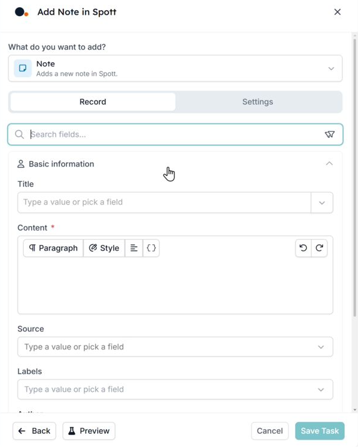
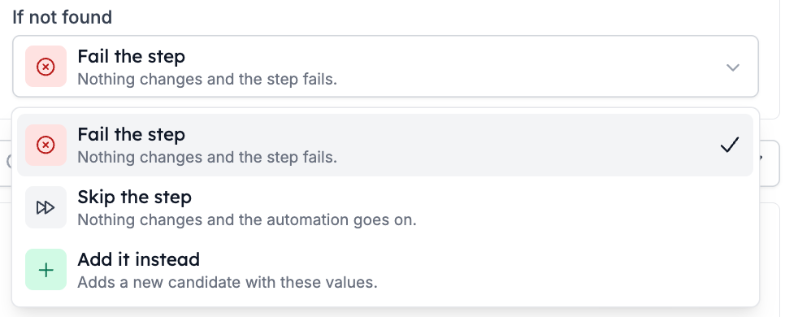
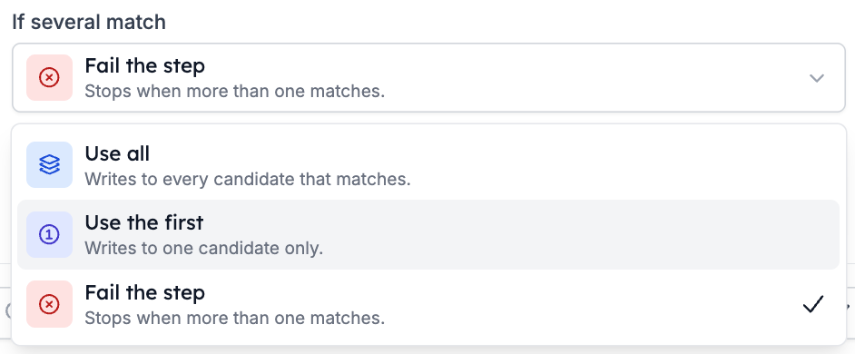
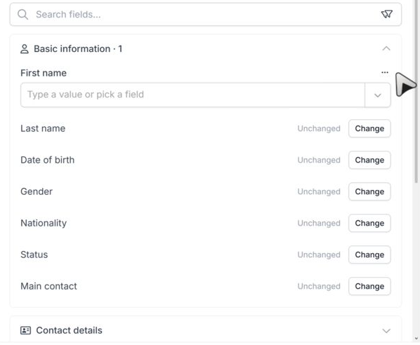
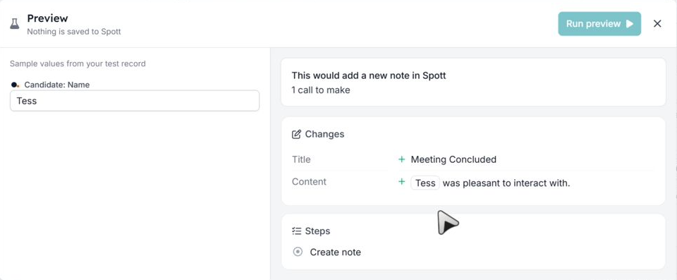
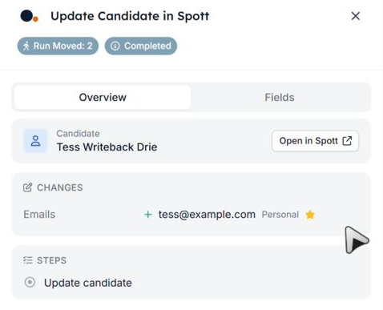

Vos automatisations peuvent maintenant écrire dans Spott. Consignez une note après une conversation WhatsApp, passez une candidature à l'étape suivante quand un candidat remplit un formulaire, ou gardez à jour les coordonnées d'un candidat, sans que personne n'ait à tout ressaisir dans Spott.

## Étape 1 : ajouter une étape Spott

Dans votre automatisation, cliquez sur **\+** et choisissez l'étape Spott dont vous avez besoin. Il existe une étape par action et par objet Spott, comme **Add Note in Spott**, **Update Candidate in Spott** ou **Delete Note in Spott**.

Sous **What do you want to add?**, vous pouvez passer à un autre objet Spott à tout moment.

## Étape 2 : choisir l'enregistrement à modifier

Pour une mise à jour ou une suppression, indiquez à HireData quel enregistrement Spott modifier :

- **Par ID**, par exemple le candidat qui a démarré l'automatisation.
- **Avec des conditions** qui trouvent l'enregistrement, par exemple le candidat avec une adresse e-mail donnée.

Choisissez ensuite ce qui se passe si l'enregistrement est introuvable :

- **Fail the step :** rien ne change et l'étape échoue. C'est le réglage par défaut.
- **Skip the step :** rien ne change et l'automatisation continue.
- **Add it instead :** ajoute un nouvel enregistrement avec ces valeurs.

Si vos conditions trouvent plusieurs enregistrements, choisissez **Use all**, **Use the first** ou **Fail the step**.

## Étape 3 : remplir les champs

Saisissez une valeur ou choisissez un champ d'une étape précédente de l'automatisation, comme une réponse à un formulaire. Les champs que vous ne touchez pas affichent **Unchanged** et restent tels quels dans Spott. Cliquez sur **Change** pour définir une nouvelle valeur ou vider le champ.

Pour les listes, comme les adresses e-mail d'un candidat, vous pouvez ajouter un élément, remplacer toute la liste ou retirer les éléments correspondants.

HireData s'occupe de quelques points pour vous :

- **Les réponses sont associées aux choix de Spott** par nom ou par valeur, pour qu'une réponse de formulaire comme "oui" ou un nom d'étape tombe sur la bonne option.
- **Les nombres et les dates** sont lus comme votre workspace les écrit.
- **Les nouvelles candidatures et les nouveaux jobs** peuvent être placés sur un track de pipeline précis, et une candidature sur une sous-étape.
- **Une valeur illisible** arrête l'étape et indique de quelle valeur il s'agit, au lieu de vider le champ dans Spott.

<Tip>
  Une mise à jour ne modifie que les champs que vous définissez. Si rien ne changerait, l'étape est ignorée au lieu d'enregistrer les mêmes valeurs, et l'exécution explique pourquoi.
</Tip>

## Étape 4 : prévisualiser avant d'enregistrer

Cliquez sur **Preview**, recherchez un enregistrement d'exemple par son nom et cliquez sur **Run preview**. Vous voyez exactement ce qui serait ajouté ou modifié. Rien n'est enregistré dans Spott.

## Étape 5 : vérifier ce qui a été enregistré

Ouvrez une exécution et cliquez sur l'étape Spott. Vous voyez quel enregistrement a été modifié, chaque champ modifié avec son ancienne et sa nouvelle valeur, et **Open in Spott** pour aller directement à l'enregistrement.

En cas de problème, l'exécution l'explique en termes simples, comme **Record not found**.

## Ce qui n'est pas encore possible

- **Les jobs** ne peuvent pas être supprimés, car Spott ne le permet pas.
- **Les placements** peuvent être mis à jour, mais pas ajoutés ni supprimés.

## Articles liés

- [Créer une automatisation Spott](/fr/apps/spott/create-a-spott-automation-in-hiredata)
- [Tester une automatisation](/fr/automations/how-to-test-an-automation)
