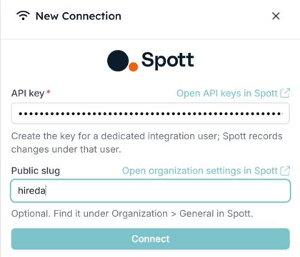
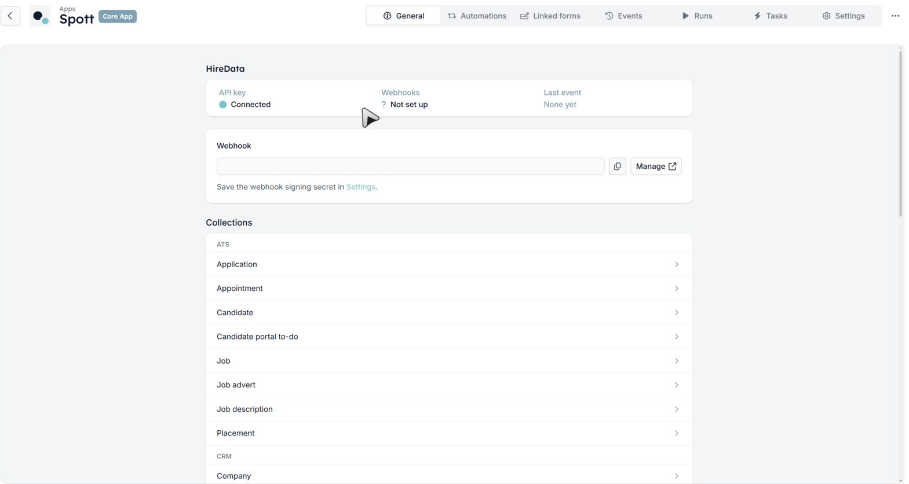

Connectez Spott une seule fois, et les changements dans Spott déclenchent vos automatisations HireData.

## Avant de commencer

- Il vous faut un utilisateur Spott qui peut créer des clés API et des endpoints de webhook dans Spott.
- Il vous faut un admin HireData pour ajouter l'app.

## Étape 1 : ajouter votre clé API

1. Allez dans **Settings** > [**Apps**](https://app.hiredata.com/settings/apps). Spott est en haut de la liste.
2. Ouvrez **Spott** et cliquez sur **Connect to Spott**.
3. Cliquez sur **Open API keys in Spott**, créez une nouvelle clé et copiez-la. Utilisez un utilisateur d'intégration dédié : Spott enregistre les changements sous cet utilisateur.
4. Collez la clé dans **API key**. Le **Public slug** est facultatif ; vous le trouvez dans Spott sous Organization > General.
5. Cliquez sur **Connect**. HireData vérifie la clé auprès de Spott avant d'enregistrer la connexion.

HireData synchronise ensuite les définitions de champs et les utilisateurs de Spott. La chronologie **Data sync** de l'onglet **General** affiche chaque étape.

## Étape 2 : ajouter le webhook dans Spott

Spott informe HireData des changements via un webhook. Vous le configurez une seule fois, dans Spott.

1. Dans l'onglet **General** de la connexion Spott, copiez l'adresse sous **Webhook**. **Manage** ouvre les réglages de webhook dans Spott.
2. Dans Spott, ajoutez un nouvel endpoint, collez l'adresse et sélectionnez tous les événements.
3. Copiez le signing secret que Spott vous affiche.
4. Dans HireData, ouvrez l'onglet **Settings** de la connexion Spott et collez-le comme webhook signing secret. Enregistrez.

HireData n'accepte que les événements signés avec ce secret : sans lui, le webhook ne fonctionne pas.

## Étape 3 : vérifier que les événements arrivent

Modifiez un candidat de test dans Spott. L'onglet **General** indique alors quand le dernier événement est arrivé, et l'événement apparaît dans l'onglet **Events**.

Vous pouvez maintenant [créer votre première automatisation Spott](/fr/apps/spott/create-a-spott-automation-in-hiredata).

<Note>
  La première synchronisation n'importe pas tous vos enregistrements Spott. Les enregistrements arrivent quand ils changent dans Spott, quand une automatisation les recherche ou quand une automatisation planifiée s'exécute.
</Note>
