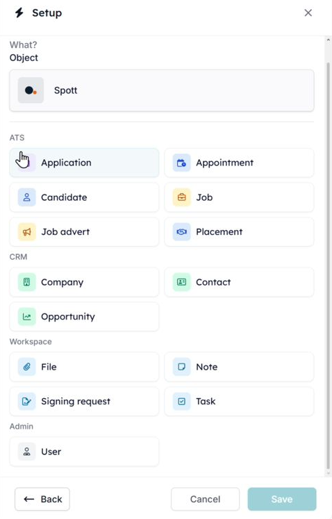
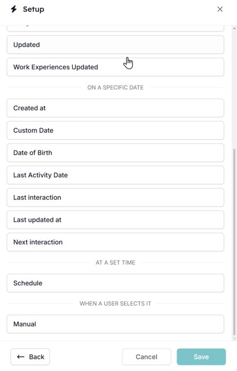

Dès que [Spott est connecté](/fr/apps/spott/connect-with-spott), chaque changement dans Spott peut démarrer une automatisation.

## Étape 1 : choisir un objet Spott

Allez dans [**Automations**](https://app.hiredata.com/automations) et créez une nouvelle automatisation. Dans **Setup**, choisissez **Spott**, puis l'objet sur lequel porte l'automatisation.

Les objets sont regroupés comme dans Spott : ATS, CRM, Workspace et Admin. Les noms suivent Spott, comme **Job** et **Job advert**.

## Étape 2 : choisir comment elle démarre

- **Un événement**, comme une candidature créée, mise à jour ou déplacée vers une autre étape, ou une opportunité créée, mise à jour, supprimée ou déplacée vers une autre étape.
- **À une date précise**, comme une semaine après la date de début d'un placement. Choisissez l'un des champs de date de l'objet, ou **Custom Date**.
- **À heure fixe** : **Schedule** exécute l'automatisation sur un groupe d'enregistrements, par exemple chaque lundi.
- **Quand un utilisateur la choisit** : **Manual** la lance manuellement pour un enregistrement.

## Étape 3 : démarrer seulement pour un track ou une étape

Si vous utilisez plusieurs tracks de pipeline dans Spott, vous pouvez limiter une automatisation de candidature à un track, et à une étape de ce track.

- Ajoutez un filtre de démarrage sur **Stage track IDs** pour choisir le track.
- Ajoutez un filtre de démarrage sur **Stage ID** pour choisir l'étape. Les étapes portant le même nom affichent leur track à côté, pour que vous puissiez les distinguer.

Une candidature dans un autre track ne démarre pas l'automatisation, même si l'étape porte le même nom.

<Tip>
  **Track ID** est marqué **(legacy)** car Spott prévoit de le supprimer. Utilisez plutôt **Stage track IDs**, qui fonctionne de la même façon dans les filtres.
</Tip>

### Automatisations planifiées

Une automatisation planifiée ne propose que les filtres sur lesquels Spott peut lui-même rechercher. Pour affiner l'audience, ajoutez une étape **Filter** après le démarrage.

Spott n'indique pas combien d'enregistrements correspondent, le builder ne peut donc pas afficher la taille de l'audience à l'avance. L'automatisation traite tout de même tous les enregistrements correspondants.

## Étape 4 : ajouter votre message

Ajoutez une étape comme **Send Email** ou un message WhatsApp. Chaque champ Spott synchronisé est disponible comme variable :

- Les enregistrements liés suivent : une candidature inclut le candidat et le job, un placement le candidat, le client et le job.
- Les scorecards des candidatures et des jobs sont disponibles.
- Les clients affichent leur date de dernier contact et avec qui il a eu lieu.

Pour voir quels champs sont arrivés pour un enregistrement, ouvrez l'événement dans l'onglet **Events**, ou consultez l'objet dans **Collections**.

## Étape 5 : tester et activer

[Testez l'automatisation](/fr/automations/how-to-test-an-automation) avec un enregistrement de test, puis cliquez sur **Activate**.
