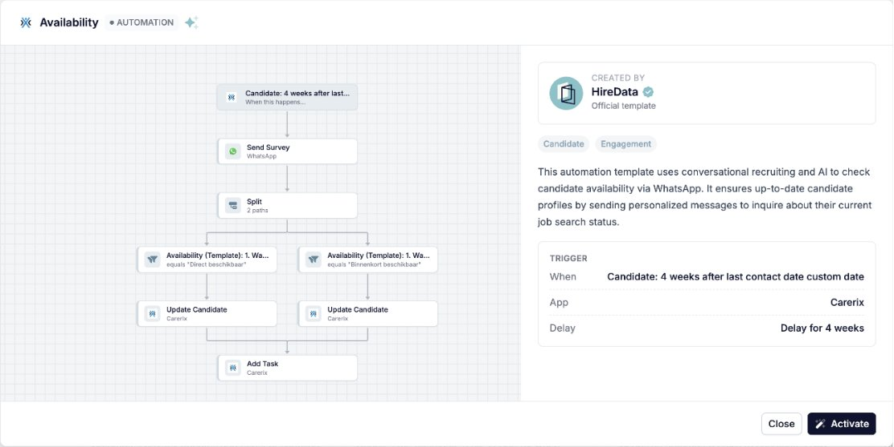
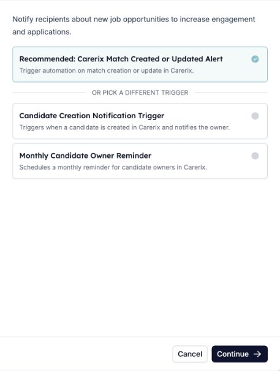

_Explorez la puissance des automatisations dans ce guide vidéo concis, couvrant tout, des concepts de base à la configuration de votre propre automatisation. La vidéo comprend une démo produit détaillée et des informations sur les automatisations déclenchées par événement versus planifiées._

<iframe src="https://www.loom.com/embed/75f5e793351a48aaa98179881f670d91" title="Loom video" allowFullScreen className="w-full aspect-video rounded-xl"></iframe>

<CardGroup cols={3}>
  <Card title="Automation Builder : vue d'ensemble" icon="diagram-project" href="/reference/automations/overview">
    Sélectionnez une étape et voyez ce qu'elle fait dans une exécution.
  </Card>

  <Card title="Catalogue des tâches" icon="list-check" href="/reference/automations/task-catalogue">
    Trouvez les tâches disponibles pour chaque app connectée et la référence de chacune.
  </Card>

  <Card title="Suivre une exécution" icon="route" href="/reference/automations/follow-a-run">
    Suivez un événement à travers son exécution, les données de ses étapes, sa tâche et son résultat.
  </Card>
</CardGroup>

## Partir d'un modèle

Vous n'avez pas à construire chaque automatisation de zéro. Cliquez sur **New Automation** dans [Automations](https://app.hiredata.com/automations) pour ouvrir la bibliothèque de modèles : des automatisations prêtes à l'emploi, et des modèles d'e-mail et WhatsApp accompagnés d'un déclencheur adapté. Filtrez par app ou par type, ou faites une recherche.

### Prévisualiser un modèle d'automatisation

Cliquez sur un modèle pour voir ce qu'il fait avant de l'utiliser :

- les étapes de l'automatisation, sous forme de diagramme
- qui l'a créé, par exemple HireData ou un partenaire
- ses tags et une courte description
- sous **Trigger** : quand il démarre (**When**), l'**App** et l'éventuel **Delay**

Cliquez sur **Activate** pour créer l'automatisation à partir du modèle, ou sur **Close** pour revenir en arrière. Vérifiez la nouvelle automatisation et [testez-la](/fr/automations/how-to-test-an-automation) avant que de vrais candidats y passent.

### Partir d'un modèle d'e-mail ou WhatsApp

Choisissez un modèle d'e-mail ou WhatsApp : l'aperçu montre le message, avec à droite le déclencheur qui le lance. Le déclencheur recommandé est sélectionné. Sous **Or pick a different trigger**, vous pouvez en choisir un autre. Cliquez sur **Continue** pour créer l'automatisation avec ce modèle et ce déclencheur.

