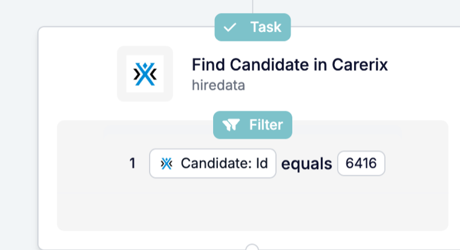

Souvent, l'enregistrement dont vous avez besoin n'est pas celui qui a déclenché l'automatisation. **Find** le recherche, pour que les étapes suivantes puissent le mettre à jour, lui envoyer un message ou joindre ses fichiers.

<Note>
  Cette page décrit Find dans le [nouveau créateur d'automatisations](/fr/automations/engine-1-3), qui fait partie de la bêta HireData.
</Note>

## Recherchez un enregistrement en cours d'automatisation

Cliquez sur **\+** dans votre automatisation : **Find** se trouve sous **Search** et recherche quelque chose qui existe déjà, comme un candidat, un contact ou une personne HireData.

### 1. Choisissez ce qu'il faut trouver

Find utilise le même sélecteur d'objets que les nouvelles étapes d'enregistrement, avec les mêmes catégories, icônes et couleurs. Recherchez un enregistrement Carerix ou une **personne HireData**.

### 2. Faites correspondre les champs qui identifient l'enregistrement

Indiquez les valeurs de champ qui identifient l'enregistrement, comme un identifiant ou une adresse e-mail. Find continue de faire correspondre les champs désactivés dans Carerix, pour que les automatisations en cours retrouvent toujours les mêmes enregistrements.

### 3. Utilisez le résultat dans les étapes suivantes

L'enregistrement renvoyé par Find est disponible dans les étapes suivantes sous le nom de l'étape. Un schéma courant : trouvez l'enregistrement, puis faites un [Update](/fr/reference/automations/steps/update).

## Qu'est-ce qui a changé d'autre ?

- **L'historique des exécutions** affiche le nom des enregistrements renvoyés par Find, y compris les personnes HireData.
- **Find Email** et **Search Domain** ne sont plus proposés dans le nouveau créateur d'automatisations.

Pour tous les réglages, consultez la [référence Find](/fr/reference/automations/steps/find).

## Essayez par vous-même

Ouvrez une automatisation dans [Automations](https://app.hiredata.com/automations), cliquez sur **\+** et choisissez **Find** sous **Search**.
