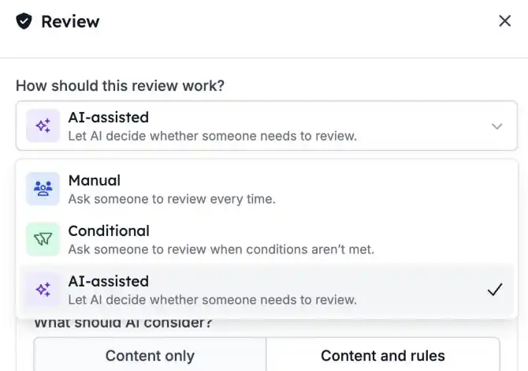
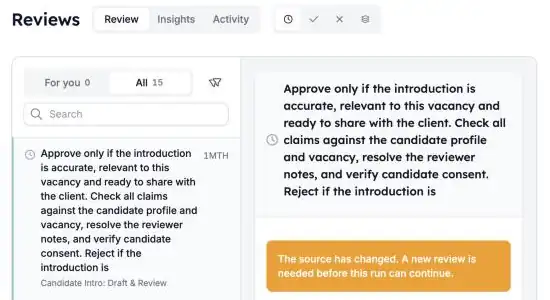

Certaines étapes doivent être automatisées, mais pas sans vérification humaine. Avec **Reviews**, une automatisation se met en pause jusqu'à ce que quelqu'un approuve ou refuse. Approuvé : l'exécution continue. Refusé : elle s'arrête.

<Note>
  Reviews fait partie de la bêta HireData et s'active par espace de travail. Demandez à votre contact HireData de l'activer pour le vôtre.
</Note>

## Mettez une exécution en pause jusqu'à la décision

Ajoutez une étape **Review** là où l'automatisation doit attendre. Dans le [nouveau créateur d'automatisations](/fr/automations/engine-1-3), cliquez sur **\+** et choisissez **Review** sous **Human in the loop**.

### 1. Choisissez le fonctionnement de la review

Une étape Review a trois modes :

- **Manual** : une personne vérifie toujours. C'est le mode par défaut.
- **Conditional** : une personne vérifie seulement quand les conditions que vous avez définies l'exigent.
- **AI-assisted** : l'IA vérifie d'abord le contenu selon vos critères, et demande à une personne en cas de doute ou d'informations manquantes.

Définissez ce que voit la personne qui vérifie : le contenu à vérifier, les critères et un contexte facultatif. Vous pouvez insérer des variables issues des étapes précédentes.

### 2. Vérifiez depuis une seule file

Ouvrez [Reviews](https://app.hiredata.com/reviews). **For you** affiche les demandes qui vous sont attribuées. Les administrateurs voient aussi **All** et peuvent réattribuer une demande à quelqu'un d'autre.

Filtrez par **Pending**, **Approved** ou **Rejected**. Sélectionnez une demande pour voir le contenu, les critères et les liens vers l'automatisation et l'exécution.

### 3. Approuvez ou refusez

- **Approve** : l'exécution passe à l'étape suivante.
- **Reject** : l'exécution s'arrête.

Vous pouvez décider depuis la file des reviews ou directement depuis l'exécution. Un court délai d'annulation vous permet de revenir sur une décision avant qu'elle ne prenne effet.

## À savoir aussi

- **Les exécutions de test** créent des reviews que vous traitez dans l'exécution elle-même. Elles restent hors de la file habituelle et hors de **Insights**.
- **Insights** affiche le volume de demandes et la charge de l'équipe. **Activity** affiche l'historique des décisions.
- **Si une automatisation a changé** après une demande de review, un administrateur peut remplacer la demande obsolète.

## Essayez par vous-même

Ouvrez une automatisation dans [Automations](https://app.hiredata.com/automations), ajoutez une étape **Review** avant l'action à vérifier et lancez un test. Approuvez-la ensuite depuis [Reviews](https://app.hiredata.com/reviews).
