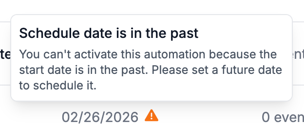
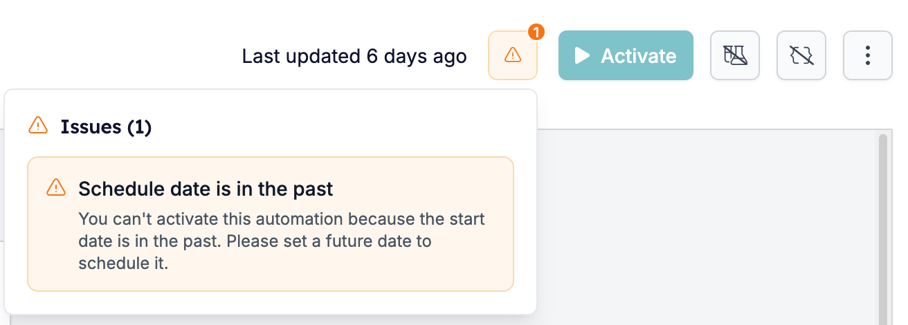

Certaines automatisations n'ont pas à attendre qu'il se passe quelque chose dans votre ATS. Une enquête NPS mensuelle, une newsletter ou une vérification annuelle des données doit partir à la date que vous choisissez. Une automatisation programmée s'exécute à l'heure fixée, pour chaque enregistrement de l'audience sélectionnée, une fois ou de façon répétée.

## Régler la programmation

<Steps>
  <Step title="Choisissez l'objet">
    Ouvrez l'automatisation et cliquez sur le bloc **Start**. Choisissez votre app et l'objet pour lequel l'automatisation s'exécute, par exemple **Candidate**.
  </Step>
  <Step title="Choisissez Schedule">
    Sous **Timing**, allez à **AT A SET TIME** et cliquez sur **Schedule**. Cette option n'apparaît que pour les objets qui peuvent être programmés.
  </Step>
  <Step title="Indiquez quand elle s'exécute">
    - **Run at** est la date et l'heure de la première exécution.
    - **Repeat every** définit la fréquence de répétition : jours, semaines, mois, trimestres, semestre ou année. Choisissez **Don't repeat** pour une seule exécution. Pour les semaines et les mois, la ligne en dessous indique le jour de répétition, par exemple "On day 28".
    - **Until** arrête les répétitions à une date. Activez **Enable** pour en fixer une. Sinon, l'automatisation se répète jusqu'à ce que vous la mettiez en pause.
  </Step>
  <Step title="Sélectionnez l'audience">
    Sous **Audience Selection**, ajoutez des filtres pour que l'automatisation ne s'exécute que pour les enregistrements voulus.
  </Step>
  <Step title="Activez">
    Cliquez sur **Activate**. L'automatisation est désormais programmée à la date indiquée dans **Run at**.
  </Step>
</Steps>

## La date de début doit être dans le futur

Vous ne pouvez activer une automatisation programmée que tant que la date de **Run at** n'est pas passée. Si elle est dépassée, l'automatisation n'est pas activée et garde son statut précédent. Le message indique : "This automation could not be scheduled because the configured start date is in the past."

HireData vous prévient avant :

- **Dans la liste des automatisations**, une icône d'avertissement orange apparaît à côté de la date de début. Survolez-la pour lire l'avertissement.
- **Sur la page de l'automatisation**, un bouton d'avertissement apparaît à côté de **Activate**. Cliquez dessus pour voir le problème **Schedule date is in the past**.

<Frame caption="L'avertissement à côté d'une date de début dans la liste des automatisations.">
  
</Frame>

<Frame caption="L'encadré Issues à côté du bouton Activate.">
  
</Frame>

Pour corriger, choisissez une nouvelle date **Run at** dans le futur et activez à nouveau l'automatisation.

C'est pareil pour une automatisation programmée que vous avez mise en pause. La pause annule sa prochaine exécution. Si la date de début est passée au moment où vous voulez la relancer, choisissez d'abord une nouvelle date **Run at**.

## Ce que vous dit l'icône de statut

Survolez l'icône de statut d'une automatisation pour voir ce qu'elle signifie.

| Infobulle | Signification |
| --- | --- |
| **Not Yet Activated** | L'automatisation n'a jamais été activée. |
| **Active** | L'automatisation est activée. |
| **Scheduled** | L'automatisation est activée et sa prochaine exécution est programmée. |
| **Scheduling Runs** | L'automatisation lance en ce moment des exécutions pour son audience. |
| **Paused** | Rien de nouveau ne s'exécute tant que vous ne réactivez pas l'automatisation. |
| **System Flagged The Automation** | HireData a arrêté l'automatisation après une erreur, par exemple parce que la connexion à l'app ne fonctionnait plus ou que les exécutions n'ont pas pu être programmées. Corrigez la cause, puis réactivez-la. |
| **Finished Scheduling Runs** | La dernière exécution prévue est terminée et il n'y a pas de date suivante, par exemple parce que la date **Until** est passée. |

## Bon à savoir

- **Le début est verrouillé pendant la programmation des exécutions.** Tant que le statut est **Scheduling Runs**, vous ne pouvez pas modifier le déclencheur, la programmation, les filtres d'audience ni le type d'automatisation. Attendez que ce soit terminé.
- **Une automatisation qui perd sa programmation est mise en pause.** Si une automatisation programmée active perd sa programmation, ou si une nouvelle programmation ne peut pas être fixée pendant que vous la modifiez, HireData la met en pause pour qu'elle ne s'exécute pas au mauvais moment.
- **Une copie ne reprend pas la programmation.** Quand vous dupliquez une automatisation programmée, la copie n'est pas programmée. Activez la copie pour la programmer.
- **Si vous activez plusieurs automatisations à la fois** depuis la liste, un message indique combien ont réussi, par exemple "2 of 3 automations activated. 1 could not be scheduled." Vérifiez la date de début de celles qui ont échoué.

## Essayez vous-même

Ouvrez [Automations](https://app.hiredata.com/automations), cliquez sur le bloc **Start** d'une automatisation et choisissez **Schedule** sous **AT A SET TIME**.

## Voir aussi

- [Tester vos automatisations](/fr/automations/how-to-test-an-automation)
- [Pourquoi mon automatisation ne s'est-elle pas exécutée ?](/fr/knowledge-base/why-didnt-my-automation-run)
- [Envoyer une newsletter par e-mail à votre audience](/fr/apps/messaging/emails/sending-an-email-newsletter-to-your-audience)
- [Référence : étape Setup](/fr/reference/automations/steps/setup)
