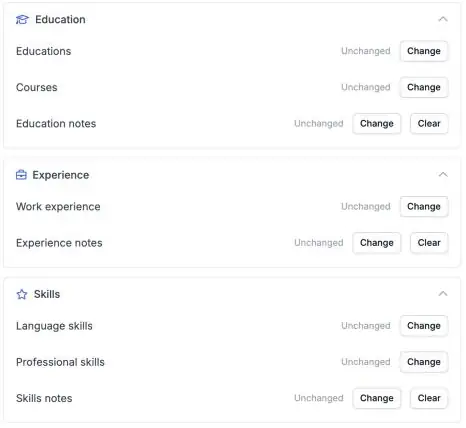

Un profil de candidat complet est plus facile à matcher. Vos automatisations peuvent désormais renseigner la formation, les compétences professionnelles et les langues d'un candidat dans Carerix, pour que personne n'ait à les recopier à la main.

<Note>
  Cette fonctionnalité fait partie de la bêta HireData et fonctionne dans le [nouveau créateur d'automatisations](/fr/automations/engine-1-3). Consultez [Comment fonctionne la bêta](/fr/beta/how-the-beta-works) pour y participer.
</Note>

## Complétez automatiquement le profil du candidat

Dans une nouvelle automatisation, cliquez sur **\+**, choisissez **Update** sous **Records**, puis **Carerix** et **Candidate**. Sélectionnez le candidat et remplissez la section dont vous avez besoin.

<Frame caption="Education, Experience et Skills ont chacune leur propre section dans l'étape Update Candidate.">
  
</Frame>

### 1. Formation

Indiquez le nom de la formation, l'**établissement**, le diplôme, le niveau ou la spécialité, les dates et si le diplôme a été obtenu.

### 2. Compétences professionnelles

Ajoutez une **compétence** et sa **spécialisation**.

### 3. Compétences linguistiques

Ajoutez une **langue** avec des niveaux distincts pour l'**oral**, l'**écrit** et la **lecture**.

Vous pouvez aussi ajouter ou mettre à jour des **cours** et l'**expérience professionnelle**.

## Avant de l'utiliser

- **Ajoutez ou modifiez une entrée à la fois.** Pour modifier une formation ou une compétence existante, choisissez cette entrée dans l'étape.
- **Testez d'abord avec un candidat de test**, et vérifiez dans Carerix que les autres entrées du candidat sont restées inchangées.

## Essayez par vous-même

Créez une nouvelle automatisation dans [Automations](https://app.hiredata.com/automations), cliquez sur **\+**, choisissez **Update** sous **Records**, puis **Carerix** et **Candidate**.
