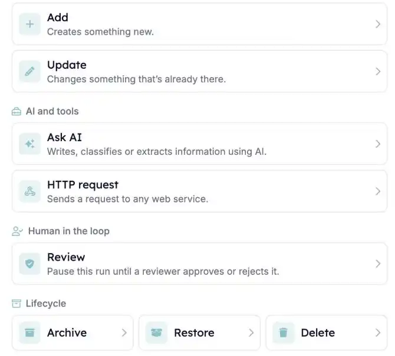

Vos automatisations peuvent désormais tenir Carerix à jour sans étape distincte pour chaque type de modification. Ajouter, mettre à jour, archiver et restaurer fonctionnent de la même façon pour les candidats, contacts, entreprises, postes et plus encore.

<Note>
  Cette fonctionnalité fait partie de la bêta HireData et fonctionne dans le [nouveau créateur d'automatisations](/fr/automations/engine-1-3). Consultez [Comment fonctionne la bêta](/fr/beta/how-the-beta-works) pour y participer.
</Note>

## Tenez Carerix à jour depuis vos automatisations

Dans une nouvelle automatisation, cliquez sur **\+**. Vous trouvez **Add** et **Update** sous **Records**, et **Archive**, **Restore** et **Delete** sous **Lifecycle**. Choisissez ensuite l'enregistrement Carerix à modifier.

<Frame caption="Add et Update se trouvent sous Records. Archive, Restore et Delete se trouvent sous Lifecycle.">
  
</Frame>

<Frame caption="Choisissez l'enregistrement Carerix à ajouter ou à mettre à jour.">
  
</Frame>

### 1. Ajoutez de nouveaux enregistrements

Créez des **candidats**, des **contacts** liés à leur entreprise, des **entreprises**, des **postes** liés à un contact, des **publications** et des **rendez-vous** avec leurs participants. Les champs obligatoires correspondent aux formulaires Carerix que vous connaissez déjà, comme l'entreprise d'un nouveau poste. Les publications gardent leur propre texte : Carerix ne le remplace pas par le texte du poste.

### 2. Mettez à jour l'existant

Modifiez n'importe quel champ, ou videz-le complètement, y compris les responsables. Tenez à jour l'**intitulé de poste**, la **formation**, l'**expérience professionnelle**, les **compétences** et les **langues** d'un candidat, ou ajoutez-le à un **vivier de talents** sans perdre les viviers dont il fait déjà partie.

### 3. Archivez et restaurez

**Archivez** un enregistrement quand il n'est plus actif et **restaurez**-le quand vous en avez de nouveau besoin. Seuls les **matches** peuvent être supprimés définitivement, car ce sont les seuls enregistrements que Carerix supprime réellement.

### 4. Modifiez plusieurs enregistrements à la fois

Une étape peut modifier plusieurs enregistrements, comme tous les matches ouverts d'un candidat. Ajoutez des **conditions** pour que l'étape ne fasse la modification que si les valeurs actuelles de l'enregistrement le permettent.

## À savoir aussi

- **Chaque modification est vérifiée après l'enregistrement.** Une étape ne peut pas indiquer un succès si rien n'a changé. Quand Carerix refuse une modification, l'exécution affiche la raison donnée par Carerix.
- **Les champs et libellés suivent vos propres écrans Carerix**, par exemple Job au lieu de Vacancy.
- **Des fichiers** peuvent être ajoutés à un enregistrement à partir d'un lien, et supprimés par nom de fichier.
- **Pas encore inclus :** la visibilité des rendez-vous, et certains filtres et statuts des viviers de talents.
- **Les automatisations existantes gardent leurs anciennes étapes Carerix**, comme la mise à jour d'un champ ou l'ajout d'une note.

## Essayez par vous-même

Créez une nouvelle automatisation dans [Automations](https://app.hiredata.com/automations), cliquez sur **\+**, choisissez **Add** sous **Records** et sélectionnez un enregistrement Carerix.
